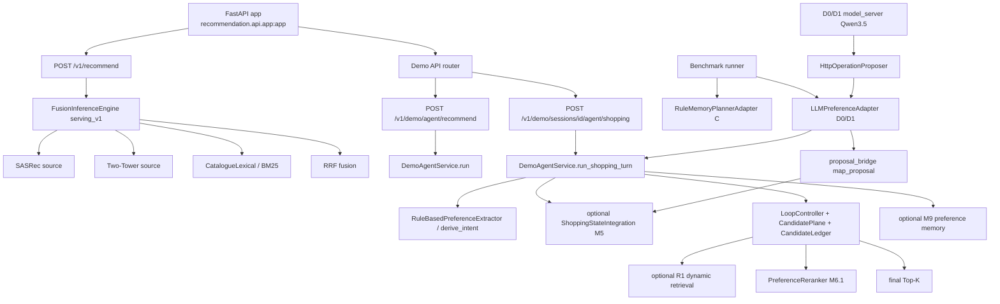

# AgentRec-X 当前架构与实现状态审计

审计日期：2026-11-06  
范围：只读静态代码、配置、现有产物；未启动 GPU、未运行 Benchmark/测试、未修改代码。

## 1. 一句话技术定位

AgentRec-X 当前是一个 **以 Serving V1（SASRec + Two-Tower + Catalogue Lexical + RRF）为默认线上推荐入口、以 Demo/Agent 会话层为可选入口的多模块推荐系统**；Qwen3.5-9B 的 Parser/Proposal 能力目前只通过 Benchmark D 策略的独立模型服务接入，不是默认 Serving 或默认 Agent API 的组成部分。

---

## 2. 当前真实系统架构

图中实线是默认/已接线路径；`M5`、`R1`、`Proposal Bridge`、Qwen 模型服务、M6.1 soft-M5
rerank 都是**条件启用**的路径，不是默认全开。

---

## 3. 默认 Serving V1 调用链

### 3.1 入口

- `recommendation/api/app.py:714`：模块级 `app = create_app(enable_demo=True)`。
- `recommendation/api/app.py:666-676`：`POST /v1/recommend`；直接调用 `state.engine.recommend(...)`。
- `recommendation/api/app.py:232`：`AGENTRECX_FUSION_PROFILE` 未设置时默认 `serving_v1`。
- `recommendation/api/app.py:239`：`FusionInferenceConfig.for_profile(profile_name)`。
- `recommendation/api/app.py:195-221`：`_build_fusion_engine` 构造 SASRec、Two-Tower、Lexical。
- `recommendation/inference/fusion.py:100-101`：`serving_v1` → `FUSION_SOURCES`。
- `recommendation/inference/fusion.py:82`：`FUSION_SOURCES = ("sequential", "two_tower", "catalog_lexical")`。
- `recommendation/inference/fusion.py:243`：`FusionInferenceEngine`。
- `recommendation/inference/fusion.py:503`：RRF 融合。
- `recommendation/inference/sasrec.py:232`：`SASRecInferenceEngine`。
- `recommendation/inference/twotower.py:70`：`TwoTowerInferenceEngine`；`app.py:215-220` 要求配置 checkpoint。
- `recommendation/inference/lexical.py:111`：`CatalogueLexicalIndex`（catalog lexical/BM25 类检索）。

### 3.2 默认行为

- 输入：`history`、`k`；
- 输出：按 RRF 融合的三源 Top-K；
- **不读取 M5，不运行 Agent Loop，不调用 Qwen，不读取偏好记忆**；
- 这是默认的 Serving V1 业务入口。

---

## 4. Agent Shopping 调用链

### 4.1 两个不同的入口

1. `POST /v1/demo/agent/recommend`：
   - `recommendation/api/demo_routes.py:763-790`；
   - 调用 `runtime.agent_service().run(payload)`（`demo_routes.py:782`）；
   - 是 stateless agent 路径，不走 `run_shopping_turn` 的 proposal 参数。

2. `POST /v1/demo/sessions/{session_id}/agent/shopping`：
   - `recommendation/api/demo_routes.py:792-834`；
   - 分配 session turn 后调用 `run_shopping_turn(...)`（`demo_routes.py:825-834`）；
   - **该 route 没有 `proposal_operations` 参数**，因此默认 Agent API 不会接收 Qwen proposal。

### 4.2 `run_shopping_turn` 内部

- `recommendation/demo/agent_service.py:1022`：函数入口；
- `agent_service.py:1228-1229`：`PreferenceMemoryService` 读取 active memory，`extractor.extract(payload.message)` 进行规则抽取；
- `agent_service.py:1267`：`derive_intent(...)` 基于规则 extraction 和消息；
- `agent_service.py:1289-1300`：`_integrate_state_turn(...)` 可选记录 M5；
- `agent_service.py:1330-1350`：R1 normal-turn 计划；默认只在 `dynamic_retrieval_enabled()` 时启用；
- `agent_service.py:1383-1420`：候选窗口复用/重排；
- `agent_service.py:1463`：R1 的候选执行路径；
- `agent_service.py:1532`：最终原因/意图附加；
- `agent_service.py:1577`：登记 candidate snapshot。

### 4.3 M7 与候选层

- `recommendation/control/loop.py:1837`：`LoopController`；
- `recommendation/control/candidate_plane.py:254`：`CandidatePlane`；
- `recommendation/control/candidate_ledger.py:198`：`CandidateLedger`；
- `recommendation/control/grounding.py` / `GroundingVerifier`：候选身份与来源证据；
- `recommendation/agent/graph.py:278`：`AgentGraph`（M7B 图路径），但它由 `runtime.llm_turn`/`llm_agent_turn` 的可选外部 LLM policy 使用（`runtime.py:384-430`），不是 `run_shopping_turn` 的默认路径。

### 4.4 M9 / M6.1

- M9：`runtime.py:152`、`build_demo_runtime`（`runtime.py:1102`）持有 `memory_service`；`run_shopping_turn` 在 `agent_service.py:1228` 读取，`agent_service.py:2247` 写回；
- M6.1：`recommendation/reranking/reranker.py:342` `PreferenceReranker`；排序是 lexicographic，非加权分数（`reranker.py:219-261`）；
- M5 软偏好排序是可选路径：`agent_service.py:433-436` 读取 `AGENTRECX_M5_SOFT_RERANK`，默认 `"off"`；`agent_service.py:1848` `_m5_soft_rerank`；
- 没有 soft-M5 rerank 时，M5 的软偏好不参与最终排序。

---

## 5. C / D0 / D1 / D1-v2 的执行链

| 组 | 入口/模型 | proposal 是否进 M5 | 状态配置 | 证据 |
|---|---|---|---|---|
| C | `RuleMemoryPlannerAdapter`（`benchmarks/agent/adapters.py:385`） | 否 | runner 统一配置 | `runner.py:44-49` |
| D0 | `LLMPreferenceAdapter` + 原始 Qwen3.5-9B model_server | 是（若 JSON 有效） | 同 D1 | `adapters.py:527`、`model_server.py:92-95` |
| D1-v1 | 同 D0，加载 SFT-v1 adapter | 是 | 同 D0 | `model_server.py:92-95` |
| D1-v2 | 同 D0，加载 SFT-v2 adapter | 是 | 同 D0 | `P2_SFT_V2_TRAINING_REPORT.md` |

具体：

- Benchmark `runner.py:101` 运行任务；
- `_apply_profile`（`runner.py:44-49`）设置 benchmark 固定 profile 和 `AGENTRECX_STATE_MODE`；代码默认 `shadow`（`runner.py:110`），不是 `apply_constraints`；
- `build_adapter`（`runner.py:152`）注入 policy adapter；
- D adapter proposal 前进：`adapters.py:579` 读取 `last_payload`；`adapters.py:592-597` 调用 `run_shopping_turn(..., proposal_operations=...)`；
- `recommendation/demo/proposal_bridge.py:62` `map_proposal`；
- `agent_service.py:1069` 接收 proposal；`agent_service.py:2030` 将其作为本轮唯一 M5 输入（关闭规则同轮状态写入）；
- 但 `agent_service.py:1229` 的规则 extraction 和 `1267` 的 intent 仍用于 R1/intent；
- D0 的 60/61 invalid proposal 不会写入 M5；无效时 `agent_service.py:2030-2040` 清空 proposal 状态输入，不调用规则 M5 写入，但规则 extraction 仍参与 R1。

**C 与 D0/D1 不是同一“模型驱动 Agent”：C 是规则 adapter；D 的模型只提供 Parser proposal，R1/M7/候选执行仍是原固定系统。**

---

## 6. Qwen3.5-9B 真实接入状态

### 6.1 模型加载位置

- `training/agent_sft/modeling.py:17-19`：`MODEL_ID`、`Qwen3_5ForCausalLM`；
- `training/agent_sft/modeling.py:63`：`load_text_model`；
- `training/agent_sft/model_server.py:92-95`：可选 `--adapter` 加载 PEFT adapter；
- `training/agent_sft/http_proposer.py:10-16`：HTTP proposer 客户端；
- `training/agent_sft/model_server.py:37-70`：`/propose` HTTP endpoint。

### 6.2 是否进入默认请求

**否。**

- `recommendation/` 中没有 `http_proposer`、`model_server` 或 `Qwen` 的导入（静态检索为空）；
- `/v1/recommend` 不经过 Agent，也不访问 Qwen；
- `/v1/demo/agent/recommend` 与 `/sessions/.../agent/shopping` 不传 `proposal_operations`；
- 只有 `benchmarks/agent` 的 D adapter 和外部 `model_server` 构成 Qwen 调用链。

### 6.3 Proposal Validator / M5 唯一来源

- `recommendation/demo/proposal_bridge.py:62` 做 schema + evidence 校验及 operation→M5 类型映射；
- `agent_service.py:2030` 注释与逻辑：有 proposal 时关闭规则同轮 M5 写入，proposal 成为本轮 M5 的唯一来源；
- **但只在 `proposal_operations` 被传入时成立**；默认 API route 不传，故默认仍是规则 extraction 写 M5（若 M5 开启）；
- 无效 proposal：`proposal_bridge` 返回错误；service 不写该 proposal 的 M5 状态；不会自动变成 SFT/规则 proposal；
- 规则 extraction 仍用于 R1/intent 和 M9 记忆，这是“状态来源分离但不等于 R1 完全由 LLM 控制”。

### 6.4 LLM 能否改变 R1/M6.1/最终商品

代码存在两条：

1. proposal 的 M5 状态可记录事件；`_integrate_state_turn` 的 `state_constraints_changed` 可触发 R1 重检索（`agent_service.py:1346-1350`）；
2. M5 soft rerank 只有 `AGENTRECX_M5_SOFT_RERANK=on` 时才通过 `_m5_soft_rerank` 影响排序（`agent_service.py:433-436`、`1384-1385`）。

**默认**：M5 mode `off`（`state_integration.py:128`），soft rerank `off`；所以默认 API 下 LLM 即使接入也不会改变最终商品。

---

## 7. 训练与评测真实状态

### 7.1 SFT

- SFT-v1：`P2_SFT_EXPERIMENT_REPORT.md`、`training/agent_sft/output/qwen3_5_9b_lora/adapter/`（本地有 adapter 目录）。
- SFT-v2：实际训练完成（`P2_SFT_V2_TRAINING_REPORT.md`；180 steps、train_loss 0.00493、eval_loss 0.04979），adapter 在 AutoDL 远端：
  `/root/autodl-tmp/agentrecx/training/agent_sft/output/qwen3_5_9b_lora_v2/adapter`；
  本地仓库没有该 adapter 副本。
- Parser Test：`training/agent_sft/eval/sft_v2_test_parser_metrics.json`（SFT-v2 Exact 1.00）；
- 100 条 hard test：`training/agent_sft/hard_test/manifest.json`，`human_review_status=pending`；
  `training/agent_sft/eval/sft_v2_hard_parser_metrics.json`（Exact 0.92）只是 exploratory。
- Parser 训练/评测脚本：`training/agent_sft/train.py`、`evaluate_parser.py`、`prepare_data_v2.py`。

### 7.2 Agent 对照

- `P2_FINAL_AGENT_COMPARISON.csv`：C/D0/D1/D1-v2 逐任务 V2 结果；
- `P2_BRIDGE_AGENT_SUMMARY.json` / `P3_BOTTLENECK_METRICS.json`；
- `runs/p2bridge_{c,d0,d1,d1v2}/trajectories.jsonl`：真实轨迹；
- **V2 四组均 12 PASS / 5 FAIL / 3 UNKNOWN；pass 集合完全相同**；
- D1-v2 的 SFT-v2 确实在 model_server 中加载（remote adapter path），并在 20 任务中产生 proposal；但 V2 无提升。

### 7.3 Evaluator / frozen

- Legacy evaluator：`benchmarks/agent/evaluator.py`；
- V2：`benchmarks/agent/evaluator_v2.py`；
- Frozen tasks：`benchmarks/agent/tasks/frozen.json` 存在，runner 支持 `--split frozen`，但审计范围内没有运行记录；不应报告 frozen 指标。
- `runner.py:101` 的 benchmark 入口存在；本次对照是 20 dev 任务，不是 frozen。

### 7.4 Agent RL

- `training/agent_sft/agent_rl_env.py:16`：`AgentAction`（ASK/RETRIEVE/RERANK/FINALIZE）；
- `agent_rl_env.py:40`：`MinimalAgentEnv`；
- 仅 toy contract + `tests/test_agent_rl_env.py`；
- 没有真实 AgentRec-X 环境 adapter、policy logprob、Reward 环境绑定、多步 Rollout 训练入口或 RL checkpoint；
- 因此 RL 状态为 **INTERFACE_ONLY / NOT_IMPLEMENTED**，不能声称已训练。

---

## 8. 关键事实复核

### A. D0 大量无效 Proposal 却同分

- D0 60/61 invalid；`HttpOperationProposer` 把无效 JSON 作为 invalid payload；service 拒绝后不写模型 M5；
- 规则 extractor 仍执行（`agent_service.py:1229`、`1267`），R1/M6.1 仍走已有路径；
- 因此 D0 的成绩来自共享执行链，不是“隐藏 fallback 使模型生效”。没有证据表明 D0 的 proposal 改变了最终结果。

### B. D1 52 accepted → 38 M5 events

- 52 valid turns / 52 accepted operations（`P2_FINAL_AGENT_COMPARISON.csv` + `P3_BOTTLENECK_METRICS.json`）；
- 38 个 M5 events 的 payload evidence 可对应 proposal（`P3_TASK_CAUSAL_TRACE.csv`）；
- 事件写入 ≠ 有效状态被 R1 消费；见 C 与 D1 最终商品只在 3/20 任务变化，且 V2 全部相同。

### C. C 与 D1 少量最终商品不同

- C vs D1 最终商品集合改变 3/20（P3 causal trace）；
- 这 3 个变化没有改变 V2；另外 2 个 C/D0 差异、1 个 D0/D1 差异也没有改变 V2；
- 不能证明“状态被正确消费并导致合理不变”；目前证据只能说明**状态变化没有穿透到任务成功**，且 M5 soft rerank 默认关闭，R1 仍以规则 intent 为主。

### D. 四组 V2 相同

- 逐任务 pass 集合完全相同（`P3_BOTTLENECK_METRICS.json`），不仅是汇总 12/5/3；
- 失败任务组件也相同：lifecycle 17/20、role 17/20、retrieval 17/20；
- 说明当前 dev 任务集对 Parser 提升不敏感，或 M5→R1/M6.1 的消费不足；不能只凭汇总分数断言没有差异，也不能断言 Parser 已转化为 Agent 增益。

---

## 9. 默认启用、实验启用、未接入

### 默认启用

- `/v1/recommend` + `serving_v1` fusion；
- SASRec、Two-Tower、CatalogLexical、RRF（依赖各自 artifact）；
- `/v1/demo/*` 路由（模块级 app `enable_demo=True`）；
- `run_shopping_turn` 的规则 extraction、M9 memory、LoopController/CandidatePlane、PreferenceReranker；
- 默认 `M5 state mode = off`、`R1 dynamic = off`、`M5 soft rerank = off`。

### 实验/条件启用

- M5：`AGENTRECX_STATE_MODE=shadow|apply_constraints`；
- R1：`AGENTRECX_R1_DYNAMIC_RETRIEVAL=on`（runner fixed profile 会打开）；
- M5 soft rerank：`AGENTRECX_M5_SOFT_RERANK=on`；
- Two-Tower：需要配置 checkpoint；
- Dense/BGE：`AGENTRECX_DENSE_RETRIEVAL=on`；
- ItemCF rerank：需要 artifact；
- TIGER / Serving V2：`AGENTRECX_FUSION_PROFILE=serving_v2_tiger` 且 shared engine；
- 外部 provider LLM policy：`AGENTRECX_AGENT_POLICY=llm` + `AGENTRECX_LLM_*`；
- Qwen D0/D1：仅 benchmark runner + model_server + HTTP proposer。

### 已实现但当前默认入口不调用

- `proposal_bridge`；
- `LLMPreferenceAdapter`；
- `model_server` / `http_proposer`；
- M7 `AgentGraph`（只有可选 LLM policy 路径）；
- soft-M5 rerank；
- `P3_*` RL 实验合同。

### 仅有接口/设计

- 真实 AgentRec-X 多步 RL 环境；
- Reward 与工具成本真实训练接口；
- policy logprob/GRPO 训练入口；
- RL checkpoint。

---

## 10. 与历史报告的差异清单

1. **“Qwen3.5-9B 已接入 Agent”**：当前源码只证明 benchmark D0/D1 通过独立 model_server 接入；默认 Agent API 不导入 Qwen，也不传 proposal。
2. **“Proposal → M5 已集成”**：只对 benchmark D adapter 成立；默认 `/sessions/.../agent/shopping` 不传 `proposal_operations`。
3. **“M5 状态影响 R1/M6.1”**：代码有可选路径，但默认 M5 off、R1 off、soft rerank off；在已记录的 20 个 dev 任务中，最终身份只 3/20 变化、V2 不变。
4. **“SFT-v2 已集成”**：只作为 AutoDL 远端 adapter，由 model_server 加载用于 benchmark；不是 API/Serving 默认。
5. **“Agent 已具备完整自主循环”**：没有证据。当前是规则 extractor + 固定 LoopController/R1/M6.1；Qwen 只输出 Parser JSON。
6. **“Agent RL 有训练”**：没有。只有 toy contract 和测试，未接入真实环境，无参数更新/checkpoint。
7. **“四组 V2 相同所以 SFT 无用”**：更准确是当前任务集/消费链路不敏感；不能反推 SFT 对 Parser 无用，也不能证明其对 Agent 有用。

---

## 11. 审计回答

- **默认运行的是什么？** `recommendation.api.app:app` 的 Serving V1 `/v1/recommend`：SASRec + Two-Tower + catalogue lexical + RRF；Demo/Agent 路由也由同一 app 暴露。
- **Agent 模式与默认 Serving 区别？** Agent 走 `run_shopping_turn`/`run`、M9 memory、LoopController/CandidatePlane、可选 M5/R1/M6.1；Serving V1 只做 history→fusion→Top-K，不读 memory/M5。
- **Qwen3.5-9B 负责什么？** 只在 benchmark D 路径中作为 Parser/Proposal 模型，输出 Preference Operation；不是默认 serving 决策器，也不选择 R1 动作。
- **M5/R1/M6.1/M7 由什么控制？** M5 由 `AGENTRECX_STATE_MODE`（默认 off）；R1 由 `AGENTRECX_R1_DYNAMIC_RETRIEVAL`（默认 off，benchmark fixed profile on）；M6.1 soft-M5 by `AGENTRECX_M5_SOFT_RERANK`（默认 off），普通 reranker 由 Agent 路径调用；M7 由 LoopController/可选 AgentGraph policy 控制。
- **SFT-v2 是否真正集成？** 实际训练并用于 benchmark D1-v2；不是默认 API/Serving 集成。
- **Agent RL 是接口还是训练？** 仅 INTERFACE_ONLY toy contract；没有真实环境、reward 训练绑定、多步 rollout 或参数更新。
- **已证明什么？** Serving V1 三源 RRF 路径、Agent 规则/候选/记忆路径、Proposal bridge 在 benchmark D 中可写 M5、SFT-v2 Parser 提升；四组 V2 在 20 dev 上无差异。
- **未证明什么？** LLM 能在默认 Agent 中自主决策、M5 状态能可靠改变 R1/M6.1/最终成功、SFT 增益可转化为 Agent 成功、RL 可行性/增益。

---

## 12. 当前技术瓶颈与未验证假设

瓶颈（有现有轨迹/代码证据）：

1. 默认 M5/R1/soft-rerank 关闭，LLM proposal 对默认 Agent 没有路径；
2. benchmark 中 proposal 虽写入 M5，但最终身份变化仅 3/20，V2 全部不变；
3. 失败任务集中在 lifecycle、role/candidate、retrieval（C/D0/D1/D1-v2 相同）；
4. 默认 R1 是规则/可选动态规划，不是 LLM 动作策略；
5. 真实 Agent RL 所需 action→observation→reward→policy update 闭环不存在。

未验证假设：

- 若打开 `AGENTRECX_M5_SOFT_RERANK`，M5 是否能在更多任务改变 M6.1 排序（未在正式对照中验证）；
- 若在 R1 中显式消费有效状态，是否能提升 V2（当前未实现/未验证）；
- dev 任务集是否足够敏感（当前四组 pass 集合相同，不能证明不敏感是任务集问题还是状态消费问题）；
- SFT-v2 在真实 Agent 上的增益（当前只有 Parser 诊断，D1-v2 V2 无提升）。
