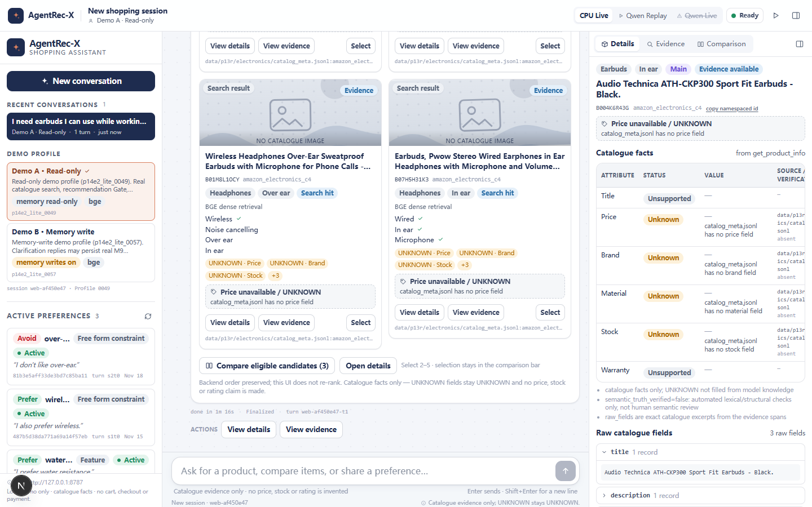
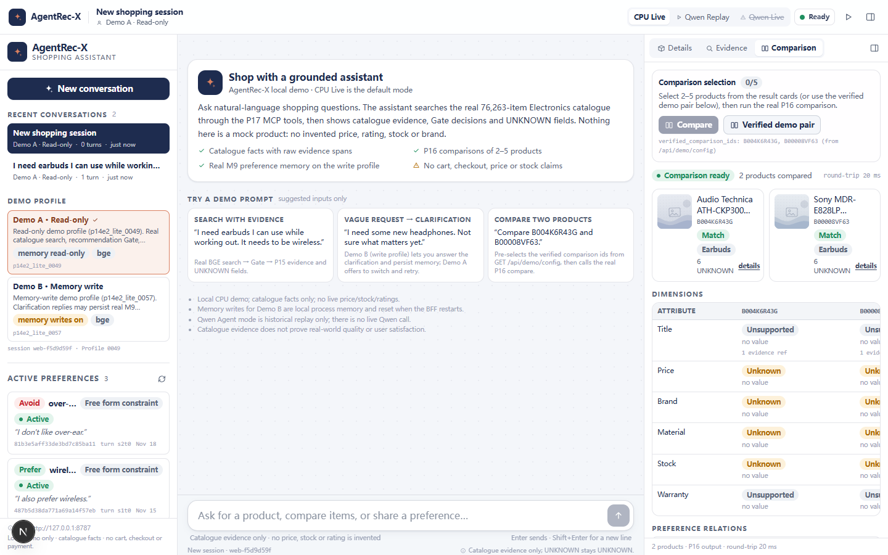
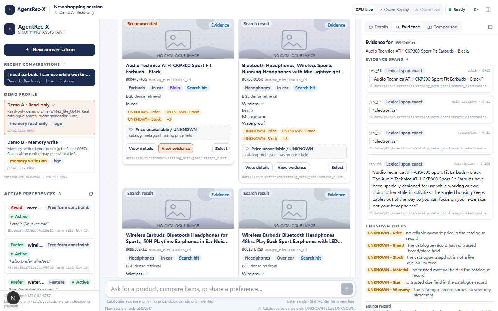
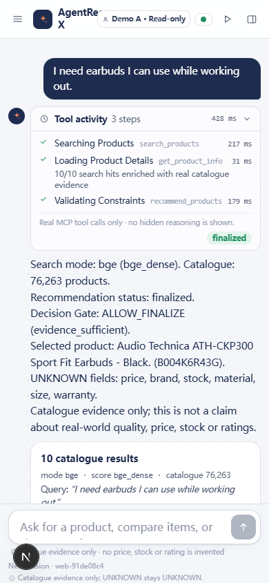

<p align="right"><b>简体中文</b> · <a href="README_EN.md">English</a></p>

# AgentRec-X

> **一个面向电子产品购物的 LLM Shopping Agent 工程原型。**  
> 用真实商品检索、可追溯证据、长期偏好记忆和 Decision Gate，演示一个“能被验证、知道边界”的购物 Agent，而不是一个只会生成文本的聊天壳。


> 完整英文版保留在 [`README_EN.md`](README_EN.md)。本中文版是项目展示入口；更深的技术细节在 [`docs/`](docs/) 和 [`P18_FINAL_REPORT.md`](P18_FINAL_REPORT.md)。

---

## 目录

- [项目是什么](#项目是什么)
- [核心能力](#核心能力)
- [界面预览](#界面预览)
- [系统架构](#系统架构)
- [运行模式](#运行模式)
- [快速开始](#快速开始)
- [关键结果（口径必须一起读）](#关键结果口径必须一起读)
- [目录结构](#目录结构)
- [文档导航](#文档导航)
- [质量与安全边界](#质量与安全边界)

---

## 项目是什么

用户输入一句自然语言购物需求后，AgentRec-X 会：

1. 用 **BGE / BM25 / 传统推荐源** 检索真实商品；
2. 读取 **M5/M9** 中当前用户已明确表达的偏好；
3. 用 **V0 Scorer、Product Type/Role、Eligibility** 约束候选；
4. 通过 **Decision Gate** 决定“推荐、继续找、还是先澄清”；
5. 用 **P15 Evidence Bundle** 给出可追溯的商品证据和 UNKNOWN；
6. 用 **P16 Skills** 比较商品或完成澄清 → 记忆更新 → 继续推荐；
7. 通过 **P17 官方 MCP stdio Server** 把这些能力暴露给独立客户端；
8. 在 **P19 本地 Web Demo** 中把完整链路展示给用户。

它最有价值的部分不是“接了一个 LLM”，而是围绕检索、事实、状态和评测建立的那些**边界**：

- 模型不能编造商品 ID、分数、证据或最终排名；
- 未确认的偏好不能自动写成长期记忆；
- 商品资料没有的字段必须保留为 UNKNOWN；
- 工程验收 PASS 与真实用户质量 PASS 分开报告。

---

## 核心能力

| 层 | 已实现能力 |
|---|---|
| 商品与检索 | 76,263 件真实 Electronics 商品；BM25 + 768 维 BGE dense index；catalogue grounding |
| 推荐 | Serving V1（SASRec / Two-Tower / BM25 + RRF）；V0 Preference Scorer；Student/规则基线 |
| Agent | ShoppingIntent、CandidatePlane、候选审计、Product Research、Clarification、恢复 |
| 长期记忆 | M5 event-sourced state、M9 preference memory、更新 / 撤回 / audit trail |
| 证据 | P15 Evidence Bundle；raw field / span / source record；UNKNOWN；Claim 自动验证 |
| 技能 | P16 `shopping-comparison`、`preference-clarification` |
| 协议 | P17 官方 MCP Python SDK v2；本地 stdio；7 个工具 |
| 界面 | P19 Next.js Web Shopping Assistant + FastAPI BFF + MCP；本地 CPU 可运行 |
| 外部评测 | ESCI 真实 query 的 judged-candidate reranking；C4 proxy 检索评测 |

---

## 界面预览

| 搜索与证据 | 商品比较 |
|---|---|
|  |  |
| **证据详情** | **移动端（390×844）** |
|  |  |

截图来自真实本地运行，不是静态 mock；商品来自真实 catalogue，缺失字段显示 UNKNOWN。

---

## 系统架构

```text
Browser / MCP Client
        |
        v
FastAPI BFF / AgentRec-X MCP Server (local stdio)
        |
        +-- ElectronicsCatalogue + BGE / BM25
        +-- Rule Planner + CandidateLedger + V0 Scorer
        +-- Product Type/Role + Eligibility + Decision Gate
        +-- P15 Evidence Bundle + Claim Validation
        +-- P16 Shopping Skills
        +-- M5/M9 Memory + HistoryStateReader
        |
        v
User-readable answer + machine-readable trace/evidence
```

关键原则：

- **MCP 是薄适配层**，不复制 Catalogue、Search、Memory、Scorer、Gate 或 Agent Runtime；
- **Gate 是 FINALIZE 的唯一权威**，RAG / Skills 不能绕过它；
- **商品文本是不可信数据**，只能证明 catalogue 写了什么，不能证明真实质量、库存或使用效果；
- **UNKNOWN 不补全**，自动验证不等于人工语义审核。

更完整的组件与信任边界见 [`PROJECT_ARCHITECTURE.md`](PROJECT_ARCHITECTURE.md) 和 [`docs/ARCHITECTURE.md`](docs/ARCHITECTURE.md)。

---

## 运行模式

| 模式 | 运行条件 | 是否真实调用 Qwen | 用途 |
|---|---|---|---|
| **CPU Live（默认）** | 本地 CPU；无 GPU 也可 | 否 | 本地 Web Demo、MCP、P15/P16、Rule Planner + Gate |
| **Qwen Base Live（可选）** | 需要现有 Qwen3.5-9B Base 服务 + GPU / tunnel | 是，真实 `/plan` | 真实模型规划；服务不可用时明确显示 unavailable，不静默降级 |
| **Qwen Replay（历史）** | 读取已保存轨迹 | 否，`live_call=false` | 展示历史真实 Qwen 验收，不冒充当前实时调用 |

**CPU 路径不需要 GPU。** Qwen Live 的模型服务/tunnel 默认已停止；需要时再按既有 Agent 入口启动，不要新建第二套 Runtime。

---

## 快速开始

### 1. 本地 Web Demo（推荐展示入口）

前置条件：Windows + WSL2 Ubuntu-22.04、仓库根目录下的 WSL `.venv`、Node.js + pnpm、Chrome/Edge。无需 GPU。

```powershell
powershell -ExecutionPolicy Bypass -File scripts/run_web_demo.ps1
```

- 前端：<http://127.0.0.1:3000>
- BFF 健康检查：<http://127.0.0.1:8787/api/health>
- 停止：`powershell -ExecutionPolicy Bypass -File scripts/stop_web_demo.ps1`
- E2E：`powershell -ExecutionPolicy Bypass -File scripts/run_web_demo_e2e.ps1`

详细步骤、资产路径和已知问题见 [`WEB_DEMO_GUIDE.md`](docs/web-demo/WEB_DEMO_GUIDE.md) 与 [`DEMO_GUIDE.md`](DEMO_GUIDE.md)。

### Legacy Serving Demo 的主要 HTTP 接口

Web Shopping Assistant 使用自己的 BFF；下面的 legacy serving demo 仍保留在 `recommendation/api`，用于推荐/Agent 接口调试：

| Method | Path | 用途 |
|---|---|---|
| `GET` | `/health` | 进程/模型 readiness |
| `GET` | `/v1/model` | 非敏感模型元数据 |
| `POST` | `/v1/recommend` | 基于可信 history 的 top-k 推荐 |
| `GET` | `/v1/demo/health` | Demo readiness |
| `GET` | `/v1/demo/profiles` | 服务端 demo profiles |
| `POST` | `/v1/demo/sessions` | 创建隔离会话 |
| `GET` | `/v1/demo/sessions/{session_id}` | 读取该会话状态 |
| `POST` | `/v1/demo/sessions/{session_id}/chat` | 有界对话轮次 |
| `POST` | `/v1/demo/sessions/{session_id}/agent/shopping` | 多轮 Shopping Agent |
| `POST` | `/v1/demo/agent/recommend` | 无状态 Agent 推荐 |

完整字段与错误码见 [`docs/USAGE.md`](docs/USAGE.md) 和运行中的 `/docs` OpenAPI。

### 2. CPU MCP Server

```bash
.venv/bin/python -m recommendation.mcp.server \
  --user-key p14e2_lite_0049 \
  --memory-fixture data/p14e2/benchmark/dev.agent.jsonl \
  --search-mode bge
```

默认写入关闭；只有显式 `--allow-memory-writes` 的本地测试 server 才接受真实测试用户回复。MCP 工具、客户端调用和失败案例见 [`P17_REPORT.md`](docs/milestones/P15-P17/P17_REPORT.md)。

### 3. 定向测试

```bash
.venv/bin/python -m pytest -q tests/test_p18_final.py tests/test_p17_mcp.py \
  tests/test_p16_skills.py tests/test_p15_rag.py
```

完整测试/复现说明见 [`docs/USAGE.md`](docs/USAGE.md) 与 [`EXPERIMENT_SUMMARY.md`](EXPERIMENT_SUMMARY.md)。

---

## 关键结果（口径必须一起读）

| 结果 | 数值 | 正确口径 |
|---|---:|---|
| Electronics catalogue | **76,263** | 真实接受商品数，不是模拟数据 |
| C4 Dev 135，BGE Hit@100 | **66/135** | P14-D2；BGE 候选可达性 |
| C4 Dev 135，BM25 Hit@100 | **20/135** | 同一 Dev；与 129 条 proxy test 不同 |
| C4 Proxy Test 129，BGE Hit@100 | **50.39%** | 评论衍生的 proxy query，不是真实搜索日志 |
| ESCI semantic gain，BGE nDCG@10 | **0.7366** | 真实 query + 人工 judgments；judged-candidate reranking |
| ESCI semantic gain，BM25 nDCG@10 | **0.6907** | 同口径；差 **+0.0459**，95% CI [0.0420, 0.0497] |
| P18 Reserved Test | **Top-1 11/12** | **模拟规则标签**，只用于受限工作流泛化检查 |
| Web E2E | **9/9** | 7 CPU/Replay + 2 真实 Qwen Live；另有 1/1 ASK→M9→resume 专项 |
| MCP / Skills | **7 tools / 2 Skills** | P17 默认工具；配置 Qwen Live 时另有 1 个入口 |

这些数字来自不同数据集、候选池和测试阶段，**不能横向相加，也不能当真实用户准确率**。严格口径与失败实验见 [`AGENTRECX_EXPERIMENT_SUMMARY.md`](docs/handoff/AGENTRECX_EXPERIMENT_SUMMARY.md) 和 [`EXPERIMENT_SUMMARY.md`](EXPERIMENT_SUMMARY.md)。

已确认的成功是：真实 catalogue、BGE 候选可达性提升、工具链/协议/记忆闭环可运行。  
未证明/失败的部分同样重要：真实长期历史没有超过 shuffled 负对照；Planner SFT 未超过 Base；SFT Adapter 不采用；解释语义真实性没有人工审核；ESCI 不是全库 Recall。

---

## 目录结构

```text
recommendation/     推荐引擎、Agent、控制面、Memory、MCP、Skills
experiments/        P5–P18 实验代码与评测脚本
tests/              单元、契约、Agent、Web、MCP 定向测试
web/                P19 Next.js 前端
web_demo/           P19 FastAPI BFF + MCP 客户端
docs/               架构、协议、评测、资产与交接文档
data/               数据（git-ignored；需按 Manifest 获取）
runs/               实验结果与截图（git-ignored）
skills/             P16 SKILL.md
archive/            历史归档与 legacy experiments
third_party/        第三方来源、licence 与 provenance
```

---

## 文档导航

| 文档 | 适合阅读 |
|---|---|
| [`AGENTRECX_HANDOFF.md`](docs/handoff/AGENTRECX_HANDOFF.md) | 接任者/新会话先读的完整交接 |
| [`AGENTRECX_EXPERIMENT_SUMMARY.md`](docs/handoff/AGENTRECX_EXPERIMENT_SUMMARY.md) | 全项目实验口径与失败经验 |
| [`EXPERIMENT_SUMMARY.md`](EXPERIMENT_SUMMARY.md) | 更短的项目实验总结 |
| [`PROJECT_ARCHITECTURE.md`](PROJECT_ARCHITECTURE.md) | 当前架构与两种运行模式 |
| [`DEMO_GUIDE.md`](DEMO_GUIDE.md) | P18 三场景 Demo 与 MCP 启动 |
| [`WEB_DEMO_GUIDE.md`](docs/web-demo/WEB_DEMO_GUIDE.md) | P19 Web Demo 一键运行与排错 |
| [`P15_REPORT.md`](docs/milestones/P15-P17/P15_REPORT.md) | Evidence Bundle、Claim Validation |
| [`P16_REPORT.md`](docs/milestones/P15-P17/P16_REPORT.md) | 两个 Shopping Skills |
| [`P17_REPORT.md`](docs/milestones/P15-P17/P17_REPORT.md) | MCP 协议、工具与客户端联调 |
| [`P18_FINAL_REPORT.md`](P18_FINAL_REPORT.md) | 冻结、Reserved Test、最终集成 |
| [`ESCI_EXTERNAL_EVAL_REPORT.md`](docs/external-eval/ESCI_EXTERNAL_EVAL_REPORT.md) | ESCI 外部评测 |
| [`REAL_RETRIEVAL_EVAL_REPORT.md`](docs/external-eval/REAL_RETRIEVAL_EVAL_REPORT.md) | C4 proxy 冻结评测 |
| [`docs/README.md`](docs/README.md) | 完整文档索引 |
| [`README_EN.md`](README_EN.md) | 完整英文版 README |

---

## 质量与安全边界

- 当前是**工程原型 / 本地演示**，不是生产推荐系统；没有真实用户 A/B、CTR/CVR 或满意度证据。
- **preference-conditioned relevance labels** 不存在，因此不能从偏好重写推出“推荐质量提升”或 **satisfaction** 结论。
- P14-E2 的 preference fixture 是 **synthetic** 构造数据；相关结论只在 synthetic 场景内成立。
- P18 Reserved Test 使用模拟规则标签；11/12 只用于工作流检查，不是真实用户准确率。
- 自动证据验证只检查引用、字段、span 和用户范围；`semantic_truth_verified=false`，不能称为人工语义审核。
- 商品 price / brand / stock / material 等缺失字段必须保持 UNKNOWN；不得用模型参数知识补齐。
- ItemCF 只有工程基线，**no same-artifact** 全量数据基准；不能与其他模型做不可比的横向排名。
- 本地 Web Demo 没有 auth/TLS；Memory 写入默认关闭；MCP 默认只允许启动时绑定的单一可信用户，不允许调用方传任意 user id。
- Qwen Live 需要 GPU 服务/tunnel，当前默认停止；Qwen Replay 只是历史回放，不是实时调用。
- 未运行 Reserved Test 的二次调参，也未基于最终指标修改模型或规则。

> **工程质量与质量结论是两件事。** 工程边界可以被测试；真实推荐效果、解释语义和用户满意度仍为 **NOT ESTABLISHED**。

---

<p align="center">
  <a href="README_EN.md">Read the full English README</a> · <a href="AGENTRECX_HANDOFF.md">Handoff</a> · <a href="EXPERIMENT_SUMMARY.md">Experiments</a>
</p>
