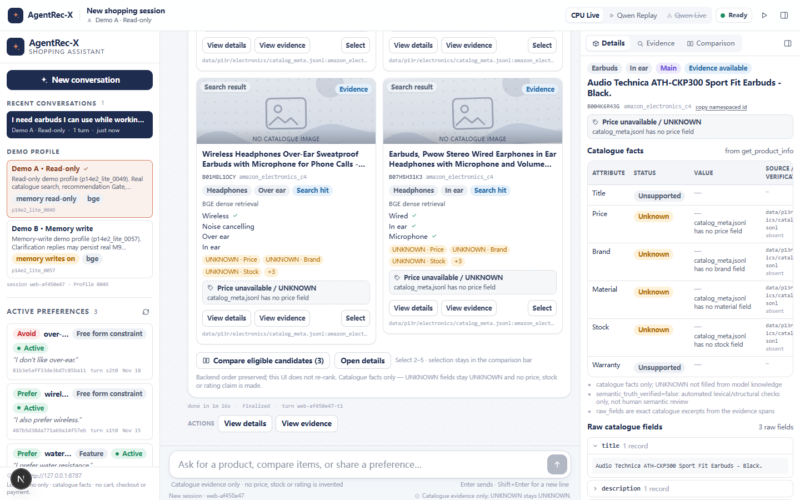
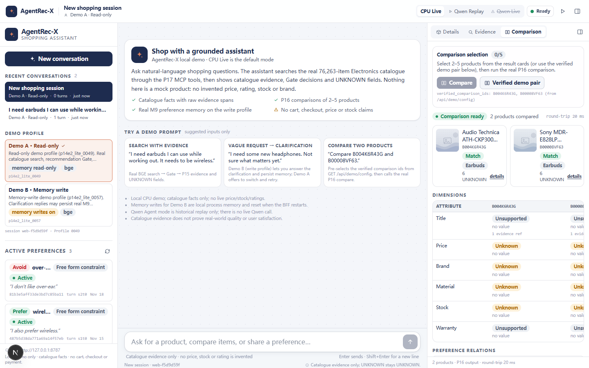
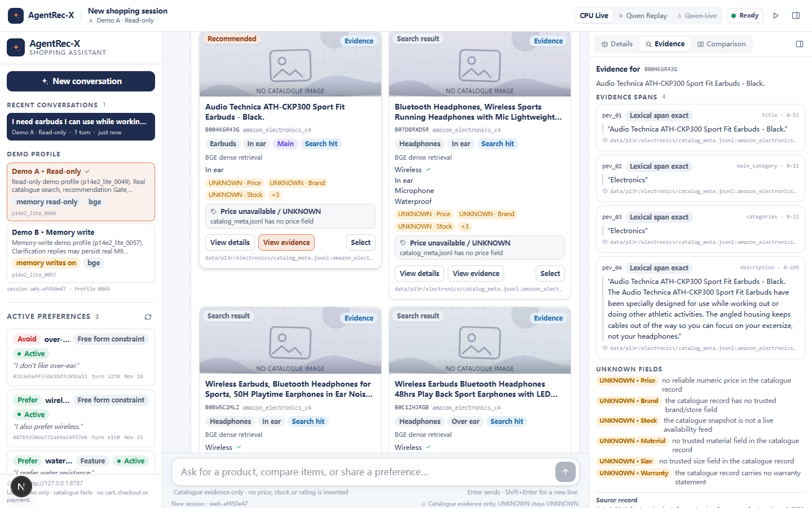
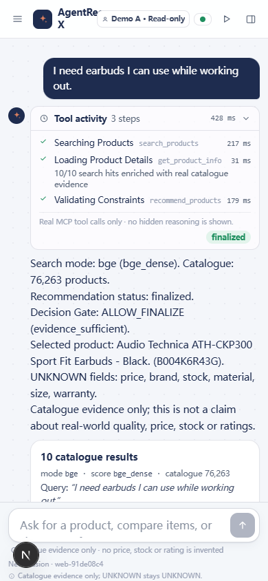
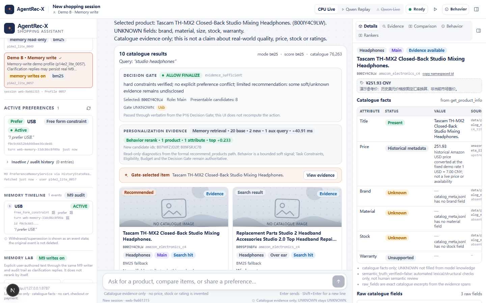
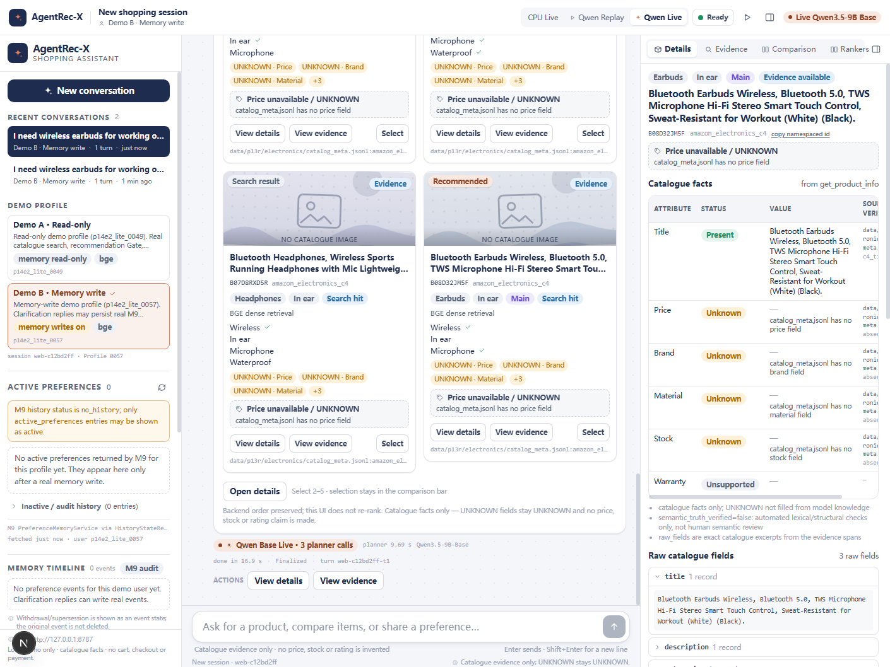
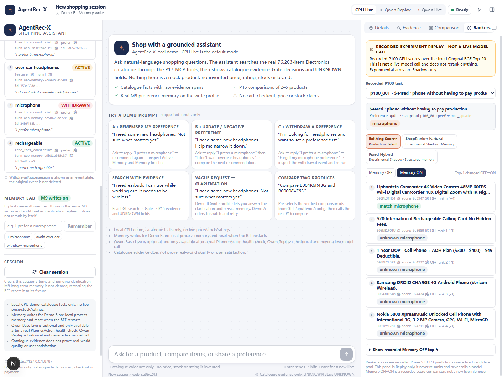
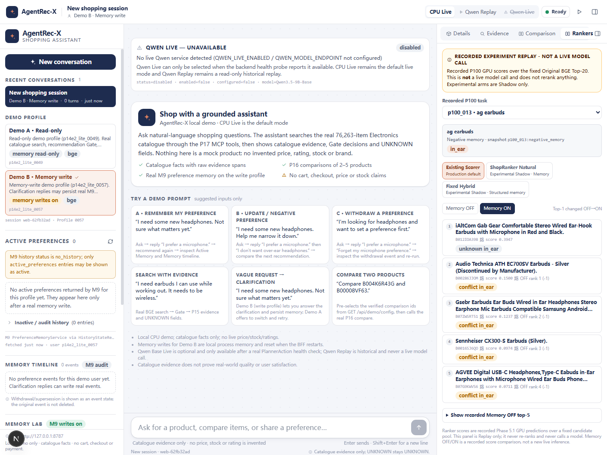
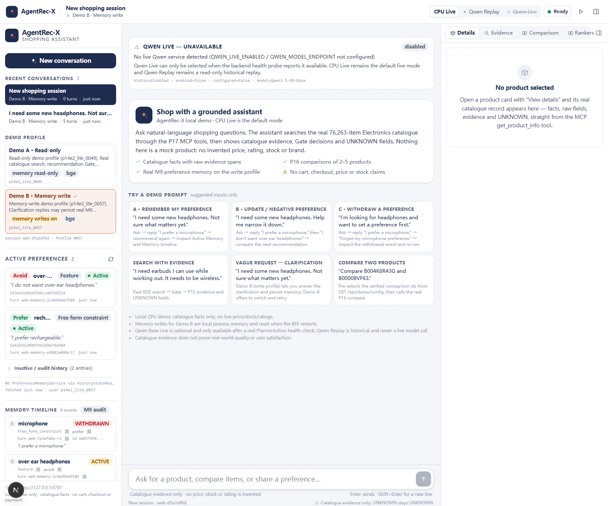

<p align="right"><b>简体中文</b> · <a href="README_EN.md">English</a></p>

# AgentRec-X

> **一个面向电子产品购物的 LLM Shopping Agent 工程原型。**
> 用真实商品检索、可追溯证据、长期偏好记忆、短期行为反馈和 Decision Gate，演示一个“能被验证、知道边界”的购物 Agent，而不是一个只会生成文本的聊天壳。


> 当前正式展示的是 **体系 A：本地 CPU Shopping Agent**。体系 B（V2/ShopRanker/历史研究链路）源码与实验记录保留在仓库中，但当前不启动、不作为已启用能力宣传。
> 完整英文版保留在 [`README_EN.md`](README_EN.md)；本中文版是当前展示入口。更深的技术细节在 [`docs/`](docs/)、[`P18_FINAL_REPORT.md`](P18_FINAL_REPORT.md) 和 [`docs/development/P1_PERSONALIZATION.md`](docs/development/P1_PERSONALIZATION.md)。

---

## 目录

- [项目是什么](#项目是什么)
- [核心能力](#核心能力)
- [界面预览](#界面预览)
- [系统架构](#系统架构)
- [运行模式](#运行模式)
- [快速开始](#快速开始)
- [打开两个个性化增强](#打开两个个性化增强)
- [完整演示路线](#完整演示路线)
- [关键结果（口径必须一起读）](#关键结果口径必须一起读)
- [历史与研究资产](#历史与研究资产)
- [目录结构](#目录结构)
- [文档导航](#文档导航)
- [质量与安全边界](#质量与安全边界)

---

## 项目是什么

用户输入一句自然语言购物需求后，AgentRec-X 会：

1. 用 **BGE / BM25** 检索真实 Electronics catalogue；
2. 读取 **M9** 中用户明确表达过的长期偏好；
3. 用 **V0 Scorer、Product Type/Role、Eligibility** 约束候选；
4. 通过 **Decision Gate** 决定“推荐、继续找、还是先澄清”；
5. 用 **P15 Evidence Bundle** 给出可追溯的商品证据和 UNKNOWN；
6. 用 **P16 Skills** 比较商品或完成澄清 → 记忆更新 → 继续推荐；
7. 通过 **P17 官方 MCP stdio Server** 暴露给独立客户端；
8. 在 **P19 Next.js Web Demo + FastAPI BFF** 中展示完整链路。

它最有价值的部分不是“接了一个 LLM”，而是围绕检索、事实、状态和评测建立的**边界**：

- 模型/UI 不能编造商品 ID、价格、证据或最终排名；
- 未确认的偏好不能自动写成长期记忆；
- 商品资料没有的字段必须保留为 UNKNOWN；
- 工程验收 PASS 与真实用户质量 PASS 分开报告；
- 硬性 Task Constraints、Eligibility、Budget 和 Decision Gate 始终是最终权威。

### 和普通商品搜索 / 聊天机器人有什么区别？

普通搜索通常只返回一个排序列表；聊天机器人可能生成没有出处的推荐。AgentRec-X 展示的是完整、可检查的决策链：

```text
自然语言需求
  -> 澄清 / 任务约束
  -> 真实 catalogue 检索
  -> 候选审计与偏好打分
  -> Eligibility + Budget + Decision Gate
  -> 可追溯 evidence / UNKNOWN
  -> 可恢复的多轮状态
```

当一个候选无法验证是否满足硬排除时，系统会安全拒绝，而不是“猜一个”或让模型补全。

---

## 核心能力

| 层 | 当前可展示能力 |
|---|---|
| 商品与检索 | 76,263 件真实 Electronics 商品；BM25 + 768 维 BGE dense index；catalogue grounding |
| 购物 Agent | 单轮推荐、澄清、真实检索、商品卡、Gate、Evidence、Comparison；CPU Rule Planner 为默认路径 |
| 多轮任务状态 | M4 多轮 ASK（如笔记本用途 → 预算）；Task Requirements；Pending/Reply/Checkpoint；M1 Warm/Cold Resume |
| 硬性约束 | P0 Task Constraints：当前任务硬排除优先于历史偏好；无法验证时 `hard_unknown` 安全拒绝；Budget Gate |
| 长期记忆 | M9 显式偏好：更新 / 撤回 / audit trail；浏览器 Session 独立 namespace；记忆可在 V0 Scorer 中影响排序 |
| 短期行为 | 真实 Click / Like / Dislike；第一方 SQLite 事件；短时兴趣 Profile；Behavior Inspector / Shadow 预览 |
| **P1 记忆召回** | 开关启用时，M9 正向偏好生成最多 2 条辅助 Query，与 base 检索做 RRF；新增候选可审计 |
| **P1 行为重排** | 开关启用时，短时行为 Snapshot 以固定权重软信号进入正式 V0 评分；不绕过 Gate |
| 证据 | P15 Evidence Bundle；raw field / span / source record；UNKNOWN；Claim 自动验证 |
| 协议 | P17 MCP Python SDK v2；本地 stdio；默认工具集；write-enabled Demo 额外显式 Memory 写入适配器 |
| 观测 | 请求 ID / trace ID / span；可选 Phoenix OTLP；现有 `/api/health` 与 tool timeline |
| 界面 | P19 Next.js Shopping Assistant；Memory Timeline、Memory Lab、Behavior Inspector、Replay、只读个性化证据条 |

**M1～M4 是能力分组，不是当前页面上的内部里程碑编号：**

- **M1**：可恢复的 Web 会话、Cold/Warm Resume、Replay。
- **M2**：请求级持久化、幂等 Fencing、durable result。
- **M3**：可观测性、Trace 关联与评测口径。
- **M4**：多轮 ASK 与任务级回复；回复后继续同一条 `recommend_products` 链路。

---

## 界面预览

| 搜索与证据 | 商品比较 |
|---|---|
|  |  |
| **证据详情** | **移动端（390×844）** |
|  |  |
| **P1 Memory + Behavior 正式路径证据** | |
|  | |

截图来自真实本地运行与真实浏览器调用，不是静态 mock；商品来自真实 catalogue，缺失字段显示 UNKNOWN。
界面中的 **Personalization evidence** 条只展示正式 `recommend_products` 返回的只读诊断：Memory 辅助召回数量/新增 ID，以及 Behavior 的软评分贡献；它不改变 Gate。

> 下列截图记录的是历史 Qwen Live / Memory Lab / P100 Ranker Replay 研究场景，保留用于说明项目历史；它们不是当前 CPU Demo 的必需启动条件。

| 历史 Qwen Live 轨迹 | Memory Timeline + Memory Lab |
|---|---|
|  |  |
| **Ranker Comparison（Recorded Replay）** | **历史首页 / Session 状态** |
|  |  |

Ranker Comparison 是 **P100 记录回放（Replay）**，不是实时 ShopRanker/Hybrid 推理。

---

## 系统架构

当前正式展示路径（体系 A）：

```text
Browser (Next.js, :3000)
        |
        v
FastAPI BFF (web_demo/, :8787)
        |
        v
Per-profile MCP stdio child (P17)
        |
        +-- ElectronicsCatalogue + BM25 / BGE
        +-- CPU Rule Planner (default)
        +-- M5/M9 HistoryStateReader -> preferences
        +-- optional P1 memory-aware auxiliary retrieval -> RRF
        +-- V0 Scorer + optional P1 behavior-aware soft rerank
        +-- Product Type/Role + Eligibility + Task Constraints + Budget
        +-- Decision Gate
        +-- P15 Evidence Bundle + P16 Skills
        |
        v
SSE products / evidence / text / clarification + machine-readable trace
```

关键原则：

- **MCP 是薄适配层**，不复制 Catalogue、Search、Memory、Scorer、Gate 或 Agent Runtime；
- **Gate 是 FINALIZE 的唯一权威**，RAG / Skills / Behavior 不能绕过它；
- **Task Constraints 优先于 M9 和 Behavior**；无法验证的硬排除不会被“猜成满足”；
- **商品文本是不可信数据**，只能证明 catalogue 写了什么，不能证明真实质量、库存或使用效果；
- **UNKNOWN 不补全**，自动验证不等于人工语义审核。

V2 / Qwen 历史路径保留为研究资料，不在当前默认启动：

```text
Browser -> Next.js -> BFF -> MCP -> Qwen3.5-9B (optional GPU)
  -> RETRIEVE -> RERANK -> FINALIZE -> DecisionGate
```

更完整的组件、信任边界和时序见 [`docs/ARCHITECTURE.md`](docs/ARCHITECTURE.md)、
[`docs/AGENTREC_X_DEMO_ARCHITECTURE.md`](docs/AGENTREC_X_DEMO_ARCHITECTURE.md) 和
[`docs/AGENTREC_X_DEMO_V21_VERIFICATION.md`](docs/AGENTREC_X_DEMO_V21_VERIFICATION.md)。

---

## 运行模式

| 模式 | 运行条件 | 是否真实调用 Qwen | 用途 |
|---|---|---|---|
| **CPU Live（默认）** | 本地 CPU；无 GPU 也可 | 否 | 当前正式 Web Demo；Rule Planner + BGE/BM25 + M9/Behavior + Gate |
| **BM25 CPU** | 本地 CPU；无需 BGE 模型 | 否 | 快速测试、无模型环境的稳定路径 |
| **Qwen Base Live（历史/可选）** | 已有 Qwen3.5-9B Base 服务 + GPU + WSL-local tunnel | 是，真实 `/plan` | 历史验证过的可选 Planner；当前不要求 AutoDL；不可用时明确 unavailable，不静默降级 |
| **Qwen Replay（历史）** | 读取已保存轨迹 | 否，`live_call=false` | 展示历史真实 Qwen 验收，不冒充当前实时调用 |

**CPU 路径不需要 GPU。** Qwen Live 的模型服务/tunnel 默认停止；需要时按
[`docs/SETUP_AND_DEPLOYMENT.md`](docs/SETUP_AND_DEPLOYMENT.md) 启动，不要新建第二套 Runtime。
Qwen Live 的 BFF health 是真实 PlannerAction 校验，不是端口探测；失败不会回退 Rule 并冒充 Qwen。

### BM25、BGE、Qwen 的运行条件

- **BM25**：只要 catalogue 可用即可；不需要 BGE 模型/索引；适合快速单元/HTTP/浏览器测试。
- **BGE**：需要本地 `models/bge-base-en-v1.5` 与 `runs/p14d2/bge_index.npz`；CPU 可运行，但两个 MCP 子进程冷启动可能各需数十秒。默认 `scripts/run_web_demo.ps1` 使用 BGE。
- **Qwen Live**：需要远端或本机 Qwen 服务、GPU、tunnel；当前 CPU Demo 不依赖它。没有服务时 UI 显示 unavailable，Qwen Replay 只读历史。

---

## 快速开始

### 前置条件

- Windows + WSL2 Ubuntu-22.04（推荐）；或 Linux/macOS 等价环境。
- 仓库根目录的 WSL `.venv`，已安装 `requirements.txt`。
- Node.js + pnpm；Chrome/Edge（浏览器 E2E）。
- 无需 GPU、无需 V2 Runtime、无需 AutoDL 即可展示 CPU 路径。

### 1. 一键启动 CPU Web Demo（默认 BGE）

```powershell
powershell -ExecutionPolicy Bypass -File scripts/run_web_demo.ps1
```

- 前端：<http://127.0.0.1:3000>
- BFF 健康检查：<http://127.0.0.1:8787/api/health>
- 停止：`powershell -ExecutionPolicy Bypass -File scripts/stop_web_demo.ps1`
- 一键浏览器验收：`powershell -ExecutionPolicy Bypass -File scripts/run_web_demo_e2e.ps1`
- CPU 浏览器 Suite（BFF/前端已启动）：`cmd /c "pnpm --dir e2e test:cpu"`；Qwen GPU 可选 Suite：`cmd /c "pnpm --dir e2e test:qwen"`

BGE 冷启动会为两个 profile 各加载一次 catalogue/index，日志出现 `status=starting` 是正常的；等待 `/api/health` 的 `ready=true` 再输入。默认价格模式是 **strict**：catalogue 没有价格时保持 UNKNOWN，并可能安全拒绝预算无法验证的请求。

默认是 **快速体验模式**（BFF 进程内 Session/M9），适合聊天、Memory、Behavior、M4 ASK；它**不能**宣传为已经验证跨 BFF 重启的持久化恢复。要验证 Task/Pending/Request Ledger、Cold Resume 和 Replay，请显式启用 **持久化恢复模式**：

```powershell
$env:AGENTRECX_WEB_STATE_DB = "runs/web_demo/durable_state.sqlite"
powershell -ExecutionPolicy Bypass -File scripts/run_web_demo.ps1
```

详细差异见 [`docs/development/INTERNSHIP_DEMO.md`](docs/development/INTERNSHIP_DEMO.md#21-两种真实运行模式不要混称)。

### 2. 最小手动启动（BM25；适合调试）

```bash
# WSL / Linux，仓库根目录；MCP 由 BFF 自动 spawn，无需另开端口
AGENTRECX_WEB_DEMO_SEARCH_MODE=bm25 \
AGENTRECX_WEB_DEMO_ALLOW_MEMORY_WRITES=1 \
.venv/bin/python -m web_demo
```

```powershell
# Windows，另一个终端
cmd /c "pnpm --dir web install"
cmd /c "pnpm --dir web dev"
```

打开 <http://localhost:3000>。默认 BFF 地址是 `http://127.0.0.1:8787`；可用 `NEXT_PUBLIC_BFF_URL` 覆盖。

### 3. 直接运行 MCP Server（调试 P17 工具）

```bash
.venv/bin/python -m recommendation.mcp.server \
  --user-key p14e2_lite_0049 \
  --memory-fixture data/p14e2/benchmark/dev.agent.jsonl \
  --search-mode bm25
```

默认写入关闭；只有显式 `--allow-memory-writes` 的本地测试 server 才接受真实测试用户回复。工具、客户端调用和失败案例见 [`docs/milestones/P15-P17/P17_REPORT.md`](docs/milestones/P15-P17/P17_REPORT.md)。

### 4. 定向测试

```bash
.venv/bin/python -m pytest -q \
  tests/test_web_multiturn_ask.py \
  tests/test_web_personalization_e2e.py \
  tests/test_task_constraints_execution.py \
  tests/test_web_reply_executor.py \
  tests/test_observability_tracing.py
```

完整测试/复现说明见 [`docs/USAGE.md`](docs/USAGE.md) 与 [`EXPERIMENT_SUMMARY.md`](EXPERIMENT_SUMMARY.md)。
真实 Qwen Agent 任务评测见 [`docs/REPRODUCE_AGENT_EVAL.md`](docs/REPRODUCE_AGENT_EVAL.md)；
Advanced Retrieval v2 见 [`docs/ADVANCED_RETRIEVAL_V2_PHASE1_REPORT.md`](docs/ADVANCED_RETRIEVAL_V2_PHASE1_REPORT.md)。

---

## 打开两个个性化增强

两个开关都是**服务端配置，默认 OFF**，不能由聊天请求打开；修改后必须重启 BFF/MCP。

```text
AGENTRECX_MEMORY_AWARE_RETRIEVAL=0|1   # 默认 0
AGENTRECX_BEHAVIOR_AWARE_RERANK=0|1    # 默认 0
```

### 方式 A：一键启动时设置环境变量（PowerShell）

```powershell
$env:AGENTRECX_PRICE_MODE = "demo_historical_fx"   # 仅用于笔记本预算演示
$env:AGENTRECX_MEMORY_AWARE_RETRIEVAL = "1"
$env:AGENTRECX_BEHAVIOR_AWARE_RERANK = "1"
powershell -ExecutionPolicy Bypass -File scripts/run_web_demo.ps1
```

`run_web_demo.ps1` 只转发这些显式环境变量，默认值仍为 strict / OFF；它不会引入运行时开关。

### 方式 B：手动启动 BFF

```bash
AGENTRECX_WEB_DEMO_SEARCH_MODE=bm25 \
AGENTRECX_WEB_DEMO_ALLOW_MEMORY_WRITES=1 \
AGENTRECX_PRICE_MODE=demo_historical_fx \
AGENTRECX_MEMORY_AWARE_RETRIEVAL=1 \
AGENTRECX_BEHAVIOR_AWARE_RERANK=1 \
.venv/bin/python -m web_demo
```

开启后，`GET /api/health` / `GET /api/demo/config` 会返回：

```json
{"price_mode":"demo_historical_fx","features":{"memory_aware_retrieval":true,"behavior_aware_rerank":true}}
```

商品区的 **Personalization evidence** 条会显示：

- Memory：base 候选数、新增候选 ID、辅助 Query 数、额外延迟；
- Behavior：活跃 product/attribute 信号、top behavior score（正负贡献）。

这些是**只读诊断**；Task Constraints、Eligibility、Budget、Decision Gate 仍然是硬边界。

### 记忆召回与行为重排的边界

- **Memory-aware Retrieval**：M9 中 ACTIVE 的正向偏好生成最多 2 条辅助 Query，每条 10 个候选，RRF 合并上限 40；base 候选始终保留。`USB` 的真实 BM25 示例新增 2 个候选，BGE 示例新增 3 个候选。
- **Behavior-aware Rerank**：Click=弱兴趣，Like=强于 Click，Dislike=负贡献；Snapshot 只包含有界商品/属性信号，不含原始文本。固定权重软信号上限 ±0.30，不会绕过硬约束或 Gate。
- **Behavior 改变分数不等于每次改变 Top-1**。如果当前 Query 的候选分数差距更大，Top-1 可以保持不变；不要伪造排序变化。
- Replay 使用已提交的 durable result，不重新读取 Behavior；Cold Resume 使用服务端当前配置和当前 Session Profile。

详细实现、真实延迟和限制见 [`docs/development/P1_PERSONALIZATION.md`](docs/development/P1_PERSONALIZATION.md)。

---

## 完整演示路线

稳定的三场景路线（详细操作、输入和排错见 [`docs/development/INTERNSHIP_DEMO.md`](docs/development/INTERNSHIP_DEMO.md)）：

### 场景 1：基础购物 Agent + 多轮 ASK + Budget Gate

使用 **Demo B · Memory write**，开启 `AGENTRECX_PRICE_MODE=demo_historical_fx`：

```text
推荐一台笔记本
  -> 这台笔记本主要用来办公还是游戏？
游戏
  -> 预算大约是多少？
8000 元
  -> 真实 BGE/BM25 检索 + 真实商品卡 + Gate ALLOW_FINALIZE
```

预期结果：笔记本候选的商品卡显示 **¥6,293.00 CNY**，并明确标注“演示参考价：历史美元价格按固定汇率换算，非当前市场售价”。历史美元价格不是实时价格。

### 场景 2：Memory-aware Retrieval

1. 在 **Memory lab** 保存一条 M9 确实能识别的偏好，例如 `I prefer USB.`；
2. 发送通用需求：`studio headphones`；
3. 开启 `AGENTRECX_MEMORY_AWARE_RETRIEVAL=1` 后，查看商品区 Personalization evidence：
   - `Memory retrieval` 出现；
   - 显示 base 候选数、新增 candidate IDs、辅助 Query 数和额外延迟；
   - 侧栏 M9 Active preferences / Memory timeline 保持真实状态。

不要求 Top-1 改变；展示真实候选新增或日志即可。不要用修改文案冒充召回。

### 场景 3：Behavior-aware Rerank

1. 在同一 Session 的商品卡点击 **Like**（不是只打开 Shadow Preview）；
2. 确认 `/api/behavior/events` 真实写入；
3. 再次发送 `studio headphones`；
4. 开启 `AGENTRECX_BEHAVIOR_AWARE_RERANK=1` 后查看 Personalization evidence 的 `Behavior rerank`：
   - 活跃 product/attribute 信号；
   - `top +0.xxx` 的真实行为贡献；
   - 正式 `recommend_products` 返回的 metadata。

若 Top-1 不变，只报告分数贡献；这是软信号，不是学习型排序模型。

### 场景 4：安全与恢复

- 当前任务硬约束优先于 Memory 和 Behavior；`hard_unknown` 候选会安全拒绝。
- 预算无法验证时 Budget Gate 拒绝，不会用历史价格猜测通过。
- 已提交 Reply 的 Replay 直接返回 durable result，不重新执行 MCP。
- M4 的两轮 ASK 在 BFF/MCP 重启后可以 Cold Resume。
- Phoenix 可选：启用 OTel 后查看真实 trace；没有 exporter 时 UI 明确显示 observability disabled。

---

## 关键结果（口径必须一起读）

| 结果 | 数值 | 正确口径 |
|---|---:|---|
| Electronics catalogue | **76,263** | 真实接受商品数，不是模拟数据 |
| M3 单轮任务 | **13/15** | **原有单轮 Runner 口径**，不是多轮任务成功率 |
| M3-C Precision@5 | **探索性** | 机器辅助标签实验，不是生产质量提升，不写成线上指标 |
| C4 Dev 135，BGE Hit@100 | **66/135** | P14-D2；BGE 候选可达性 |
| C4 Dev 135，BM25 Hit@100 | **20/135** | 同一 Dev；与 proxy test 不同 |
| C4 Proxy Test 129，BGE Hit@100 | **50.39%** | 评论衍生的 proxy query，不是真实搜索日志 |
| ESCI semantic gain，BGE nDCG@10 | **0.7366** | 真实 query + 人工 judgments；judged-candidate reranking |
| ESCI semantic gain，BM25 nDCG@10 | **0.6907** | 同口径；差 **+0.0459**，95% CI [0.0420, 0.0497] |
| P18 Reserved Test | **Top-1 11/12** | **模拟规则标签**，只用于受限工作流泛化检查 |
| 当前 CPU Browser Suite | **7 passed / 0 failed / 4 skipped** | 默认 BGE、Flags OFF、strict price；跳过的 3 个为可选 Qwen GPU 测试，1 个为需 P1 配置的 09 |
| 当前 P1 Browser Demo | **09：1/1 passed** | 真实 BM25 + Demo FX 的笔记本多轮、Memory、Behavior；单独运行，不与默认 CPU Suite 混算 |
| P1 Memory 真实召回 | **BM25 +2 / BGE +3 候选** | 同一 Query 的真实辅助检索；不是全库 Recall |

这些数字来自不同数据集、候选池和测试阶段，**不能横向相加，也不能当真实用户准确率**。严格口径与失败实验见
[`docs/handoff/AGENTRECX_EXPERIMENT_SUMMARY.md`](docs/handoff/AGENTRECX_EXPERIMENT_SUMMARY.md) 和
[`EXPERIMENT_SUMMARY.md`](EXPERIMENT_SUMMARY.md)。

已确认的成功是：真实 catalogue、BGE 候选可达性提升、工具链/协议/记忆闭环可运行、Task Constraints/Budget/Gate 安全边界。
未证明/失败的部分同样重要：真实长期历史没有超过 shuffled 负对照；Planner SFT 未超过 Base；
SFT Adapter 不采用；解释语义真实性没有人工审核；ESCI 不是全库 Recall；
Behavior 改变分数不等于每次都改变 Top-1。

### P1 当前验证（单次真实运行）

| 项目 | 结果 |
|---|---:|
| Memory BM25 额外候选 | 2 |
| Memory BM25 额外延迟 | 约 44 ms |
| Memory BGE 额外候选 | 3 |
| Memory BGE 额外延迟 | 约 105 ms |
| Behavior Like -> 正式 `recommend_products` | `top_behavior_score` 约 0.233（单次） |
| Behavior Top-1 变化 | **不保证**；展示真实分数贡献 |
| Flags 全 OFF | 仍走原 M1–M4/P0 路径；新 metadata 不出现 |

完整证据：[`docs/development/P1_PERSONALIZATION.md`](docs/development/P1_PERSONALIZATION.md)、
[`tests/test_web_personalization_e2e.py`](tests/test_web_personalization_e2e.py)。

---

## 历史与研究资产

以下内容保留，但不再是当前默认展示能力：

- **体系 B / V2 Runtime**：`recommendation/api`、SASRec/Two-Tower/RRF Serving、LightGBM、TIGER 等历史研究资产保留源码与文档；当前不启动，不修改。相关历史说明仍见
  [`P18_FINAL_REPORT.md`](P18_FINAL_REPORT.md)、[`docs/AGENTREC_X_DEMO_V21_VERIFICATION.md`](docs/AGENTREC_X_DEMO_V21_VERIFICATION.md)。
- **Qwen Base Live**：历史真实 GPU 实验与浏览器轨迹保留；当前 CPU Demo 不依赖 AutoDL。需要时按
  [`docs/SETUP_AND_DEPLOYMENT.md`](docs/SETUP_AND_DEPLOYMENT.md) 配置真实服务。
- **Behavior V2 GPU E2E**：100 个自动化场景、21 个真实 Qwen Live、BGE 延迟等历史结果保留在
  [`docs/AGENTREC_X_BEHAVIOR_FEEDBACK_V2_GPU_E2E_REPORT.md`](docs/AGENTREC_X_BEHAVIOR_FEEDBACK_V2_GPU_E2E_REPORT.md)。自动化事件为 `AUTOMATED_BROWSER_E2E`，不是人类偏好标签；`human_review_count=0`。
- **Ranker Comparison**：P100 recorded Replay，页面明确标注，不是实时推理。

这些历史结果可以帮助理解项目演进，但不能用来声称当前 CPU Demo 具备 GPU/Qwen/V2 线上能力。

### Legacy Serving Demo 的主要 HTTP 接口（历史，不在当前 Web Demo 启动）

Web Shopping Assistant 使用自己的 BFF；下面的 legacy serving demo 仍保留在 `recommendation/api`，用于历史推荐/Agent 接口调试：

| Method | Path | 用途 |
|---|---|---|
| `GET` | `/health` | 进程/模型 readiness |
| `GET` | `/v1/model` | 非敏感模型元数据 |
| `POST` | `/v1/recommend` | 基于可信 history 的 top-k 推荐 |
| `GET` | `/v1/demo/health` | Demo readiness |
| `GET` | `/v1/demo/profiles` | 服务端 demo profiles |
| `POST` | `/v1/demo/sessions` | 创建隔离会话 |
| `GET` | `/v1/demo/sessions/{session_id}` | 读取该会话状态 |
| `POST` | `/v1/demo/sessions/{session_id}/chat` | 有界对话轮次 |
| `POST` | `/v1/demo/sessions/{session_id}/agent/shopping` | 多轮 Shopping Agent |
| `POST` | `/v1/demo/agent/recommend` | 无状态 Agent 推荐 |

完整字段与错误码见 [`docs/USAGE.md`](docs/USAGE.md) 和运行中的 `/docs` OpenAPI。

---

## 目录结构

```text
recommendation/     推荐引擎、Agent、控制面、Memory、MCP、Skills
experiments/        P5–P18 实验代码与评测脚本
tests/              单元、契约、Agent、Web、MCP 定向测试
web/                P19 Next.js 前端
web_demo/           P19 FastAPI BFF + MCP 客户端
docs/               架构、协议、评测、资产与交接文档
data/               数据（git-ignored；需按 Manifest 获取）
runs/               实验结果与截图（git-ignored）
skills/             P16 SKILL.md
archive/            历史归档与 legacy experiments
third_party/        第三方来源、licence 与 provenance
```

---

## 文档导航

| 文档 | 适合阅读 |
|---|---|
| [`docs/development/INTERNSHIP_DEMO.md`](docs/development/INTERNSHIP_DEMO.md) | **本轮实习展示：真实启动、三场景、Flags、Phoenix、排错** |
| [`docs/development/P1_PERSONALIZATION.md`](docs/development/P1_PERSONALIZATION.md) | **P1 Memory 召回 / Behavior 重排实现与真实证据** |
| [`docs/development/P0_TASK_CONSTRAINTS_FIX.md`](docs/development/P0_TASK_CONSTRAINTS_FIX.md) | P0 Task Constraints、Budget/Gate 安全边界 |
| [`AGENTRECX_HANDOFF.md`](docs/handoff/AGENTRECX_HANDOFF.md) | 接任者/新会话先读的完整交接 |
| [`AGENTRECX_EXPERIMENT_SUMMARY.md`](docs/handoff/AGENTRECX_EXPERIMENT_SUMMARY.md) | 全项目实验口径与失败经验 |
| [`EXPERIMENT_SUMMARY.md`](EXPERIMENT_SUMMARY.md) | 更短的项目实验总结 |
| [`PROJECT_ARCHITECTURE.md`](PROJECT_ARCHITECTURE.md) | 当前架构与两种运行模式 |
| [`docs/DEMO_GUIDE.md`](docs/DEMO_GUIDE.md) | V2.1 历史 Web Demo 操作说明（含 Qwen 历史场景） |
| [`docs/SETUP_AND_DEPLOYMENT.md`](docs/SETUP_AND_DEPLOYMENT.md) | Local CPU / 远程 Qwen Live 完整启动与部署 |
| [`docs/ARCHITECTURE.md`](docs/ARCHITECTURE.md) | 当前架构、Qwen Live / Memory / Session 隔离时序 |
| [`docs/AGENTREC_X_DEMO_V21_VERIFICATION.md`](docs/AGENTREC_X_DEMO_V21_VERIFICATION.md) | V2.1 Qwen Live 与 Session Isolation 历史验收证据 |
| [`docs/AGENTREC_X_BEHAVIOR_FEEDBACK_V2_GPU_E2E_REPORT.md`](docs/AGENTREC_X_BEHAVIOR_FEEDBACK_V2_GPU_E2E_REPORT.md) | V2 历史 GPU Live + BGE + 100 场景 E2E 证据、延迟与边界 |
| [`docs/web-demo/WEB_DEMO_GUIDE.md`](docs/web-demo/WEB_DEMO_GUIDE.md) | P19 Web Demo 一键运行与排错 |
| [`P15_REPORT.md`](docs/milestones/P15-P17/P15_REPORT.md) | Evidence Bundle、Claim Validation |
| [`P16_REPORT.md`](docs/milestones/P15-P17/P16_REPORT.md) | 两个 Shopping Skills |
| [`P17_REPORT.md`](docs/milestones/P15-P17/P17_REPORT.md) | MCP 协议、工具与客户端联调 |
| [`P18_FINAL_REPORT.md`](P18_FINAL_REPORT.md) | 冻结、Reserved Test、历史最终集成 |
| [`ESCI_EXTERNAL_EVAL_REPORT.md`](docs/external-eval/ESCI_EXTERNAL_EVAL_REPORT.md) | ESCI 外部评测 |
| [`REAL_RETRIEVAL_EVAL_REPORT.md`](docs/external-eval/REAL_RETRIEVAL_EVAL_REPORT.md) | C4 proxy 冻结评测 |
| [`docs/README.md`](docs/README.md) | 完整文档索引 |
| [`README_EN.md`](README_EN.md) | 英文版 README（可能滞后于本中文入口） |

---

## 质量与安全边界

- 当前是**工程原型 / 本地演示**，不是生产推荐系统；没有真实用户 A/B、CTR/CVR 或满意度证据。
- **preference-conditioned relevance labels** 不存在，因此不能从偏好重写推出“推荐质量提升”或 **satisfaction** 结论。
- P14-E2 的 preference fixture 是 **synthetic** 构造数据；相关结论只在 synthetic 场景内成立。
- P18 Reserved Test 使用模拟规则标签；11/12 只用于工作流检查，不是真实用户准确率。
- 自动证据验证只检查引用、字段、span 和用户范围；`semantic_truth_verified=false`，不能称为人工语义审核。
- 商品 price / brand / stock / material 等缺失字段必须保持 UNKNOWN；不得用模型参数知识补齐。
- **Historical FX 不是实时价格**：`demo_historical_fx` 仅把历史美元价格按固定 7.00 汇率换算，并显示“演示参考价”；不得写成当前市场售价。
- ItemCF 只有工程基线，**no same-artifact** 全量数据基准；不能与其他模型做不可比的横向排名。
- 本地 Web Demo 没有 auth/TLS；Memory 写入默认关闭；MCP 默认只允许启动时绑定的单一可信用户，不允许调用方传任意 user id。
- V2.1 起浏览器 Session 拥有独立 M9 namespace（A/B 不互读、不互相撤回）；但默认 in-memory Session 仍是 **BFF 进程内状态，BFF 重启会丢失**；durable 路径使用 Web SQLite ledger，两者不能混称持久化多租户 Memory。
- Qwen Live 需要 GPU 服务 + **WSL-local loopback tunnel**；tunnel/模型停止时 UI 明确显示 unavailable，不能声称 Qwen 成功。
- Behavior V2 的 100 个自动化场景使用 `AUTOMATED_BROWSER_E2E` provenance；它们验证机制与排序响应，不是人类偏好标签；`human_review_count=0`，`preference_lift` 为 `unavailable_no_human_labels`，不声称 CTR/满意度提升。
- P1 的 Behavior 是固定权重软信号，不是训练后的学习型排序模型；Top-1 不保证变化。
- P1 的 Memory 辅助召回受 base top-20 + 2×10 约束，不能召回两者都找不到的商品；M9 仍是规则抽取，中文长期偏好支持有限。
- Ranker Comparison 当前是 **P100 recorded Replay**，页面明确标注；不是实时 ShopRanker/Hybrid 推理。
- 未运行 Reserved Test 的二次调参，也未基于最终指标修改模型或规则。

> **工程质量与质量结论是两件事。** 工程边界可以被测试；真实推荐效果、解释语义和用户满意度仍为 **NOT ESTABLISHED**。

---

<p align="center">
  <a href="docs/development/INTERNSHIP_DEMO.md">Internship Demo Guide</a> ·
  <a href="README_EN.md">English README</a> ·
  <a href="docs/handoff/AGENTRECX_HANDOFF.md">Handoff</a> ·
  <a href="EXPERIMENT_SUMMARY.md">Experiments</a>
</p>
