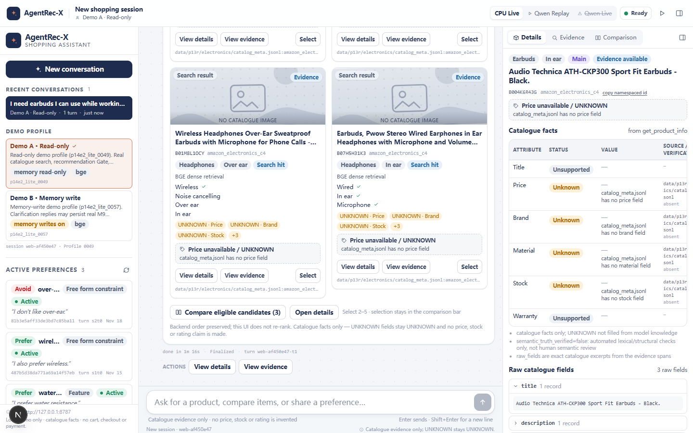
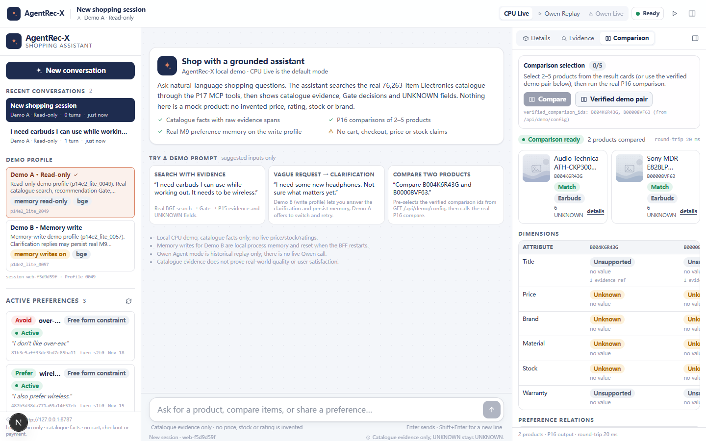
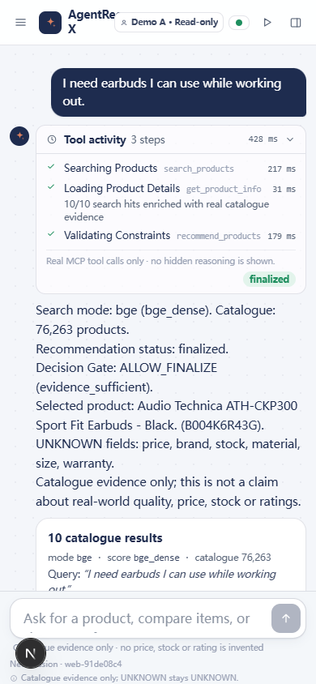
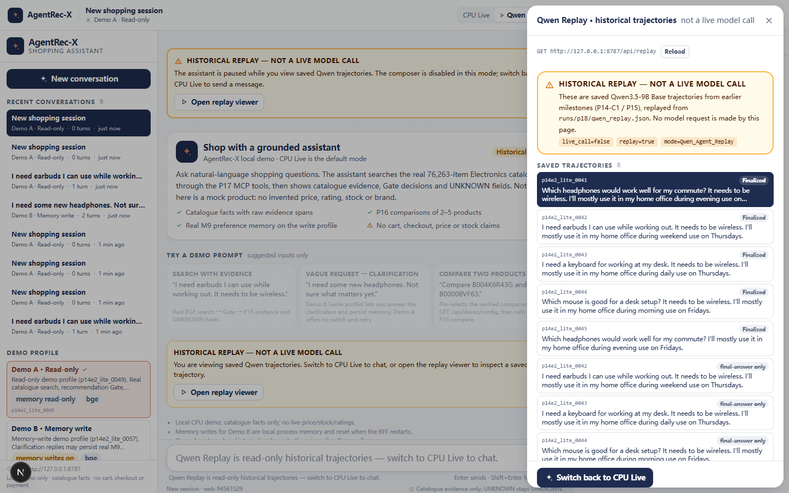

# AgentRec-X

> [简体中文](README.md) · **English**

> **Status: CURRENT** — product overview and quick start. Detailed architecture lives in
> [`docs/ARCHITECTURE.md`](docs/ARCHITECTURE.md); historical records are kept separate.

**A bounded recommendation system with a deterministic retrieval/ranking backbone and an Agent layer that may propose, not decide, what is true.**

AgentRec-X takes a conversational shopping request and a trusted behavioural history, retrieves
candidates from multiple sources, fuses their orderings with reciprocal-rank fusion, grounds
candidates in catalogue metadata, and applies only user-confirmed preferences. The optional LLM
Agent can choose a route, ask a bounded clarification, or select a supported preference value; it
cannot write a product id, score, evidence record, ranking or metric.

The project is built for a recommendation-systems / AI-agent engineering portfolio: the interesting
part is not an LLM wrapper, but the **boundaries** around retrieval, truth, state and evaluation.

---

## Web Shopping Assistant (P19, current local demo)

A **real, user-facing shopping assistant** built on the existing AgentRec-X stack. It is not a
mock chatbot or a static dashboard: the browser talks to a thin FastAPI BFF, which talks to the
existing **P17 official MCP stdio server**, which calls the real Electronics catalogue, BGE
retrieval, Rule Planner, Decision Gate, P15 evidence, P16 Skills and M9 preference memory.

| Search + evidence | Comparison |
|---|---|
|  |  |
| Mobile (390×844) | Qwen Replay (historical only) |
|  |  |

### Run it

```powershell
# prerequisites: WSL Ubuntu-22.04 .venv + Amazon-C4 Electronics/BGE assets, Node 24 + pnpm, Chrome
# external asset paths and SHA-256: docs/ARCHIVE_MANIFEST.md
powershell -ExecutionPolicy Bypass -File scripts/run_web_demo.ps1
```

* front end: `http://127.0.0.1:3000` (also works via `localhost`)
* BFF health: `http://127.0.0.1:8787/api/health`
* stop: `powershell -ExecutionPolicy Bypass -File scripts/stop_web_demo.ps1`
* end-to-end: `powershell -ExecutionPolicy Bypass -File scripts/run_web_demo_e2e.ps1`

Cold start is real: BFF/MCP loads the catalogue + BGE before reporting `Search Ready`; in the
verified CPU run `/api/health` became ready after **~46–58 s** (three Web cold starts), and the
MCP children used **~37–49 s** each. The encoder is warmed once inside startup, so the **first
user BGE query after readiness is ~0.54–0.56 s** (before this fix it paid a measured **15.6–17.1 s**
encoder load); subsequent queries are ~0.28–0.30 s. The page renders immediately and shows a real
initialization banner; the startup cost is not hidden.

### Three real scenarios

1. **Search & recommend with evidence** — send e.g. `I need wireless earbuds for working out.`
   Real BGE search → existing Rule Planner + Decision Gate → 10 real catalogue cards → View
   Details/Evidence (P15 raw field/span/span text/source record, UNKNOWN fields, automated
   validation clearly labelled). Price is always `Price unavailable / UNKNOWN`; nothing is
   invented.
2. **Compare 2–5 products** — select the P18-verified pair `B004K6R43G` and `B00008VF63`, then
   Compare. The P16 `comparison_ready` payload is rendered verbatim (dimensions, MATCH/UNKNOWN,
   preference relations, claims count, evidence sources, conditional recommendation). Invalid refs
   return a real HTTP 400, not a mocked comparison.
3. **Clarify → persist memory → continue** — on **Demo B · Memory write** (`profile_0057`), a vague
   request gets a real `NEED_USER_CLARIFICATION`. Type your own reply (e.g. `I prefer noise
   cancelling and wireless.`); the BFF writes it through M9 with
   `confirmation_source="web_ui_explicit_user_reply"`, the real update (`added=2`) and refreshed
   active preferences appear in the panel, and the pending recommendation resumes.

### CPU Live vs Qwen Base Live vs Qwen Replay

* **CPU Live (default, live):** real local MCP/BGE/Rule Planner/Gate/P15/P16/M9; no GPU, no Qwen.
* **Qwen Base Live (real GPU-validated optional mode):** when explicitly configured and a real
  `/plan` health check returns a valid PlannerAction, the browser can select Qwen Base Live. The real
  Qwen3.5-9B Base PlannerActions are executed by the **existing** electronics executor — same
  catalogue/search/Scorer/CandidateLedger/Eligibility/Gate/P15/M9. No Rule→Qwen rewriting and no
  Qwen→Rule fallback. On 2026-11-09 this was validated on an RTX 4090 with real `/plan` inference,
  real MCP executor runs and two real browser turns; the temporary service/tunnel are stopped now,
  so a rerun requires starting them. On 2026-11-10 the real **Qwen ASK → M9 → resume** branch was
  exercised on an isolated conflict profile. A follow-up consistency fix now gives the current
  clarification reply task-scoped priority, re-evaluates the preserved candidate pool and prevents
  an explicit-wired final product without deleting historical M9 preferences; see
  [`QWEN_CLARIFICATION_FIX_REPORT.md`](QWEN_CLARIFICATION_FIX_REPORT.md). The one-reply Qwen fix is
  **GO** for that scope, with the final product's wireless evidence reported as UNKNOWN where the
  catalogue provides none. No fake ASK or Rule substitute was used.
* **Qwen Replay (historical only):** saved P18 trajectories from `runs/p18/qwen_replay.json`,
  visibly labelled **Historical Replay — Not a Live Model Call**; read-only.
* **Qwen Live unavailable / failures:** CPU Live and Replay remain available; no fake Qwen
  success, no silent downgrade to Rule. See [`docs/QWEN_LIVE_CONTRACT.md`](docs/QWEN_LIVE_CONTRACT.md)
  and [`QWEN_LIVE_WEB_REPORT.md`](QWEN_LIVE_WEB_REPORT.md).

### Verified results and honest limits

| Result | Value / status |
|---|---|
| Electronics catalogue | 76,263 accepted products |
| BGE candidate reachability | Recall@100 **20/135 → 66/135** (P14-D2; retrieval layer, not final quality) |
| P18 Reserved Test | recommendation Top-1 **11/12** — **simulated rule labels**, not real users |
| Web E2E | **9/9 regression passed** (7 CPU/Replay + 2 real Qwen Live) **+ 1/1 real one-reply ASK→task-constraint→resume test** (isolated profile; see fix report) |
| MCP tools / P16 Skills | **7** default tools (+ optional 8th `run_agent_turn` when Qwen Live is configured) / **2** Skills |
| Web Demo answer quality | **NOT ESTABLISHED** (no online A/B, clicks, conversion or satisfaction) |

Limits that must travel with these numbers: the Reserved Test uses simulated rule labels; real
long-term-history personalization gain is **not established**; Planner SFT did not beat Base;
the Web CPU Live path uses the Rule Planner; Qwen Base Live is a separate real GPU-validated mode
(available only after a real model health/PlannerAction check; its real ASK/memory continuation now
uses task-scoped clarification constraints and is **GO** for the explicit-wired-exclusion scope per
`QWEN_CLARIFICATION_FIX_REPORT.md`, with unknown wireless evidence retained as UNKNOWN); Qwen Replay is historical only; semantic truth of
generated explanations has **not** been human-reviewed; the local demo has no auth/TLS and is not
production-ready. The catalogue snapshot has no trusted price/stock/rating/image, so the UI shows
UNKNOWN and a neutral placeholder instead of inventing facts.

### Stack, reuse and reports

* **Frontend:** Next.js 16 / React 19 / TypeScript / Tailwind CSS 4 (`web/`); **BFF:** FastAPI over
  the official P17 MCP client (`web_demo/`); **E2E:** Playwright with system Chrome (`e2e/`).
* **Open-source reuse:** selected UI components adapted from `anthropics/commerce-agents`
  (Apache-2.0; headers retained, see [`THIRD_PARTY_NOTICES.md`](THIRD_PARTY_NOTICES.md)).
* **Dependencies/resources:** [`docs/ARCHIVE_MANIFEST.md`](docs/ARCHIVE_MANIFEST.md) records Python/
  Node versions, the external catalogue/BGE-model/index/memory-fixture SHA-256 values, and
  reproduction steps.
* **Detailed docs:** [`WEB_DEMO_GUIDE.md`](WEB_DEMO_GUIDE.md) ·
  [`WEB_DEMO_REPORT.md`](WEB_DEMO_REPORT.md) · [`docs/WEB_DEMO_CONTRACT.md`](docs/WEB_DEMO_CONTRACT.md) ·
  [`GIT_ARCHIVE_REPORT.md`](GIT_ARCHIVE_REPORT.md).

---

## What is in the repository

```text
Serving V1                         deterministic recommendation product
  SASRec · Two-Tower · BM25        three candidate sources
  RRF(K=60) · head 100             ordering fusion, not score addition
  catalogue grounding              title/brand/price/category facts
  preference reranking             explicit memory + task soft preferences

Bounded shopping Agent             session-based product surface
  ShoppingIntent                    hard/soft intent, task state
  CandidatePlane / LoopController   typed actions, observations, validation
  product research                  inspect / compare / dynamic research
  clarification + recovery          structured suspension and resume
  adaptive preferences              evidence → counterfactual → ask/skip (≤2 rounds)

Web Shopping Assistant (P19)       real local consumer UI over the same core
  Next.js 16 + FastAPI BFF          browser → HTTP/SSE → thin BFF
  P17 MCP stdio (7 tools)           catalogue/BGE/Gate/P15/P16/M9
  CPU Live · Qwen Replay            live local tools · saved trajectories only

Offline lab                        evidence, not the serving path
  temporal leave-two-out            full-catalogue evaluation
  frozen cohort + reports           paired uncertainty, preregistered arms
  constructed scenarios             P3/P4/P6 engineering evaluations
```

Two distinctions matter throughout:

* **Serving vs research.** `/v1/recommend` and `/demo/` serve the product; `experiments/` evaluates
  models, fusion arms and policies offline. A research result does not become serving behaviour
  without an explicit promotion step.
* **Engineering correctness vs quality.** Tests and deterministic contracts establish the former.
  The latter is reported only where a frozen evaluation supports it; otherwise it is
  `NOT ESTABLISHED`.

---

## Architecture

```text
                    Browser / HTTP client
                            |
                  FastAPI app (recommendation/api)
                    |                       |
        /v1/recommend                /v1/demo/* sessions
                    |                       |
        RecommendationEngine       DemoSessionManager
                    |                       |
                    |              DemoAgentService (shopping)
                    |                       |
                    |              LoopController + CandidatePlane
                    |                  |        |        |
                    |          trusted tool  observations  product research
                    |                  |        |        |
                    +----------+-------+--------+--------+
                               |
             Serving V1 retrieval / fusion
       SASRec  +  Two-Tower  +  Catalogue Lexical (BM25)
                               |
                    reciprocal_rank_fusion(K=60)
                               |
                    catalogue evidence / titles
                               |
             hard constraints  →  preference / task rerank
                               |
                 recommendations + trace + reasons
```

The shopping path additionally has:

```text
message + session
  → ShoppingIntent (hard constraints, soft goals, conflicts)
  → plan sources → typed actions → candidate ledger / grounding
  → optional research / comparison / clarification / recovery
  → hard-filtered candidates
  → adaptive preference question (optional, max 2)
  → confirmed soft preference
  → frozen-candidate rerank + preference_outcome
  → final response
```

The current architecture, module ownership and directory map are in
[`docs/ARCHITECTURE.md`](docs/ARCHITECTURE.md). Superseded milestone-era architecture is kept in
[`docs/HISTORICAL_ARCHITECTURE.md`](docs/HISTORICAL_ARCHITECTURE.md).

---

## Recommendation engine

### Default Serving V1

| Component | Role | Default |
| --- | --- | --- |
| **SASRec** | sequential next-item retrieval over trusted history | on |
| **Two-Tower** | representation-based candidate retrieval | on in `serving_v1` when its artifact is present |
| **Catalogue BM25** | whole-catalogue lexical retrieval | on in `serving_v1` |
| **RRF** | fuse ranked lists, `RRF_K = 60`, source head 100 | on |
| **Catalogue grounding** | attach candidate-scoped facts and titles | on |
| **Preference reranking** | explicit memory and task preferences | on when preferences exist |

SASRec logits, Two-Tower cosines and BM25 values are not comparable quantities. Only the **rank
lists** are fused; the result is labelled `rrf_rank_fusion` and carries per-source provenance.

### Optional components

* **Learned Ranker** (`serving_v1_learned_ranker`): LightGBM LambdaRank over the same fused legal
  pool. It is **experimental**, requires model/schema artifacts and the optional `lightgbm`
  dependency, and falls back to full-precision RRF on failure. It is **not claimed to beat RRF**.
* **TIGER / Semantic-ID backend**: optional external generative backend, off by default. It is
  qualified in the research stack; do not treat it as part of Serving V1.
* **LLM Agent policy**: optional proposal layer. The default demo is deterministic and needs no
  API key.

`/health` reports `active_engine`, `fallback_used` and `fallback_reason`; the browser also exposes
the model metadata. A degraded engine is visible over HTTP, not hidden in a log.

---

## Agent layer

### `/v1/recommend` versus multi-turn shopping

| | `/v1/recommend` | `/v1/demo/sessions/.../agent/shopping` |
| --- | --- | --- |
| State | stateless | server session + task state |
| Input | explicit trusted history | session history + message |
| Output | ranked top-k | recommendations, intent, research, clarification, trace |
| Agent policy | none | deterministic plan or optional LLM proposal |
| Preference memory | caller-independent | per-session `user_key` memory + task preferences |
| Questions | none | bounded research/preference clarification |

The direct endpoint is the recommendation service. The shopping endpoint is the product Agent built
on the same trusted tool and engine.

### Intent and state

`ShoppingIntent` separates:

* **hard constraints** (price max, weight max, category/brand requirements),
* **soft preferences** (ranking aims, never guarantees),
* **conflicts**, which suspend the turn for a structured clarification.

Task preferences are scoped to the demo session (`task_key`). They are not written to long-term
memory. Explicit memory remains in the accepted SQLite preference store keyed by `user_key`.
The newest confirmed task preference is the primary refinement; earlier confirmed preferences remain
tie-breakers. Hard constraints are applied before any soft ordering.

### Research, clarification, recovery

The bounded loop can inspect products, compare a small set, search the catalogue, and request
dynamic research within explicit budgets. A research failure is represented as a typed observation
and may degrade or ask a bounded question; it never becomes a fabricated fact.

Clarifications are suspensions (`waiting_for_user`), not successful answers. Invalid, expired,
duplicate or cross-session clarification ids are rejected without consuming another task. Pending
questions are in-process demo state and disappear on restart; the response carries the question so
the client can recover.

### Adaptive preference construction

The preference path is deliberately deterministic:

1. **Trusted evidence** — `ProductResearchTool` compares at most five presented candidates. A
   dimension is eligible only if every candidate has a comparable value.
2. **Unresolved dimensions** — explicit, confirmed, revoked and hard-constrained attributes are
   excluded. Context relevance, coverage, normalized difference and projected effect rank the rest.
3. **Counterfactual Top-K** — every executable option is simulated. An option survives only if it
   changes the current preference window's order.
4. **Interaction or skip** — `ASK_DIRECT`, `SHOW_CONTRAST`, `EXPLAIN` or `SKIP`. At most two rounds
   are allowed; the second only when another option still changes the window.

After an answer, the service applies the preference to the **same frozen candidate response** that
produced the question, compares expected and actual Top-K, and returns a `preference_outcome` with
`changed`/`verified`. `none`/`skip` creates no preference. A non-change is reported honestly, not
presented as an improvement.

### LLM authority boundary

When the optional LLM policy is enabled, it receives a narrow decision schema and returns a typed
proposal: route and/or supported preference values. There is no field for a candidate id, score,
evidence, final rank or mutation result. `extra="forbid"` makes an injected field a validation
error. The proposal is validated and executed by deterministic code; a provider failure is a typed
error, never a silent fallback.

---

## Quick start

> **Newest entry point:** the Web Shopping Assistant in the section above
> (`scripts/run_web_demo.ps1`, front end on port **3000**). The commands below are the **legacy
> serving demo** (FastAPI on port **8000**, `/demo/`), kept for the recommendation/Agent surface.

### Requirements

* Python **3.10.x**
* CPU is sufficient for the demo; CUDA is optional
* No LLM key for the deterministic default

The runtime demo uses the accepted artifacts listed in
[`config/demo_runtime_artifacts.json`](config/demo_runtime_artifacts.json). They are intentionally
not in Git; see [`docs/ARTIFACT_STORAGE.md`](docs/ARTIFACT_STORAGE.md) and
[`docs/USAGE.md`](docs/USAGE.md).

### Start the browser demo

```bash
./scripts/setup_demo.sh      # creates .venv, installs the CPU runtime, prints readiness
./scripts/start_demo.sh      # foreground server; Ctrl+C stops it
```

Then open <http://127.0.0.1:8000/demo/>.

The first start can take roughly 1–2 minutes on a CPU host: the SASRec checkpoint, Two-Tower
checkpoint and catalogue index are loaded once. The readiness script distinguishes:

```text
DEMO READINESS: READY
DEMO READINESS: BLOCKED
```

A missing artifact is reported with a recovery command; it is not silently replaced by synthetic
data.

### Synthetic quick start without accepted artifacts

```bash
./scripts/run_demo.sh
```

This is an offline, synthetic fixture path for examining the architecture without the large
catalogue. It is not the accepted-artifact serving configuration.

### Configuration

Optional provider configuration lives in `.env` (copied from `.env.example`) and is loaded by
`scripts/start_demo.sh`; explicitly exported variables take precedence. `.env`, `.env.local` and
`.m4_credential` are git-ignored. The demo and tests require no provider credential by default.

Useful names include:

```text
AGENTRECX_LLM_*                 optional provider configuration
AGENTRECX_FUSION_PROFILE        serving profile; default serving_v1
AGENTRECX_TIGER                 opt-in TIGER backend
AGENTRECX_CONTROL_PLANE         opt-in bounded loop for the stateless Agent endpoint
AGENTRECX_MEMORY_DB             SQLite preference-memory path
```

See [`docs/USAGE.md`](docs/USAGE.md) for the full list and precedence rules. Do not commit secrets.

### API examples

Create a session and run one shopping turn:

```bash
curl -s -X POST http://127.0.0.1:8000/v1/demo/sessions \
  -H 'Content-Type: application/json' \
  -d '{"profile_id":"demo-user-1"}'
```

```bash
curl -s -X POST "http://127.0.0.1:8000/v1/demo/sessions/<session_id>/agent/shopping" \
  -H 'Content-Type: application/json' \
  -d '{"message":"Recommend camping gear.","k":5,"sources":["history","catalog_search"],"preference_discovery":true}'
```

The response may be a final list or a bounded clarification. Direct model inference:

```bash
curl -s -X POST http://127.0.0.1:8000/v1/recommend \
  -H 'Content-Type: application/json' \
  -d '{"history":["B0BX5QFWQN","B0BJH866HJ"],"k":5}'
```

### HTTP surface

| Method | Path | Purpose |
| --- | --- | --- |
| `GET` | `/health` | process/model readiness, active engine, fallback and fusion state |
| `GET` | `/v1/model` | non-sensitive model metadata |
| `POST` | `/v1/recommend` | direct top-k recommendation from trusted history |
| `GET` | `/v1/demo/health` | demo readiness |
| `GET` | `/v1/demo/profiles` | server-owned demo profiles |
| `GET` | `/v1/demo/decision-modes` | which decision modes this deployment can serve |
| `POST` | `/v1/demo/sessions` | create an isolated session |
| `GET` | `/v1/demo/sessions/{session_id}` | session state and active preferences |
| `POST` | `/v1/demo/sessions/{session_id}/chat` | bounded graph conversational turn |
| `POST` | `/v1/demo/sessions/{session_id}/agent/shopping` | multi-turn shopping Agent (research, clarification, adaptive preference) |
| `POST` | `/v1/demo/agent/recommend` | stateless bounded Agent recommendation |
| `DELETE` | `/v1/demo/sessions/{session_id}` | reset that session |
| `GET` | `/demo/` | browser demo |

The exact schemas and error codes are in the OpenAPI docs at `/docs` and in
[`docs/USAGE.md`](docs/USAGE.md).

---

## Evidence and evaluation

The project reports **four different layers** and does not merge them:

| Layer | What it can claim | What it cannot claim |
| --- | --- | --- |
| Formal offline evaluation | ranking quality on the frozen dataset/cohort | online user behaviour |
| Fixed-pool / fusion study | a controlled comparison on a defined candidate pool | full-catalogue serving quality |
| Constructed shopping scenarios | constraint adherence, tool use, recovery, preference behaviour | shopping success or satisfaction |
| Engineering tests | contracts, fixtures, API/UI wiring, failure handling | recommendation quality |

### Dataset and protocol

| | |
| --- | --- |
| Dataset | Amazon Reviews 2023 — Sports & Outdoors |
| Interactions | ~3.5 M |
| Users / items | 412,445 / 156,746 after iterative k-core |
| Split | chronological temporal leave-two-out; never random |
| Frozen cohort | 20,000 users, seed `20260201` |
| Evaluation | full-catalogue ranking, seen-item masking, Recall/HR/NDCG @ 5/10/20 |

### Headline offline evidence

The best-supported comparison is the B1 paired study: adding Two-Tower to
popularity + SASRec + metadata improved Recall@10 from 0.01435 to 0.01900
(+32.4% relative; ΔNDCG@10 +0.0023818; 95% paired bootstrap CI
[+0.0017313, +0.0030716]; McNemar p ≈ 1.2e-10; supported at K = 5, 10, 20).
This was a **depth-1000 offline protocol**, while Serving V1 reads depth 100. It is evidence of
offline complementarity, not a claim about current serving uplift or user satisfaction. Details:
[`docs/EXPERIMENTS.md`](docs/EXPERIMENTS.md), [`docs/B1_PREREGISTRATION.md`](docs/B1_PREREGISTRATION.md).

Standalone model comparisons on the same cohort/protocol are reports, not a ranking of products:
SASRec Recall@10 0.01350, Two-Tower 0.01435, metadata BM25 0.00925. Do not quote these as
serving-configuration uplift.

### Constructed scenarios

P3/P4/P6 experiments exercise constraints, multi-turn shopping, research, recovery and preference
behaviour on constructed cases and real catalogue records. They are engineering evidence for
**policy adherence and failure behaviour**, not an online shopping success rate.

### Known evidence limits

* **No preference-conditioned relevance labels** exist. No satisfaction, conversion or
  recommendation-quality claim is made for preference rewriting.
* ItemCF is an engineering baseline, **not comparable** on this artifact — there is no same-artifact
  full-data ItemCF benchmark. No ItemCF number is presented as a comparison.
* No A/B test, click data, CTR/CVR, live inventory or production traffic exists.
* The `runs/` directory is local/generated output; selected small evidence files are tracked
  explicitly.

---

## Tests and verification

The test suite is deterministic and uses synthetic fixtures; it does not need the real catalogue,
checkpoint or provider. Typical commands:

```bash
.venv/bin/python -m pytest -q
.venv/bin/python -m pytest -q tests/test_preference_construction.py
.venv/bin/python -m pytest -q tests/test_docs.py
.venv/bin/python -m compileall -q recommendation tests experiments
node --check recommendation/web/app.js
git diff --check
```

The documentation guard checks relative links, documented endpoints, smoke modules, claim
discipline and README navigability. The docs state the preference-relevance limitation, the
synthetic-fixture caveat and the ItemCF non-comparability explicitly.

The browser demo has also been exercised with a headless browser against a real local server; that
is an engineering acceptance check, not a user study. The adaptive preference flow additionally has
unit/API tests for context-sensitive dimension choice, counterfactual changes, two-round gating,
hard constraints, task/session isolation and no long-term write of task preferences.

---

## Learned Ranker and optional backends

### Learned Ranker

`serving_v1_learned_ranker` keeps the same recall sources but replaces the final RRF ordering with
LightGBM LambdaRank. It:

* is **off by default**;
* requires a model, feature schema and optional LightGBM installation;
* counts every fallback and reports the reason;
* falls back to full-precision RRF on the same legal pool, not to a second recall;
* is **not claimed to beat RRF**; its quality evidence is separate and not a serving guarantee.

Operational details: [`docs/LEARNED_RANKER_DEPLOYMENT.md`](docs/LEARNED_RANKER_DEPLOYMENT.md).

### TIGER / external backend

The TIGER adapter is a boundary for an external generative backend. It is optional, disabled by
default, and subject to the provenance/licence rules in
[`backends/tiger_public/PROVENANCE.md`](backends/tiger_public/PROVENANCE.md). It is not part of the
default Serving V1 result.

---

## Data, assets and dependencies

* **Runtime artifacts:** accepted SASRec checkpoint and manifest, mappings, catalogue, sequences
  for the **legacy serving demo**. Paths and SHA-256 values are in
  [`config/demo_runtime_artifacts.json`](config/demo_runtime_artifacts.json); the files themselves
  are not tracked. The **P19 Web Shopping Assistant** uses a different Electronics asset set
  (catalogue, P14-D2 BGE index, BGE model, P17 memory fixture) documented with sizes/SHA-256 and
  rebuild/obtain steps in [`docs/ARCHIVE_MANIFEST.md`](docs/ARCHIVE_MANIFEST.md).
* **Processed data:** `data/` is ignored. Raw Amazon Reviews data is never mutated in place.
* **Python:** 3.10.x; runtime dependencies in `requirements.txt`, CPU PyTorch in
  `requirements-cpu.txt`, development tools in `requirements-dev.txt`, P17 MCP in
  `requirements-mcp.txt`; exact verified environment in `docs/archive_python_freeze.txt`.
* **No database server:** the legacy serving demo uses a local SQLite preference store; the P19
  Web Demo's M9 preference memory is a process-local fixture (`data/p14e2/benchmark/dev.agent.jsonl`)
  that resets when the BFF restarts.
* **No external LLM by default:** deterministic mode is offline; the optional Qwen Base Live mode
  is explicit opt-in, uses the existing Qwen3.5-9B Base planner/executor stack, and is only
  available after a real model health/PlannerAction check. It was GPU-validated on 2026-11-09;
  the temporary model service is not kept running by this repository. Qwen Replay remains
  historical only.
* **Licences and provenance:** external design sources and backend files are documented in
  [`backends/tiger_public/PROVENANCE.md`](backends/tiger_public/PROVENANCE.md); the Web Demo's
  upstream reuse is in [`THIRD_PARTY_NOTICES.md`](THIRD_PARTY_NOTICES.md).

Artifact recovery and storage:
[`docs/ARTIFACT_STORAGE.md`](docs/ARTIFACT_STORAGE.md) ·
[`docs/USAGE.md`](docs/USAGE.md).

---

## Security and limitations

* The demo has **no authentication** and is intended for local/trusted use. Do not expose it to an
  untrusted network as-is.
* `.env`, `.env.local`, `.m4_credential`, local databases, checkpoints and generated data are
  ignored by Git. Secrets are supplied at runtime and never logged or written to artifacts.
* Session ids are opaque capability tokens; task state and pending questions are process-local and
  disappear on restart. Preference memory persists in SQLite; it is not a durable identity system.
* The Agent is bounded: no autonomous web browsing, no free-form tool execution, no model-authored
  catalogue facts, no unbounded loop.
* Adaptive preference questions are limited to trusted comparable attributes (`price`, `weight`,
  `color`, `material`, `brand`) and at most five candidates per comparison.
* Offline-only evaluation; no live inventory, pricing, cart, CTR/CVR, A/B or user-satisfaction
  claims. No `preference-conditioned relevance labels`; no satisfaction claim.
* Learned Ranker is experimental and not a quality guarantee. TIGER is optional/qualified, not the
  default path.

---

## Documentation map

| Document | Purpose |
| --- | --- |
| [`docs/ARCHITECTURE.md`](docs/ARCHITECTURE.md) | current architecture, ownership, request paths and directory map |
| [`docs/USAGE.md`](docs/USAGE.md) | setup, launch, API, tests, troubleshooting |
| [`docs/EXPERIMENTS.md`](docs/EXPERIMENTS.md) | formal protocol, accepted metrics and threats to validity |
| [`docs/README.md`](docs/README.md) | complete documentation index with Current/Historical/Experimental status |
| [`docs/ONBOARDING.md`](docs/ONBOARDING.md) | fast orientation for a new contributor |
| [`docs/V2_KNOWN_LIMITATIONS.md`](docs/V2_KNOWN_LIMITATIONS.md) | explicitly unproven areas |
| [`docs/HISTORICAL_ARCHITECTURE.md`](docs/HISTORICAL_ARCHITECTURE.md) | superseded detailed architecture, retained for chronology |
| [`docs/INTERVIEW_DEMO.md`](docs/INTERVIEW_DEMO.md) | a short demo narrative for interviews |
| [`WEB_DEMO_GUIDE.md`](WEB_DEMO_GUIDE.md) | P19 Web Shopping Assistant: one-command run, three scenarios, troubleshooting |
| [`WEB_DEMO_REPORT.md`](WEB_DEMO_REPORT.md) | P19 final report: the eleven acceptance questions, real MCP evidence, limits |
| [`docs/WEB_DEMO_CONTRACT.md`](docs/WEB_DEMO_CONTRACT.md) | P19 BFF/SSE/view-model contract |
| [`docs/ARCHIVE_MANIFEST.md`](docs/ARCHIVE_MANIFEST.md) | P19 external assets: paths, sizes, SHA-256, rebuild/obtain steps |
| [`GIT_ARCHIVE_REPORT.md`](GIT_ARCHIVE_REPORT.md) | local Git archive: commits, included/excluded content, reproducibility verdict |
| [`THIRD_PARTY_NOTICES.md`](THIRD_PARTY_NOTICES.md) | P19 upstream reuse, Apache-2.0 compliance and dependency licences |

The repository does not claim to be a deployed commercial recommender. It is a bounded,
reproducible engineering system with explicit evidence boundaries.

---

## P18 final integration (current)

- Final deliverables: [`P18_FINAL_REPORT.md`](P18_FINAL_REPORT.md), [`PROJECT_ARCHITECTURE.md`](PROJECT_ARCHITECTURE.md), [`DEMO_GUIDE.md`](DEMO_GUIDE.md), [`EXPERIMENT_SUMMARY.md`](EXPERIMENT_SUMMARY.md).
- CPU MCP Mode: local stdio MCP server, BGE/BM25, Rule Planner/Gate, P15 evidence, P16 Skills. No GPU/Qwen required.
- Qwen Agent Mode: existing Qwen3.5-9B Base Planner and P15 explanation require the external GPU/model service; P18 uses saved real trajectories as **Replay only**.
- P18 demos: `.venv/bin/python -m experiments.p18.demos` (three real CPU MCP scenarios under `runs/p18/demos/`).
- Quality status: engineering correctness is tested; semantic truth and real-user satisfaction remain **NOT ESTABLISHED**.

## P19 Web Demo archive

- **Local Git archive:** branch `archive/agentrecx-web-demo-v1`; commit IDs, included/excluded
  files, tests and the reproducibility verdict are in
  [`GIT_ARCHIVE_REPORT.md`](GIT_ARCHIVE_REPORT.md) and
  [`GIT_ARCHIVE_SOURCE_DIFF.txt`](GIT_ARCHIVE_SOURCE_DIFF.txt).
- **Run:** `powershell -ExecutionPolicy Bypass -File scripts/run_web_demo.ps1` (front end
  `http://127.0.0.1:3000`; stop with `scripts/stop_web_demo.ps1`; E2E with
  `scripts/run_web_demo_e2e.ps1`).
- **Reported Web E2E:** **7/7 passed**, 64 real DOM+network evidence checks, desktop + mobile
  screenshots committed under `docs/assets/web_demo/`.
- **External assets are not in Git:** catalogue, BGE index/model and P17 memory fixture are
  documented with SHA-256 and obtain/rebuild steps in
  [`docs/ARCHIVE_MANIFEST.md`](docs/ARCHIVE_MANIFEST.md). Without them the real-data demo cannot
  start; the archive states this explicitly.
- **Boundary:** local demo only; no auth/TLS; Qwen Base Live is real GPU-validated but
  availability-gated and its service is stopped by default; Qwen Replay is historical;
  quality/online effectiveness is **NOT ESTABLISHED**.
