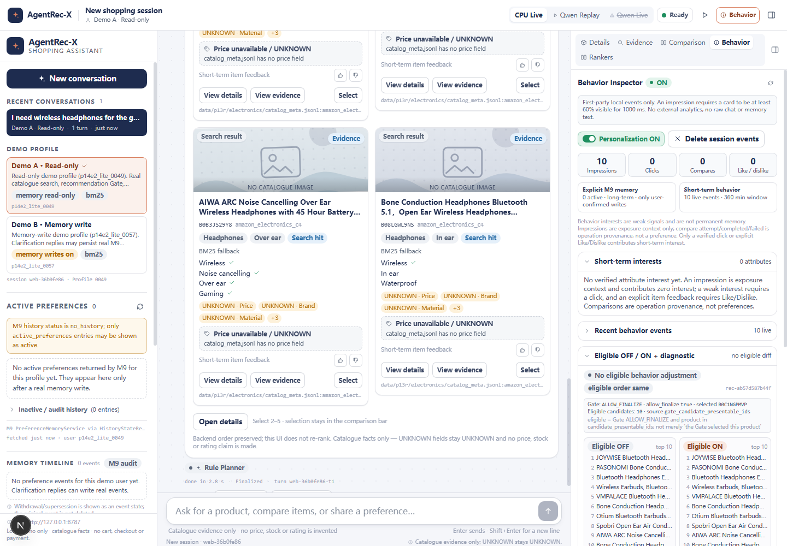
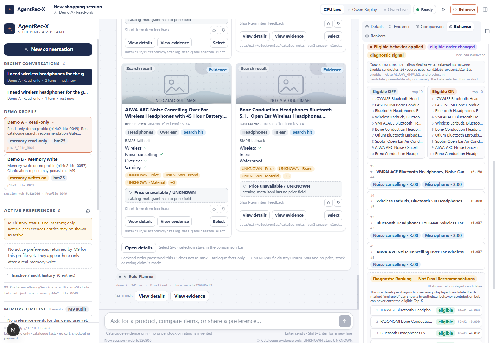
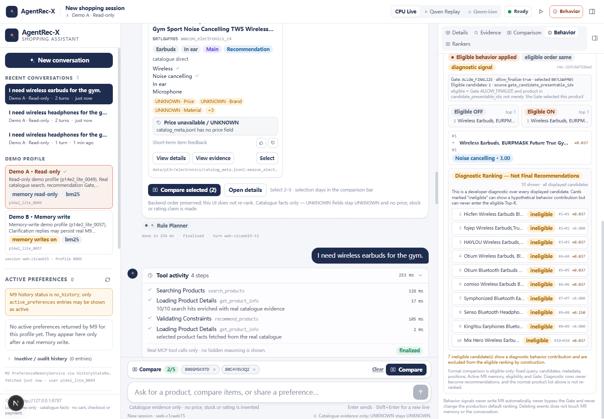
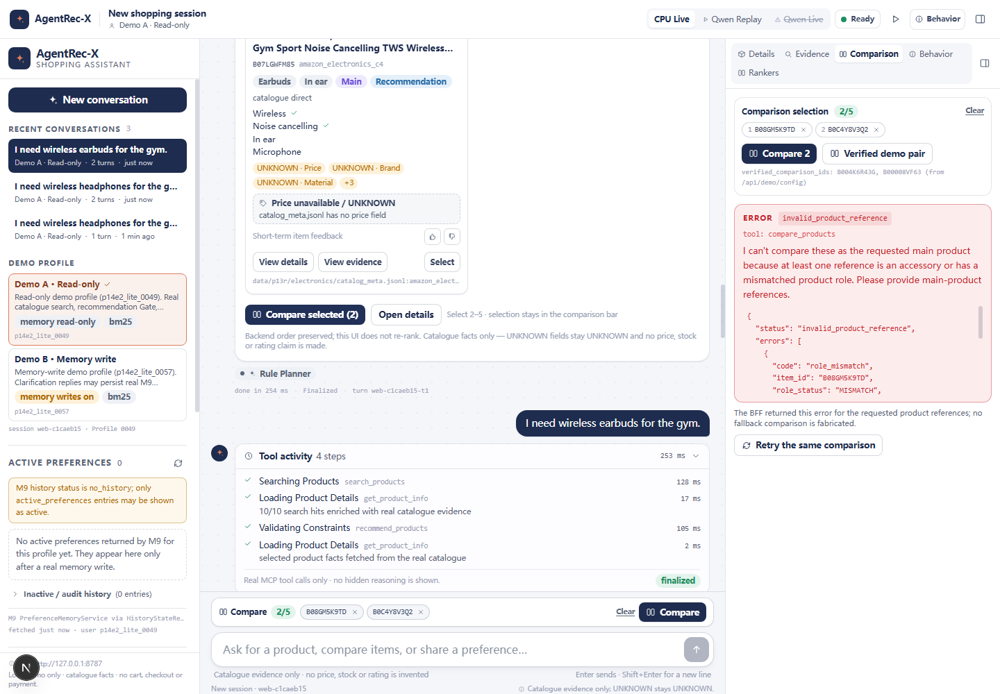

# AgentRec-X — Behavior Feedback V1.1 Report

Status: **IMPLEMENTED and browser-verified** (2026-11-17).  
Base: Behavior Feedback V1 commit `c9c1f0e`.  
Scope: correct signal semantics, compare lifecycle, eligible-only Behavior Shadow, and an
independent human-preference review harness.  No new recommendation model, no CTR/CVR model, no
Behavior V2 platform, no GPU/Qwen run, no production Scorer/Planner/Gate change, no Git push.

## 0. Executive answers to the ten required questions

| # | Question | Answer |
|---|---|---|
| 1 | Did V1 Impression actually contribute positive interest? | **Yes.** V1 used `product_impression = 0.15` and added it to product, verified-attribute and category scores. |
| 2 | After the fix, is impression-only interest zero? | **Yes.** Scenario A: 10 real impressions, 0 product interests, 0 attribute interests; eligible ON = OFF. |
| 3 | What exactly caused compare `role_mismatch`? | The BFF did not pass the session's current query to the MCP comparison tool, so P16 inferred the target from the static fixture query (`...earbuds...`); the compared cards were `product_type=headphones`, hence role MISMATCH. |
| 4 | Are Attempt / Completed / Failed distinguished? | **Yes.** Scenario C recorded 2 attempts, 1 completed, 1 failed; failed carries a real `failure_code` and is never counted as completed. |
| 5 | What does `gate_eligible=false` mean? | Only “not in the Gate-issued `candidate_presentable_ids` on an `ALLOW_FINALIZE` decision”. The BFF does not encode the per-item reason, so the UI must not claim a specific hard-constraint violation. |
| 6 | Can ineligible products enter the Eligible Top-K? | **No by construction.** Scenario D: Gate had 1 eligible candidate, 11 diagnostic candidates, 7 ineligible candidates with diagnostic signal; eligible ranking contained only the one Gate-eligible product. `hard_constraint_violations=0`, `eligibility_unchanged=true`. |
| 7 | Can Behavior ON affect Eligible Candidate ranking? | **Yes, when ≥2 eligible candidates exist.** Scenario B: 10 eligible candidates; clicked/Liked `B07FLZN4CW` moved #5 → #4 with +0.149932 contribution. |
| 8 | Are Session Isolation and Personalization OFF correct? | **Yes.** Fresh Session E had 6 impressions / 0 clicks and no inherited profile; OFF returned 409 `behavior_disabled`, empty profile, normal products still available. |
| 9 | Were real human preference labels collected? | **No.** `human_review_count=0`; one real eligible-only case is prepared for review. No rule/LLM labels were generated. |
| 10 | Is there evidence Behavior ON ranks better than OFF? | **No.** Only engineering correctness and a ranking effect are demonstrated. `preference_lift = unavailable_no_human_labels`. |

## 1. Signal semantics audit (Task A)

Full machine-readable audit:
[`../runs/behavior_feedback_v11/signal_semantics_audit.json`](../runs/behavior_feedback_v11/signal_semantics_audit.json).

### V1 finding (actual code, not assumption)

V1 commit `c9c1f0e`, `web_demo/behavior.py`:

```python
EVENT_WEIGHTS = {
    "product_impression": 0.15,
    "product_click": 1.0,
    "product_compare": 1.0,
    "explicit_like": 2.0,
    "explicit_dislike": -2.0,
}
```

The profile loop applied that weight to:

- `product_scores[product_id]`;
- every `verified_attributes` entry of the impressed product → `attribute_scores`;
- `category_scores` when the weight was positive.

So a mere visible impression could create positive attribute interest. V1 also treated a compare
event as a `1.0` positive interest on every compared product. This was a real semantics defect.

V1 real evidence: 13 live events (10 impressions, 1 click, 1 compare, 1 Like) produced **7**
verified attribute interests, including attributes of products that were only impressed.

### V1.1 fixed semantics

| Event | Weight in profile | Product interest | Attribute interest |
|---|---|---|---|
| Impression | **0.0** | no | no |
| Click | 1.0 (decayed) | weak attention | weak, verified-only |
| Compare attempted | **0.0** | no | no |
| Compare succeeded | **0.0** | no | no |
| Compare failed | **0.0** | no | no |
| Like | +2.0 | explicit item-level positive | weak, verified-only |
| Dislike | −2.0 | explicit item-level negative | weak, verified-only |

Impression is retained for exposure context, click association, visible-position analysis and future
exposure-bias work; it is **not** treated as negative feedback.

V1.1 live evidence:

- Scenario A (impression only): 10 impressions → 0 product interests, 0 attribute interests.
- Scenario B (click + Like): 12 impressions + 1 click + 1 Like → 4 verified attribute interests,
  all sourced from `product_click` / `explicit_item_feedback`; the click had a matching impression
  (`click_after_impression=1`), but the impression itself was not an interest source.

Repeated clicks are capped per product (2 counted clicks), attribute evidence requires a verified
P15 evidence id, and the exponential decay half-life is 30 minutes. These are fixed rules, not
tuned on P20/P100.

## 2. Compare lifecycle (Task B)

Full audit:
[`../runs/behavior_feedback_v11/compare_lifecycle_diagnostics.json`](../runs/behavior_feedback_v11/compare_lifecycle_diagnostics.json).

### Root cause found

The BFF's `POST /api/products/compare` called the MCP `compare_products` tool with only
`product_refs` and `session_id`. The MCP tool then called `ctx.current_task()` without a query,
which used the server fixture's static `current_query` (an earbuds request) for P16 role inference.
The selected cards had trusted `product_type=headphones`; P16 correctly returned `role_mismatch`.
This was an adapter/context bug, not a reason to bypass P16.

### Minimal fix

- MCP `compare_products` accepts an optional `query` argument and passes it into
  `ctx.current_task(query)`;
- BFF tracks `Session.last_query` and passes it for both compare paths;
- P16 role checks, role rules, comparison skill and Gate thresholds are unchanged.

After the fix:

- Compare with an earbuds query and headphone cards still returns the real
  `invalid_product_reference / role_mismatch` failure (role check retained).
- Compare with a headphones query and headphone cards returns `comparison_ready`.
- No fake success, no role bypass.

### Event lifecycle

One event type `product_compare` with metadata:

```json
{
  "compared_product_ids": ["...", "..."],
  "compare_id": "cmp-...",
  "action_status": "attempted|succeeded|failed",
  "failure_code": "...",
  "failure_message": "..."
}
```

- Attempt is queued before the API call; zero interest.
- Result is queued after the real P16 result with the same `compare_id`.
- Failed requires `failure_code`; it is never counted as completed.
- A late attempt event cannot downgrade an already-recorded result (server timestamp ties).
- Completed compare still has **zero** interest weight; it does not imply liking every compared
  product.

Browser evidence:

```text
Scenario C failed compare:
  counts: attempted=1 completed=0 failed=1
  error: invalid_product_reference
  errors: role_mismatch (B08GM5K9TD, B0C4Y8V3Q2)

Scenario C successful compare:
  counts: attempted=2 completed=1 failed=1
  P16 UI: comparison_ready, round-trip 379 ms
```

## 3. Eligibility semantics and eligible-only ranking (Task C)

Full audit:
[`../runs/behavior_feedback_v11/eligibility_semantics_audit.json`](../runs/behavior_feedback_v11/eligibility_semantics_audit.json).

### What `gate_eligible` means

`recommendation/preference/decision_gate.py:296` builds:

```python
presentable = [c for c in candidates if _hard_tier(c) == 0 and role_ok(c)]
```

and on `ALLOW_FINALIZE` returns up to 10 of those as `candidate_presentable_ids` (line 449).
Therefore:

- `gate_eligible=true` = Gate allows finalization and this product is in that set;
- `gate_eligible=false` = it is not in that set; the BFF payload does **not** provide the exact
  per-item reason (hard tier, role mismatch, unknown, or outside examined scope), so the UI must not
  infer one;
- it is not equivalent to “the Gate selected this product”.

V1's expression `(not presentable) or product_id in presentable` would mark all products eligible
when the list was empty and allowed ineligible items to move in the same ranking. V1.1 removes that.

### Two ranking spaces

- **Eligible Recommendation Ranking (formal OFF/ON)** — only Gate `ALLOW_FINALIZE` products in
  `candidate_presentable_ids`. Ineligible products cannot enter this Top-K.
- **Diagnostic Candidate Ranking** — every displayed candidate, explicitly labelled
  `Diagnostic Ranking — Not Final Recommendations`; it may show hypothetical behavior contribution
  for ineligible candidates but never feeds a recommendation list.

Real browser evidence:

```text
Scenario B:
  eligible candidates = 10
  clicked B07FLZN4CW: eligible OFF #5 → ON #4 (+0.149932)

Scenario D (earbuds query):
  Gate ALLOW_FINALIZE, selected B07LGWFM85
  candidate_presentable_ids = [B07LGWFM85]
  eligible_candidate_count = 1
  diagnostic_candidates = 11
  ineligible candidates with diagnostic signal = 7
  eligible ranking ids = [B07LGWFM85]
  hard_constraint_violations = 0
  eligibility_unchanged = true
```

The clicked ineligible product (Senso) appears in the diagnostic list as #9 → #8 with a diagnostic
contribution, but is absent from the eligible ranking. That is the intended outcome.

## 4. Human preference validation (Task D)

Full package: [`../runs/behavior_feedback_v11/`](../runs/behavior_feedback_v11/).

The existing blind-review approach was reused, not replaced: a small HTML page in the same A/B,
BOTH, INSUFFICIENT style was generated from real V1.1 data. It shows:

- current query;
- active explicit M9 memory;
- behavior summary;
- verified product attributes/evidence;
- eligible-only A/B top-K lists.

It hides OFF/ON identity, scores, ranker identity and original rank labels. The private A/B mapping
is in `human_review_mapping.json` (not shown in the review page).

Real-data selection:

- only **one** recommendation in this run had ≥2 eligible candidates and an eligible ranking change
  (Scenario B), so only one case was prepared. No synthetic sessions were replicated to inflate the
  count.
- `human_review_count = 0`, `valid_judged_cases = 0`, `preference_lift =
  unavailable_no_human_labels`. No rule or LLM labels were generated.

To collect real labels:

1. open `runs/behavior_feedback_v11/blind_review_tool.html`;
2. choose A / B / BOTH / INSUFFICIENT;
3. export the CSV to `runs/behavior_feedback_v11/behavior_v11_review_results.csv`;
4. rerun `scripts/build_behavior_feedback_v11_evidence.py` (or the importer helper) to compute
   OFF wins, ON wins, BOTH, INSUFFICIENT and agreement.

## 5. Real browser acceptance (Task F)

Run: real headless Chrome 157.0.8103.78 via CDP, 1440×1000; Next.js 16.4.5; FastAPI BFF in WSL;
BM25 fast dev mode; no Qwen/GPU; CPU only.

| Scenario | Session | Observed |
|---|---|---|
| A — Impression only | `web-36b0fe86` | 10 impressions, 0 clicks, 0 product/attribute interests, 10 eligible, ON=OFF |
| B — Click + Like + next shadow | `web-fe326906` | 12 impressions, 1 click, 1 Like, 4 verified interests; eligible OFF/ON changed; point-in-time previous shadow had no behavior signal |
| C — Compare attempt/failure/success | `web-c1caeb15` | 2 attempts, 1 completed, 1 failed; real `role_mismatch` failure and real `comparison_ready` success |
| D — Ineligible diagnostic | same as C | 1 eligible, 11 diagnostic, 7 ineligible with diagnostic signal, no ineligible in eligible ranking |
| E — Session isolation | `web-1ab08489` | 6 impressions, 0 clicks, no inherited behavior signal |
| F — Personalization OFF | same as E | events endpoint 409 `behavior_disabled`; profile disabled; normal recommendation still loaded |

Screenshots (real):









Raw evidence: `runs/behavior_feedback_v11/browser_e2e.json`, `eligible_off_on_comparison.json`.

The browser console contains exactly one expected HTTP 400 from the intentionally failed compare;
it is not a hidden success and not a runtime error in the behavior chain.

## 6. Tests and build

```bash
.venv/bin/python -m pytest -q \
  tests/test_behavior_feedback.py \
  tests/test_web_demo_unit.py \
  tests/test_qwen_live_bff.py \
  tests/test_demo_api.py \
  tests/test_demo_sessions.py \
  tests/test_docs.py
# 231 passed in 39.36s

cd web && pnpm exec tsc --noEmit   # PASS
cd web && pnpm exec next build     # PASS
```

The behavior test file covers:

- impression zero interest;
- click / Like / Dislike semantics;
- compare attempt / success / failure lifecycle and ordering;
- repeated click caps and time decay;
- verified-attributes-only interests;
- explicit-memory conflict and withdrawn-preference suppression;
- empty-profile ON=OFF;
- eligible-only ranking and ineligible diagnostic exclusion;
- Gate not-finalizable empty eligible ranking;
- session isolation, replay/synthetic exclusion, disabled session;
- compare query adapter propagation and M9 no-auto-write.

## 7. Engineering boundaries

Kept unchanged:

- production `PreferenceAwareScorer`;
- production Planner and Decision Gate thresholds;
- P18, P20, P100;
- existing BGE index and asset artifacts;
- Qwen/ShopRanker/DCN training (none);
- Git push (none).

Allowed and made:

- Behavior V1 event/profile/shadow semantics;
- small BFF/MCP compare adapter fix (pass current session query; P16 role rules unchanged);
- Behavior Inspector display;
- tests and evidence harness;
- local Git commit only.

Not claimed:

- no CTR, conversion, revenue or user-satisfaction lift;
- no IPS/SNIPS/DR (no propensity log);
- no quality superiority of Behavior ON;
- no generalization from one browser session;
- no human labels.

## 8. Artifacts

Generated under `runs/behavior_feedback_v11/`:

```text
signal_semantics_audit.json
compare_lifecycle_diagnostics.json
eligibility_semantics_audit.json
behavior_profile_before_after.json
eligible_off_on_comparison.json
browser_e2e.json
human_review_tasks.jsonl
human_review_results.json
experiment_manifest.json
blind_review_tool.html
human_review_template.csv
human_review_mapping.json
*.png
```

Code:

```text
web_demo/behavior.py
web_demo/app.py
web_demo/config.py
web_demo/demo_flow.py
web_demo/sessions.py
web/lib/behavior.ts
web/lib/types.ts
web/components/BehaviorInspector.tsx
web/components/DemoApp.tsx
recommendation/mcp/server.py   (optional compare query adapter only)
tests/test_behavior_feedback.py
scripts/behavior_feedback_browser_e2e.mjs
scripts/build_behavior_feedback_v11_evidence.py
```

## 9. Next step

Collect real blind-review labels for the prepared case(s), then report OFF/ON wins or BOTH/
INSUFFICIENT honestly.  Only after a real impression/click log with a stochastic policy exists
should propensity/IPS/DR evaluation be attempted.  Until then, V1.1 is an engineering-correct,
eligible-only shadow and evaluation harness — **not** evidence of better recommendation quality.
