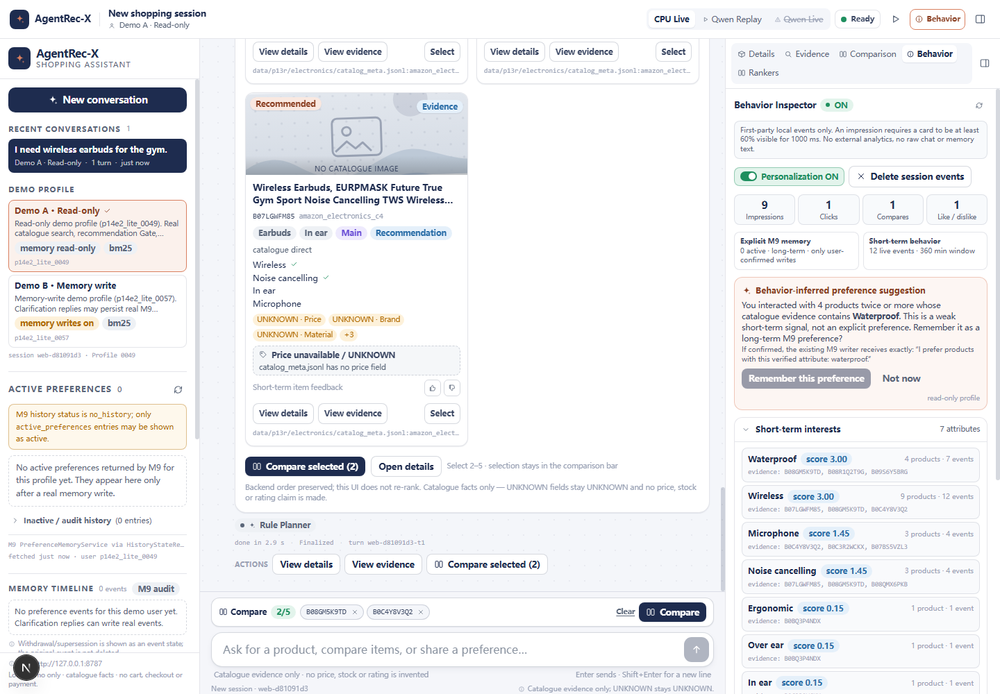
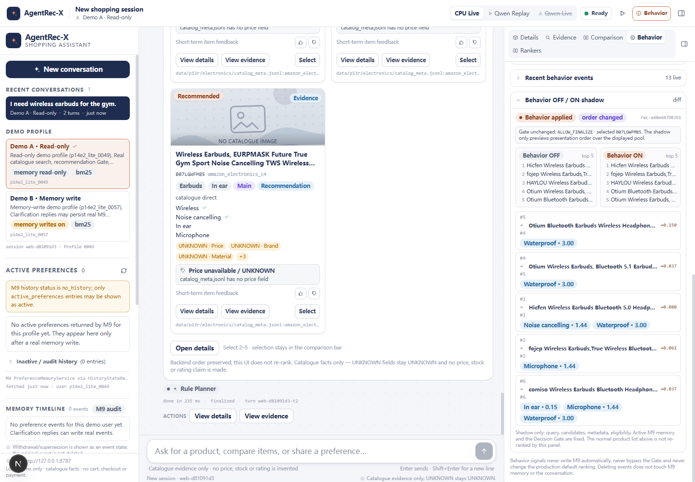
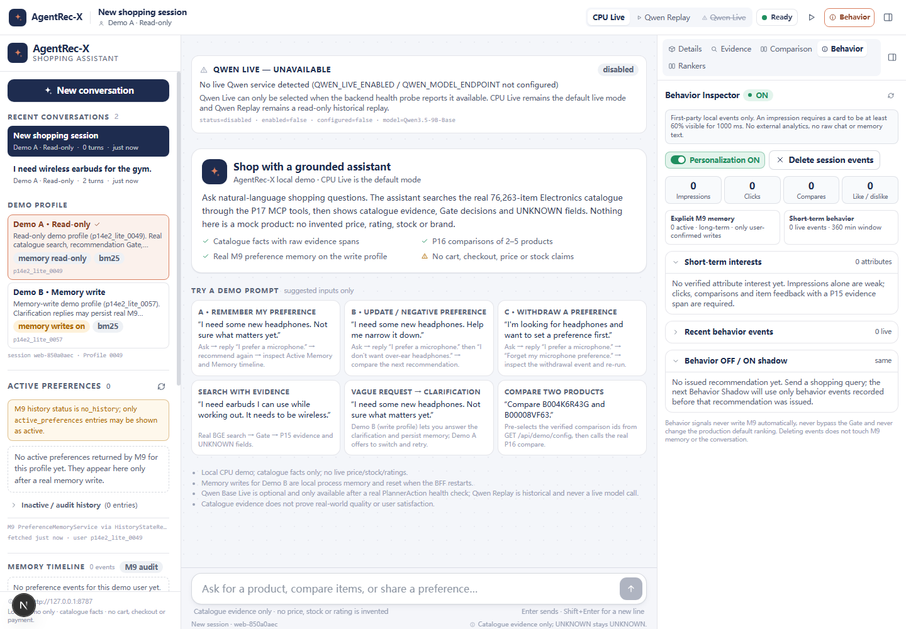

# AgentRec-X — Behavior Feedback V1 Report

Status: **IMPLEMENTED and browser-verified** (2026-11-17).  
Scope: real shopping-event collection → short-term behavior profile → switchable Behavior-Aware
Ranking Shadow.  No model retraining, no production Scorer/Planner/Gate/P18 change, no BGE rebuild,
no P100 expansion, no Kafka/Flink/Feast, and no second recommendation platform.

Related documents:

- [`BEHAVIOR_FEEDBACK_TECH_SELECTION.md`](BEHAVIOR_FEEDBACK_TECH_SELECTION.md) — public references,
  reuse-first decision and privacy boundaries.
- [`WEB_DEMO_CONTRACT.md`](WEB_DEMO_CONTRACT.md) — updated BFF/API/view-model contract.
- [`../runs/behavior_feedback_v1/browser_e2e.json`](../runs/behavior_feedback_v1/browser_e2e.json)
  — raw machine-readable evidence from the recorded browser run (git-ignored runtime artifact).

## 1. Outcome

The completion criterion was met with a real browser session:

> a real product view / click / comparison was recorded, attributed to the issued recommendation,
> aggregated into an explainable short-term interest, and used by the next Behavior Shadow ranking
> without changing the production default list or the explicit M9 memory.

Recorded run:

| Item | Value |
|---|---|
| Browser | real headless Chrome 157.0.8103.78 via DevTools Protocol, 1440×1000 |
| Frontend | Next.js 16.4.5 at `127.0.0.1:3000` |
| BFF | FastAPI at `127.0.0.1:8787`, WSL Ubuntu-22.04, CPU |
| Retrieval mode for this run | `bm25` fast dev mode (BGE was not rebuilt; event chain is retrieval-independent) |
| Qwen/GPU | not used; Qwen Live unavailable, GPU 0 MiB |
| Session A | `web-d81091d3` (final E2E run) |
| Session B | `web-850a0aec` (fresh conversation, same browser) |
| Captured evidence | 11 rendered cards → 10 impressions (visibility gate, not Top-K); 1 click, 1 compare action, 1 Like |
| Profile | 7 verified attribute interests, top: Waterproof, Wireless, Microphone, Noise cancelling |
| Behavior suggestion | Waterproof (4 products, 7 evidence events), no automatic M9 write |
| Next shadow | `rec-a48e44798391`; `applied=true`, `order_changed=true` |
| Movement | clicked item `B09S6Y5BRG`: OFF rank **5 → 4**, contribution **+0.150** |
| Gate | `ALLOW_FINALIZE`, selected `B07LGWFM85` — **unchanged** |
| Session isolation | Session B profile: **0 events**, 0 interests, no shadow history |

Screenshots (real run, copied for docs):







## 2. Reuse-first technical selection

The full comparison is in `BEHAVIOR_FEEDBACK_TECH_SELECTION.md`.  Summary:

| Candidate | Decision |
|---|---|
| PostHog / Snowplow / Segment SDK | **Not used** — external key, autocapture/session-recording risk, offline requirement |
| Kafka / Flink / Redis / event platform | **Not used** — no multi-node need; local SQLite is sufficient |
| AWS Retail Demo Store | design reference only; archived; no migration |
| Amazon Personalize event model | borrowed user/session/item, recommendation id, impression context |
| Snowplow ecommerce taxonomy | borrowed product-list view/click/detail and item position ideas |
| Open Bandit Pipeline / IPS | future only; **no propensity log → no fake IPS/SNIPS/DR** |
| Transformers4Rec / RecBole | sequence-modeling reference only; **no new model trained** |

Reused components:

- Next.js/React shopping UI, product cards, right context panel, chat composer;
- FastAPI BFF, `extra="forbid"` request conventions, exception mapping;
- opaque session ids and the existing per-session M9 namespace (no new memory store);
- existing MCP `remember_preference` → `PreferenceMemoryService` path for a user-confirmed write;
- existing `ProductsPayload`, `get_product_info`, P15 evidence spans and Gate output;
- existing Replay/read-only distinction (replay is never a live interaction).

## 3. Data path

```text
Browser (Next.js)
  IntersectionObserver (>=60% visible, >=1000 ms)
  card click / Compare / Like-Dislike
        │  batched whitelisted events (no raw text, no user id)
        ▼
FastAPI BFF
  session ownership check
  recommendation snapshot lookup (server-issued rec id + positions)
  schema + position/product validation
  idempotency (event_id; impression key)
        │
        ▼
SQLite behavior store (runs/web_demo/behavior/events.sqlite3)
        │
        ├──> GET /api/behavior/profile  (short-term interests, evidence, counts)
        └──> GET /api/behavior/shadow   (fixed-pool OFF/ON preview)
                    │
                    └── active M9 preferences via existing MCP get_active_preferences
```

The production `ProductsPayload.items` order is **never modified** by this path.  A Behavior Shadow
is a separate preview over the exact frozen candidate pool.

## 4. Event schema

All events carry: `event_id`, `event_type`, opaque `session_id` (request envelope), server-derived
`request_id`/`turn_id`, `recommendation_id`, `product_id`, `displayed_position`, `ranker_version`,
server timestamp and `event_source`.

| Type | Trigger | Metadata | Attribution |
|---|---|---|---|
| `product_impression` | card actually visible in browser | none | dedupe `(session, recommendation, product)` |
| `product_click` | user opens details/evidence | none | must match issued position |
| `product_compare` | real compare action | `compared_product_ids` (2–5) | all ids in one issued list |
| `explicit_item_feedback` | Like/Dislike on a card | `feedback: like|dislike` | never an M9 preference |

Sources: `LIVE_USER_INTERACTION`, `RECORDED_REPLAY`, `SYNTHETIC_TEST`.  Only live events enter the
profile; replay/synthetic rows are stored with provenance and counted separately as excluded.

Important non-decisions:

- backend Top-K is **not** an impression; only browser visibility counts;
- a new displayed list gets a new `recommendation_id`;
- a compare event is recorded even if the later P16 comparison skill returns a real error; it is the
  user action that is measured, not the skill's success;
- an explicit Like/Dislike does not call M9 and does not become a long-term preference.

## 5. Short-term behavior profile

Fixed, declared rules (not tuned on P20/P100):

- window: 6 h (`AGENTRECX_BEHAVIOR_WINDOW_S`, default 21600);
- exponential decay half-life: 30 min (`AGENTRECX_BEHAVIOR_HALF_LIFE_S`, default 1800);
- event weights: impression 0.15, click 1.0, compare 1.0, Like +2.0, Dislike −2.0;
- per-product caps: 1 impression, 2 clicks, 2 compares, 1 feedback event; total product score ±3;
- attribute score cap ±3; top 8 attribute interests; repeated clicks cannot accumulate unbounded;
- attribute-level interests only from verified P15 evidence ids; a present catalogue flag without
  evidence contributes nothing.

Final browser run profile (after the recording stopped):

```text
13 live events (10 impressions, 1 click, 1 compare, 1 Like, 0 Dislike)
7 verified attribute interests:
  Waterproof       score 3.00  4 products / 7 events
  Wireless         score 3.00  9 products / 12 events
  Microphone       score 1.45  3 products / 4 events
  Noise cancelling score 1.45  3 products / 4 events
  Ergonomic        score 0.15  1 product / 1 event
  Over ear         score 0.15  1 product / 1 event
  In ear           score 0.15  1 product / 1 event
suggestion: Waterproof (4 products, 7 evidence events), requires explicit confirmation
```

The profile endpoint also returns `recent_viewed`, `recent_compared`, `recent_explicit_feedback`,
`recent_categories`, per-product scores and per-attribute evidence refs.  Every interest explicitly
names the product ids and P15 evidence ids that produced it.

## 6. Behavior-Aware Ranking Shadow

`GET /api/behavior/shadow?session_id=...&recommendation_id=...` produces:

- `base_ranking` (production order, no behavior);
- `behavior_ranking` (same candidates/metadata/query/positions/eligibility/Gate);
- per-row `base_score`, `behavior_contribution`, `final_shadow_score`,
  `matched_attribute_interests`, `ignored_common_attributes`, `suppressed_reason`,
  `gate_eligible`, `gate_selected`;
- `changes` with movement and evidence.

Fixed shadow policy:

- behavior weight 0.15 of the rank-normalised score range;
- product-level signal weight 0.75, attribute signal 0.25;
- attribute interests covering >60% of the fixed pool are ignored (ubiquitous attributes such as
  “wireless” say little about one product);
- explicit active preferences suppress behavior for the affected attribute/item; withdrawn/inactive
  values are never resurrected from old clicks;
- no behavior data ⇒ ON = OFF;
- behavior never writes M9, never changes the Gate action/selected id/eligibility flags, and never
  changes the production list.

Recorded next-recommendation result:

```text
recommendation rec-a48e44798391
applied = true, order_changed = true
Gate: ALLOW_FINALIZE, selected B07LGWFM85 (unchanged)
OFF top 5:  B08GM5K9TD, B0C4Y8V3Q2, B08QMX6PKB, B08R1Q2T9G, B09S6Y5BRG
ON  top 5:  B08GM5K9TD, B0C4Y8V3Q2, B08QMX6PKB, B09S6Y5BRG, B08R1Q2T9G
movement:   B09S6Y5BRG  #5 → #4, behavior contribution +0.150
            (clicked and Liked in the previous turn; Waterproof 3.00 evidence)
```

The clicked item is marked `gate_eligible=false` in the shadow because the Gate only marked the
selected `B07LGWFM85` as presentable.  The shadow does not make it a Gate recommendation; it is a
labelled presentation-order preview over the already-displayed pool.  This is the explicit trade-off
that lets the demo show a measurable difference while keeping Gate output byte-identical.
Automated tests assert the shadow response's `hard_constraint_violations=0` and
`eligibility_unchanged=true` invariants.

Point-in-time protection: the shadow profile uses events with
`occurred_at <= recommendation.created_at`.  A click after a recommendation therefore cannot leak
into that recommendation's shadow; it only affects the next one.

## 7. Session isolation

- Session A and B are different browser conversations with different opaque ids.
- Session B's behavior profile: `live_events=0`, no interests, no events, no shadow history.
- A behavior event submitted with another session's `recommendation_id` is rejected with
  `unknown_recommendation` (tested).
- Deleting session A's behavior events leaves session B's events untouched (tested).
- The browser never sends `user_id`; the BFF uses only the server-issued session/profile scope.
- The existing M9 memory namespace remains session-scoped and unchanged.

## 8. Memory confirmation loop

The profile returns a `suggestion` object with:

```json
{
  "attribute": "waterproof",
  "label": "waterproof",
  "distinct_products": 4,
  "evidence_count": 7,
  "message": "I prefer products with this verified attribute: waterproof.",
  "inferred_from_behavior": true,
  "requires_confirmation": true
}
```

Rules implemented:

- the suggestion is clearly labelled as a behavior inference;
- nothing is written to M9 by profile generation, event ingestion or shadow computation;
- `Remember this preference` calls the **existing** `remember_preference` M9 path only after the
  user click; `Not now` writes nothing;
- the read-only demo profile disables the write button and states “read-only profile” (the demo
  does not pretend to persist memory on a read-only MCP server);
- a written preference is not a click/compare conversion; no claim of automatic preference learning
  is made.

Unit coverage verifies that merely generating the suggestion makes **no** `remember_preference`
MCP call, while the explicit confirmation endpoint does call it.  The browser run used the read-only
Demo A profile, so the actual browser write path was intentionally not exercised there.

## 9. Tests and commands

Executed (WSL, project venv):

```bash
.venv/bin/python -m pytest -q \
  tests/test_behavior_feedback.py \
  tests/test_web_demo_unit.py \
  tests/test_qwen_live_bff.py \
  tests/test_demo_api.py \
  tests/test_demo_sessions.py \
  tests/test_docs.py
# 220 passed in 28.64s
```

Frontend:

```bash
cd web && pnpm exec tsc --noEmit
# PASS
```

Browser E2E:

```bash
# BFF (WSL, fast BM25 development mode for this run)
AGENTRECX_WEB_DEMO_SEARCH_MODE=bm25 \
AGENTRECX_WEB_DEMO_ALLOW_MEMORY_WRITES=1 \
bash scripts/run_web_demo_bff.sh

# Chrome with remote debugging on 9222 (launcher used a fresh temporary profile)
node scripts/behavior_feedback_browser_e2e.mjs
```

The E2E script writes `runs/behavior_feedback_v1/browser_e2e.json` plus the screenshots under
`runs/behavior_feedback_v1/`.  The three important screenshots are copied to
`docs/assets/web_demo/`.

New automated tests cover:

- impression validation, duplicate event/impression idempotency, wrong position/product/recommendation;
- session A/B rejection and delete isolation;
- replay/synthetic exclusion from profile counts/interests;
- verified-evidence-only attribute interests;
- no-data shadow equality;
- point-in-time shadow (old recommendation ignores later events; next recommendation moves a tail item);
- explicit negative preference suppression;
- disabled-session event rejection and empty profile;
- hard-constraint/Gate immutability (`gate_eligible` flags, Gate copied unchanged);
- suggestion requires confirmation and does not call the M9 writer automatically.

## 10. What cannot be claimed

- **No CTR / conversion / revenue lift.**  There is no production traffic, no conversion target and
  no controlled online experiment.  The demo has clicks and Likes, not purchase events.
- **No IPS/SNIPS/DR or unbiased evaluation.**  No propensity was logged; no such metric is computed.
- **No claim that behaviour improves recommendation quality.**  The shadow shows a reproducible
  ranking difference under a fixed policy, not a quality gain.
- **One local user/session pair is not evidence of generalization.**  The browser run is a
  functional end-to-end verification, not a user study.
- **The comparison skill returned a real `invalid_product_reference` / `role_mismatch` error** for
  the selected search-result pair; the UI displayed that error and the `product_compare` action was
  still recorded with provenance.  A successful P16 comparison was not claimed for that pair.
- **BM25 fast mode was used for this browser run.**  The event/profile/shadow path is independent
  of retrieval mode; the default BGE path was not rebuilt or re-evaluated here.
- **Behavior feedback is not a production auth system.**  The local demo authorizes by opaque
  server-issued session capability, not by user login.

## 11. Files

Created:

- `web_demo/behavior.py` — SQLite event store, validation, profile, suggestion, shadow;
- `web/lib/behavior.ts` — first-party tracker, batching, retry, IntersectionObserver hook;
- `web/components/BehaviorInspector.tsx` — Behavior tab/inspector;
- `tests/test_behavior_feedback.py` — 10 backend tests;
- `scripts/behavior_feedback_browser_e2e.mjs` — real Chrome/CDP E2E;
- `docs/BEHAVIOR_FEEDBACK_TECH_SELECTION.md` — reference review and selection.

Modified:

- `web_demo/app.py` — 5 behavior endpoints, behavior config, exception mapping;
- `web_demo/config.py` — behavior settings/env and public config;
- `web_demo/demo_flow.py` — server-issued recommendation ids and frozen snapshots at every product
  emission;
- `web_demo/sessions.py` — session behavior switch and recommendation snapshot cache;
- `web_demo/viewmodels.py` — `displayed_position`, `recommendation_id`, `request_id`, ranker version;
- `web/components/DemoApp.tsx`, `ProductsBlock.tsx`, `ProductCard.tsx`, `RightPanel.tsx`,
  `Header.tsx`, `icons.tsx` — tracker wiring, impression observer, item feedback, Behavior tab/
  header action;
- `web/lib/api.ts`, `web/lib/types.ts` — behavior endpoints and view-model types;
- `docs/WEB_DEMO_CONTRACT.md` — behavior API/schema and the shadow exception to “no re-ranking”.

Runtime artifacts (git-ignored): `runs/web_demo/behavior/events.sqlite3`,
`runs/behavior_feedback_v1/`.

## 12. Next step

Only after a real impression/click log with a stochastic logging policy exists should the project
consider propensity-based off-policy evaluation (Open Bandit Pipeline / IPS / SNIPS / DR).  Until
then, the honest next step is to keep the shadow experimental, collect more real sessions, and
report event-chain health rather than recommendation-quality claims.
