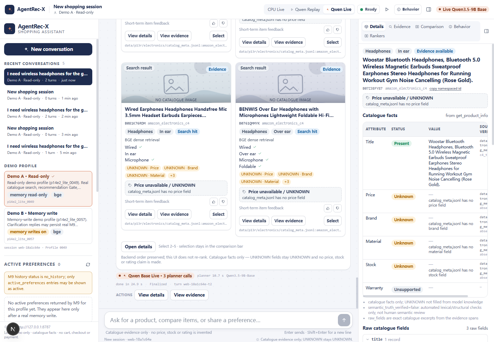

# AgentRec-X — Behavior Feedback V2
## GPU Live Agent End-to-End Integration & Evaluation

Status: **IMPLEMENTED and verified** (2026-11-17); local commit only, not pushed.  
Scope: real Qwen3.5-9B Base GPU Live + real BGE retrieval + MCP + M9 + Behavior
Profile + eligible-only shadow + Decision Gate, with a 100-scenario automated E2E run.
No model training/retraining, no BGE index rebuild, no production Scorer/Gate change, no Git push.

## 0. Answers to the ten required questions

| # | Question | Answer |
|---|---|---|
| 1 | Did Qwen3.5-9B Live Planner really run? | **Yes.** Real remote RTX 4090 inference returned `RETRIEVE → RERANK → FINALIZE` (and real `ASK` turns); 31 Qwen turns, 31 raw action traces, 0 parser errors, 0 silent Rule fallback. |
| 2 | Did BGE retrieval really execute online? | **Yes.** All 136 retrieval turns reported `search_mode=bge`, `score_kind=bge_dense`, top-10 BGE candidates. No turn fell back to BM25. |
| 3 | Did Browser → Behavior → next recommendation work? | **Yes.** Real Chrome + Qwen Live + BGE completed two turns; browser click + Like produced 12 automated profile events; the next recommendation was frozen and its eligible shadow computed. |
| 4 | Are automated and human behavior isolated? | **Yes.** All 82 automated events are `AUTOMATED_BROWSER_E2E`; human LIVE counts are 0. The API reports them separately and human-preference statistics use LIVE only. |
| 5 | How many eligible-comparable OFF/ON cases? | **42** scenarios had ≥2 eligible candidates; **58** were excluded from ranking comparison (mostly 0 eligible). |
| 6 | How many real Eligible Ranking changes? | **2 / 42** comparable scenarios: `v2-022`, `v2-028`, each moved the same product **#5 → #4** with contribution `0.14998`. |
| 7 | Is M9 explicit memory free of weak behavior pollution? | **Yes.** Explicit update/add and withdrawal/remove were observed (2 active after update; 1 active + 1 inactive after withdrawal); behavior events did not change M9 state. |
| 8 | Did Gate remain authoritative? | **Yes.** 54 `ALLOW_FINALIZE`, 40 `NEED_USER_CLARIFICATION`, 6 `NEED_MORE_PRODUCT_EVIDENCE`; 0 hard-constraint violations and 0 eligibility changes. |
| 9 | What are the real latencies? | Qwen planner **p50 11.17 s / p95 14.23 s** per turn; Qwen turn total **p50 17.98 s / p95 24.77 s**; BGE retrieval **p50 159.64 ms / p95 187.18 ms**; Behavior profile **p50 15.51 ms**; shadow **p50 18.16 ms**. GPU peak 19,491 MiB. |
| 10 | Is there independent human preference evidence? | **No.** `human_review_count=0`; `preference_lift=unavailable_no_human_labels`. Automated clicks and Qwen judgments are not human gold. |

## 1. Real Qwen Live GPU chain

### 1.1 Environment

- Remote AutoDL GPU: `NVIDIA GeForce RTX 4090`, 24,564 MiB, driver 580.76.05.
- Model: `/root/autodl-tmp/models/Qwen3.5-9B-ms`, Qwen3.5-9B **Base**, no LoRA adapter.
- Server: `training.agent_sft.model_server` on remote `127.0.0.1:18029`; process PID recorded in
  [`../runs/behavior_feedback_v2/gpu_health.json`](../runs/behavior_feedback_v2/gpu_health.json).
- Transport: existing WSL-local SSH loopback tunnel to `127.0.0.1:18029`; no public endpoint and no
  credential in evidence.
- BFF: real `POST /plan` health validation; MCP children receive the same endpoint. A Qwen failure
  would surface as an error, never a Rule fallback.

Evidence:

- [`../runs/behavior_feedback_v2/qwen_live_trace.jsonl`](../runs/behavior_feedback_v2/qwen_live_trace.jsonl)
- [`../runs/behavior_feedback_v2/environment_manifest.json`](../runs/behavior_feedback_v2/environment_manifest.json)
- [`../runs/behavior_feedback_v2/gpu_health.json`](../runs/behavior_feedback_v2/gpu_health.json)

### 1.2 Actual model-generated action trace

Example from `scenario v2-001` (real Qwen Base output, not replay):

```json
[
  {"step": 1, "action": "RETRIEVE",
   "arguments": {"query": "I need wireless headphones for the gym.", "source_policy": "balanced"}},
  {"step": 2, "action": "RERANK", "arguments": {}},
  {"step": 3, "action": "FINALIZE", "arguments": {}}
]
```

Across 31 Qwen turns:

```text
RETRIEVE 31, RERANK 32, FINALIZE 32, ASK 14
planner parser errors: 0
```

The browser screenshot shows the real Qwen Base Live badge and the same
`RETRIEVE → RERANK → FINALIZE` trace in the UI:



### 1.3 Browser Qwen Live session

Session `web-18a1c64e`:

```text
turn 1: Qwen Live, 3 planner calls, BGE/bge_dense, products returned
turn 2: Qwen Live, 3 planner calls, BGE/bge_dense, next recommendation returned
browser profile: 12 AUTOMATED_BROWSER_E2E events
  10 impressions, 1 click, 1 Like
  0 human LIVE_USER_INTERACTION events
shadow: 10 eligible candidates, eligible_ranking_changed=false
console errors: 0
```

The absence of a rank change in this browser query is reported as **ON=OFF**, not hidden.

## 2. Real BGE retrieval

- Mode: `bge`, score kind: `bge_dense`.
- Existing accepted P14-D2 index: `runs/p14d2/bge_index.npz`, 76,263 identities × 768 dims,
  SHA-256 in `bge_environment.json`; **not rebuilt**.
- Encoder: local `models/bge-base-en-v1.5`; **CPU/WSL**, not GPU.
- All 136 harness turns returned exactly top-10 BGE candidates; 0 BM25-only turns.
- BGE retrieval latency: p50 **159.64 ms**, p95 **187.18 ms**.

Real candidate example (`v2-001`, query “I need wireless headphones for the gym.”):

```text
B08CDZYJ99, B08G8CPCXN, B07D8RXD5R, B01M8L1OCY, B07Z38FY87,
B0BW5C2MLZ, B078H5TZB9, B0B6BG83B3, B097BJQY89, B01ES07NWA
```

Evidence:
[`../runs/behavior_feedback_v2/bge_retrieval_trace.jsonl`](../runs/behavior_feedback_v2/bge_retrieval_trace.jsonl),
[`../runs/behavior_feedback_v2/bge_environment.json`](../runs/behavior_feedback_v2/bge_environment.json).

Device boundary:

```text
Qwen3.5-9B planner  -> remote NVIDIA RTX 4090, real live GPU inference
BGE encoder/index   -> local CPU/WSL
FastAPI BFF/MCP     -> local CPU/WSL
```

No cached score or replay is presented as live GPU inference.

## 3. Behavior integration and provenance

V2 adds a backward-compatible source distinction:

```text
LIVE_USER_INTERACTION     human browser interaction (only human-preference statistics)
AUTOMATED_BROWSER_E2E     real Chrome execution driven by CDP automation; mechanism evidence only
RECORDED_REPLAY           historical replay, excluded from profile
SYNTHETIC_TEST            test data, excluded from profile
```

A CDP E2E run explicitly sets `window.__AGENTRECX_AUTOMATED_BROWSER_E2E__ = true`; the normal UI
never sets it. The profile returns:

```json
{
  "source_counts": {"live_user_interaction": 12, "automated_browser_e2e": 12, "...": 0},
  "profile_provenance": {
    "human_live_events": 0,
    "automated_browser_e2e_events": 12,
    "human_preference_statistics": "LIVE_USER_INTERACTION only"
  }
}
```

All 100 harness scenarios used `AUTOMATED_BROWSER_E2E`; 82/82 accepted events and 0 human events.
No automated event was written to M9 and no behavior event changed an explicit memory entry.

## 4. 100-scenario execution

Command:

```bash
.venv/bin/python scripts/behavior_feedback_v2_harness.py --all
```

Result:

```text
executed: 100
PASS:     100
FAIL:     0
Qwen Live scenarios: 21
CPU/Rule BGE scenarios: 79
Qwen Live turns traced: 31
BGE turns: 136
```

Coverage (17 categories):

```text
single-turn search, multi-turn follow-up, click + next recommendation, Like/Dislike,
Compare success, Compare failure, preference update, preference withdrawal,
explicit memory vs weak behavior, empty profile, impression-only, personalization OFF,
eligible-few, no-eligible, session A/B isolation, ASK clarification,
evidence validation
```

Gate/eligibility distribution across the first turn of the 100 scenarios:

```text
ALLOW_FINALIZE             54
NEED_USER_CLARIFICATION    40
NEED_MORE_PRODUCT_EVIDENCE  6

first-turn eligible candidate count:
 0 -> 46, 1 -> 14, 7 -> 13, 8 -> 2, 9 -> 19, 10 -> 6
```

The formal OFF/ON comparison below is computed on the frozen **next-turn** recommendation where a
second turn exists (or the current recommendation for single-turn scenarios); its eligible-count
distribution is:

```text
0 -> 44, 1 -> 14, 6 -> 1, 7 -> 12, 8 -> 1, 9 -> 15, 10 -> 13
comparable (>=2 eligible) = 42
```

Each scenario was a fresh session; no retry was used to hide failures. The harness records the
first real failure and continues.

Evidence:
[`scenario_results.jsonl`](../runs/behavior_feedback_v2/scenario_results.jsonl),
[`evaluation_summary.json`](../runs/behavior_feedback_v2/evaluation_summary.json).

## 5. Eligible OFF / ON comparison

Rules are unchanged from V1.1:

- only `ALLOW_FINALIZE` + `candidate_presentable_ids` form the formal eligible ranking;
- ineligible products appear only in the labelled diagnostic ranking;
- same query/candidates/evidence/active memory/Gate; only Behavior Profile changes;
- candidate count < 2 is excluded from ranking-change statistics.

Result:

```text
eligible-comparable scenarios: 42
eligible ranking changed:       2  (v2-022, v2-028)
eligible rank changes:
  B07Z38FY87  OFF #5 -> ON #4
  behavior contribution: +0.14998
  displaced: B01M8L1OCY  #4 -> #5
hard-constraint violations: 0
eligibility changed: 0
```

The other 40 comparable scenarios were honestly **ON = OFF**; no weight was tuned after seeing this.

Evidence:
[`eligible_off_on_comparison.json`](../runs/behavior_feedback_v2/eligible_off_on_comparison.json),
[`gate_validation.json`](../runs/behavior_feedback_v2/gate_validation.json).

## 6. Explicit M9 memory and Gate safety

Real M9 writes/withdrawals in fresh write-enabled sessions:

```text
preference update:
  "I prefer noise cancelling and wireless."
  -> 2 active, 0 inactive

preference withdrawal:
  "I prefer noise cancelling and wireless."
  "Forget my preference for noise cancelling."
  -> 1 active, 1 inactive; update.removed contains the removed id

explicit behavior conflict:
  explicit preferences active=2; behavior clicks/Likes do not add an M9 entry
```

Safety validation:

- Gate action/selected candidate/presentable set copied unchanged;
- no behavior candidate entered the eligible ranking without Gate eligibility;
- no explicit preference was overwritten by weak behavior;
- Personalization OFF probe: event endpoint HTTP 409 `behavior_disabled`, profile disabled;
  normal BGE recommendation still returned HTTP 200.

## 7. Latency and GPU health

Real measurements (not replay):

| Component | p50 | p95 |
|---|---:|---:|
| Qwen planner calls per turn | 11,165.96 ms | 14,226.63 ms |
| Qwen turn total | 17,981.31 ms | 24,769.87 ms |
| BGE retrieval | 159.64 ms | 187.18 ms |
| CPU/Rule turn total | 337.35 ms | 385.09 ms |
| Behavior profile read | 15.51 ms | 21.90 ms |
| Behavior shadow calculation | 18.16 ms | 21.58 ms |
| Session read | 13.40 ms | 15.04 ms |

GPU:

```text
RTX 4090, 24,564 MiB total
peak observed: 19,491 MiB
OOM: 0
Qwen timeouts in the run: 0
invalid planner actions / parser errors: 0
```

Evidence:
[`latency_breakdown.json`](../runs/behavior_feedback_v2/latency_breakdown.json),
[`browser_e2e_results.json`](../runs/behavior_feedback_v2/browser_e2e_results.json).

Startup note: BGE cold start with two concurrent MCP children took 117–135 s on this host; the BFF
was started with `AGENTRECX_WEB_DEMO_MCP_TIMEOUT_S=360`. This is an operational timeout setting,
not a Gate/Scorer change.

## 8. Tests and build

```text
231 passed in 63.48s
TypeScript `tsc --noEmit`: PASS
Next.js production build: PASS
```

Run before commit:

```bash
.venv/bin/python -m pytest -q tests/test_behavior_feedback.py tests/test_web_demo_unit.py \
  tests/test_qwen_live_bff.py tests/test_demo_api.py tests/test_demo_sessions.py tests/test_docs.py
cd web && pnpm exec tsc --noEmit
cd web && pnpm exec next build
```

## 9. Engineering boundaries

Unchanged:

- production `PreferenceAwareScorer`, Eligibility, DecisionGate, M9 semantics;
- P18/P20/P100 frozen assets;
- Qwen weights, BGE index, ShopRanker/DCN (no retraining);
- no Gate bypass, no fake live call, no replay presented as live;
- no Git push.

Allowed and made:

- V2 telemetry: raw `planner_actions` in the Qwen Live done/turn payload;
- backward-compatible `AUTOMATED_BROWSER_E2E` event source with separate provenance;
- behavior harness, evidence scripts, BGE cold-start documentation;
- browser E2E script for Qwen Live + BGE.

## 10. Human preference quality

No independent human labels were collected in V2. The reusable V1.1 blind-review package remains at
`runs/behavior_feedback_v11/` (`blind_review_tool.html`, one real eligible case,
`human_review_results.json` with `human_review_count=0`).

Therefore:

```text
preference_lift = unavailable_no_human_labels
```

The 2 eligible ranking changes and 100 automated scenarios are **mechanism evidence**, not evidence
that Behavior ON is better for humans. CTR, conversion, satisfaction, and preference lift are not
claimed.

## 11. Artifacts

Under `runs/behavior_feedback_v2/`:

```text
environment_manifest.json
gpu_health.json
bge_environment.json
qwen_live_trace.jsonl
bge_retrieval_trace.jsonl
browser_e2e_results.json
v2-qwen-live-after-like.png
v2-browser-e2e-final.png
behavior_event_summary.json
behavior_profile_snapshots.json
eligible_off_on_comparison.json
gate_validation.json
latency_breakdown.json
personalization_off_probe.json
behavior_latency_probe.json
scenario_results.jsonl
evaluation_summary.json
experiment_manifest.json
```

Code:

```text
scripts/behavior_feedback_v2_harness.py
scripts/build_behavior_feedback_v2_manifest.py
scripts/build_behavior_feedback_v2_experiment_manifest.py
scripts/behavior_feedback_v2_browser_e2e.mjs
web_demo/behavior.py
web_demo/app.py
web_demo/config.py
web_demo/demo_flow.py
web_demo/sessions.py
web/lib/behavior.ts
web/lib/types.ts
tests/test_behavior_feedback.py
docs/WEB_DEMO_CONTRACT.md
docs/AGENTREC_X_DEMO_GUIDE.md
```

## 12. Conclusion

The required real chain is demonstrated:

```text
Browser → Next.js → FastAPI BFF → MCP → Qwen3.5-9B Live (remote GPU)
        → real BGE retrieval (CPU) → preference/eligibility/Gate
        → Browser behavior events → short-term profile
        → next-turn eligible OFF/ON shadow
```

Qwen Live is genuine, BGE is genuine, behaviors are correctly attributed, Gate/eligibility remain
authoritative, and the eligible shadow is safe. The evidence does **not** establish human preference
quality: no human labels exist, and no CTR/conversion/satisfaction claim is made.
