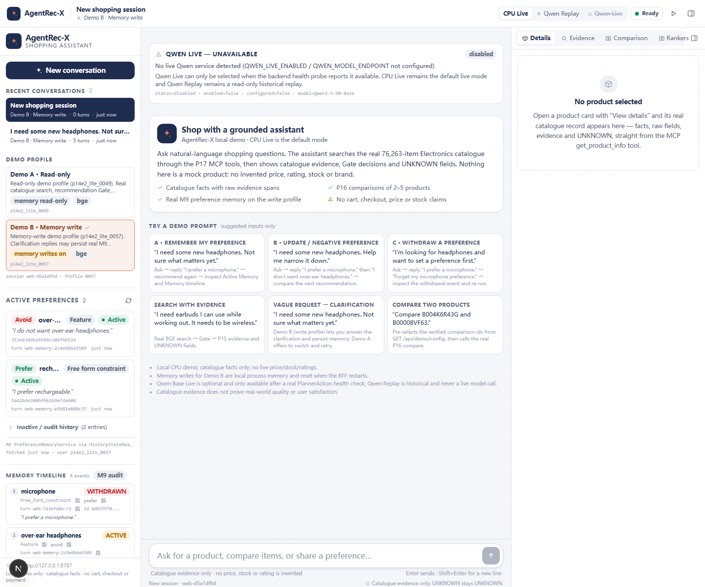
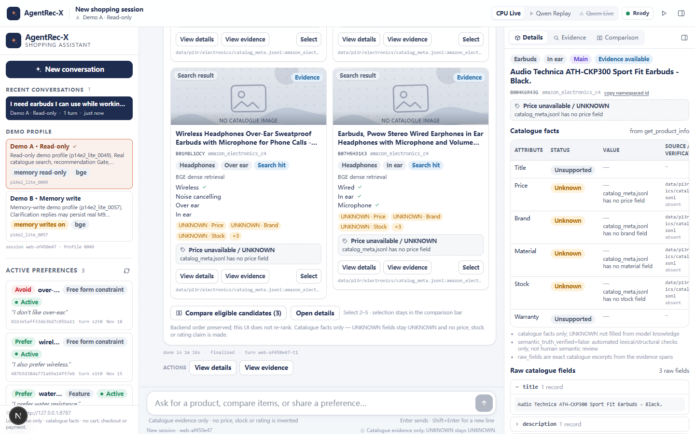
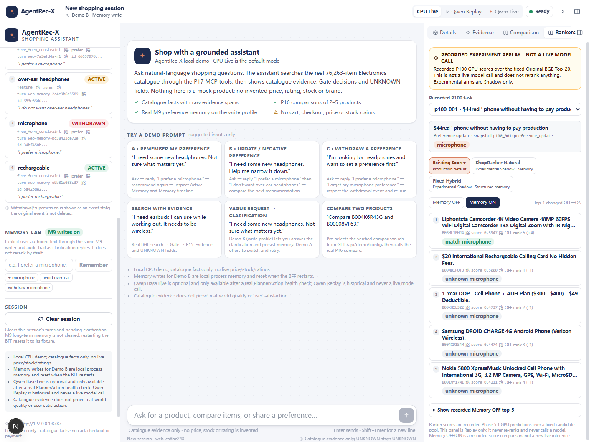
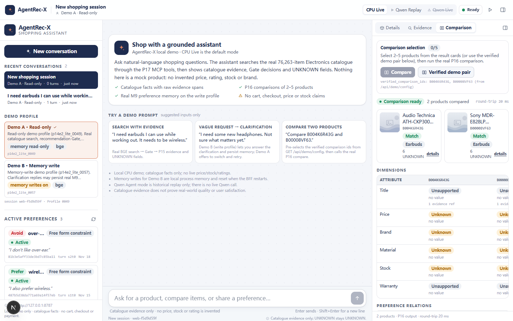
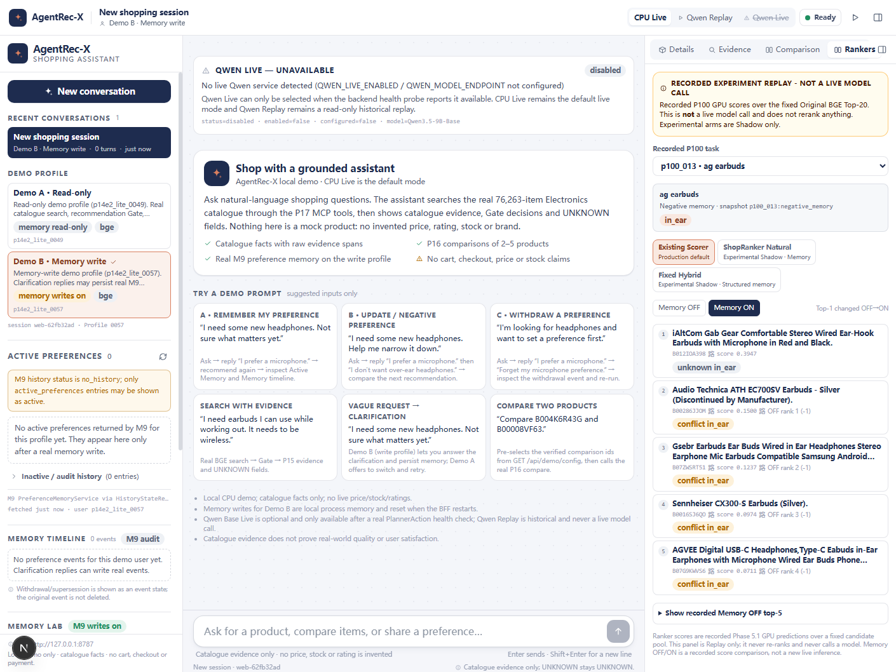
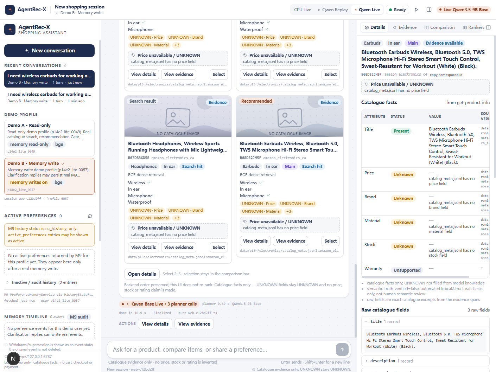

# AgentRec-X Demo Guide (V2.1)

> This is the user-facing guide for the current `web/` + `web_demo/` demo. It describes what you
> can operate in the actual browser and what the Agent does behind each screen. Start commands are
> in [`SETUP_AND_DEPLOYMENT.md`](SETUP_AND_DEPLOYMENT.md); exact V2.1 evidence is in
> [`AGENTREC_X_DEMO_V21_VERIFICATION.md`](AGENTREC_X_DEMO_V21_VERIFICATION.md).

## 1. Demo Overview

```text
Browser / Next.js UI
  -> FastAPI BFF
  -> MCP stdio
  -> AgentRec-X catalogue + BGE
  -> Planner + Executor + Decision Gate
  -> P15 evidence + P16 skills + M9 memory
```

The default profile is the write-enabled **Demo B · Memory write**. The read-only **Demo A**
profile refuses memory writes; the UI distinguishes them.



## 2. Shopping Chat

**What it does:** natural-language shopping query; no keyword-only frontend logic.

**Steps:**
1. Open `http://127.0.0.1:3000`.
2. Type `I need earbuds I can use while working out. It needs to be wireless.`
3. Watch the streaming response and tool timeline.
4. Inspect product cards and **View details / View evidence**.

**Agent technology:** BFF → MCP `search_products` → BGE catalogue → `get_product_info` → P15
evidence → `recommend_products` → Rule Planner (CPU default) or Qwen Planner (optional) →
Decision Gate.

**Verification:** actual browser UX checked; product cards are real catalogue records; no price /
rating / stock / image is fabricated.

## 3. Planner–Executor

**What it does:** the existing bounded executor reads the PlannerAction and calls tools.

**Steps:**
1. Select **Qwen Live** only if the UI reports it available.
2. Run a query.
3. Open the trace and look for `Qwen Planner Request`, `Planner Action: RETRIEVE/RERANK/FINALIZE`,
   `Decision Gate`.

**Technology:** the existing `ElectronicsPlannerExecutor` and `run_planner`; the UI does not
reimplement them. Qwen may propose actions; it cannot write candidate identity, scores, evidence
or final rank.

**Known limit:** CPU Live uses the Rule Planner. Qwen Live requires the remote model service and a
local tunnel; its absence is shown as **Unavailable**, never silently replaced with Rule.

## 4. MCP Tool Execution

**What it does:** every product/evidence/memory/Gate value comes from a real P17 MCP stdio tool.

**Steps:** open the tool timeline; rows show the real tool name, status and measured latency.
Actual tools include `search_products`, `get_product_info`, `recommend_products`,
`get_active_preferences`, `compare_products`, `request_preference_clarification`,
`submit_clarification_reply`, and (write demo only) `remember_preference`.

**Verification:** no local product JSON or mock response is inserted by the frontend.

## 5. Decision Gate

**What it does:** the Gate is the only authority for `FINALIZE`, `ASK`/clarification, or no
verified candidate.

**Steps:** after a recommendation, inspect the Gate row in the trace and the product card's
`Finalize` / `ASK` state.

**Technology:** existing DecisionGate receives eligibility, evidence, preference conflict and
budget context. The frontend cannot force `ALLOW_FINALIZE`.

**V2.1 evidence:** real Qwen Live turn ended with
`ALLOW_FINALIZE / evidence_sufficient`; no Rule fallback.

## 6. Product Recommendation

**What it does:** renders real ranked catalogue candidates with evidence and UNKNOWN fields.

Each card has:
- real title / product ID / rank / product type;
- verified attributes with evidence provenance;
- `UNKNOWN` fields (price, brand, stock, material, etc. where absent);
- a neutral product-category placeholder because the catalogue has no trusted image URL;
- `View details`, `View evidence`, and comparison selection.



**No fabrication:** there is no price, rating, promotion, stock, brand or image invented by the UI.

## 7. Preference Memory

**What it does:** M9 stores explicit user-authored preferences; the current active state is shown
in the sidebar.

**Steps:**
1. Use the clarification reply (`I prefer a microphone.`), or
2. use **Memory Lab** on the write profile (`+ microphone`, `avoid over-ear`, or free text).
3. Send a new recommendation request to recompute using the updated state.

**Memory Lab** is an explicit demo adapter over the existing
`PreferenceMemoryService.process_turn`; it is **not** a second Memory Store. It does not rerank by
itself.

**Known limitation:** session memory is in-memory for the BFF process. Restarting the BFF clears it;
the UI says so.

## 8. Memory Timeline

**What it does:** shows the real M9 audit view:
- memory ID;
- value / kind / polarity;
- logical sequence and source turn;
- status (`active`, `removed`, `superseded`);
- source text.



Withdrawal is a new state, not deletion: the old event remains visible as `removed`; Active Memory
no longer contains it. This is the Event-Sourced lifecycle demonstration.

## 9. ASK / Clarification / Resume

**What it does:** when the Gate lacks enough criteria, the Agent asks a real clarification; a
write-enabled profile can persist the reply and resume the task.

**Steps:**
1. Start with a vague query: `I need some new headphones. Not sure what matters yet.`
2. The real ASK card appears.
3. Reply `I prefer a microphone.`
4. Inspect the `memory_update` (`added=1`) and refreshed Active Memory.
5. Re-run the recommendation.

The Qwen V2.1 recorded trace did **not** include an ASK; this is a supported system behavior, not a
claim that the recorded trace used it.

## 10. Session Memory Isolation

**What it does:** each browser session is an opaque M9 namespace.

**Steps for A/B:**
1. Session A writes `microphone`.
2. Session B reads Active Memory: A's preference is absent.
3. B writes `over-ear` avoid.
4. A withdraws `microphone`; B's memory remains.
5. Reset A; B's memory remains.
6. A read-only profile write returns HTTP 400.

**Verified:** see [`../runs/final_demo/session_isolation.json`](../runs/final_demo/session_isolation.json)
and the V2.1 verification document. Session memory is **not persistent across BFF restarts**.

## 11. Product Comparison

**What it does:** renders the real P16 comparison payload for 2–5 selected products.

**Steps:** select two cards (e.g. `B004K6R43G` and `B00008VF63`), click **Compare**, inspect
dimensions, preference relations, UNKNOWN fields, claims and conditional recommendation.



## 12. Ranker Comparison — Recorded Replay

**What it does:** shows saved Phase 5.1 P100 GPU predictions for:
- Existing Scorer;
- ShopRanker Natural (Experimental / Shadow);
- Fixed Hybrid (Experimental / Shadow).

**Steps:** open right panel → **Rankers**; select a recorded P100 task; toggle **Memory OFF/ON**;
inspect rank movement, scores, evidence count and memory match/conflict/UNKNOWN.



**Strict boundary:** this is **Recorded Experiment Replay — Not a Live Model Call**. It does not
rerank and does not claim live ShopRanker/Hybrid inference.

## 13. Qwen Live

**What it does:** runs the real Qwen3.5-9B Base Planner through the existing MCP executor.

**V2.1 actual browser trace:**
```text
RETRIEVE -> RERANK -> FINALIZE
Gate: ALLOW_FINALIZE / evidence_sufficient
selected: B08D32JM5F
3 planner calls; 20.58 s full browser turn; GPU 17,551 MiB
```



Qwen Live requires a running model service and a **WSL-local loopback tunnel**; if unavailable,
the UI shows Unavailable and never falls back silently. Setup is in
[`SETUP_AND_DEPLOYMENT.md`](SETUP_AND_DEPLOYMENT.md).

## 14. Demo Verification

| Function | Status | Evidence |
|---|---|---|
| CPU Live chat / tools / Gate / evidence | PASS | actual browser walkthrough |
| Qwen Live | PASS | `ui_qwen_live.png`, `qwen_live_turn_v21.json` |
| Memory add / negative / withdrawal | PASS | `walkthrough_three_scenarios.json` |
| Memory Timeline | PASS | UI + M9 audit fields |
| A/B Session isolation | PASS | `session_isolation.json` |
| Read-only profile refuses write | PASS | HTTP 400 |
| Ranker / OFF–ON replay | PASS | `ranker-replay.png`, P100 artifacts |
| TypeScript | PASS | `pnpm exec tsc --noEmit` |
| WSL / local tests | PASS | 38 / 20 |

## 15. Known Limitations

- Session memory is process-local; BFF restart loses it.
- Qwen Live requires an external GPU service + local tunnel, not auto-started by the demo.
- Ranker comparison is recorded replay; not live inference.
- The local demo has no auth/TLS and is not a production multi-tenant deployment.
- The catalogue snapshot has no trusted price, image, rating or stock source; UNKNOWN/placeholder
  is intentional.
