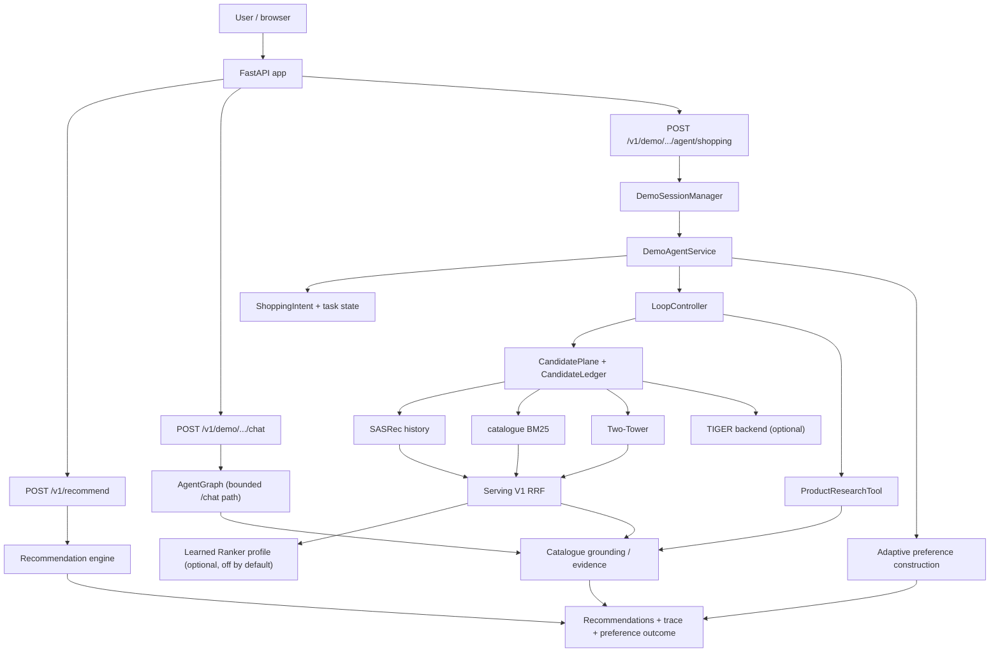

# AgentRec-X 实习面试讲解稿（基础版）

> **状态：CURRENT DRAFT。** 依据当前仓库 `feat/agent-source-limit-ablation`、
> HEAD `4dec6d2`、工作区 clean 编写。本文只描述项目实现和已有证据，不做线上效果或个人独立贡献的推断。
>
> **证据口径：**
> - **代码已实现**：以当前 worktree 为准。
> - **测试已验证**：以当前 `tests/` 和最近一次全量 pytest 为准（3183 passed / 40 skipped）。
> - **实验有证据**：以对应冻结报告或本地实验产物为准，并标注样本、对照和不能外推的范围。
> - **尚未证明**：线上用户效果、转化、长期偏好收益、跨环境 SLA。
>
> 本文中的“项目实现了”是对仓库事实的描述，不等同于“我个人独立完成了全部工作”。

---

## 0. 资料来源与口径核对

### 0.1 实际基线

```text
branch: feat/agent-source-limit-ablation
HEAD:   4dec6d2
status: clean
```

### 0.2 使用的资料

| 资料 | 本文用途 | 口径说明 |
| --- | --- | --- |
| [`README.md`](../README.md) | 项目定位、启动命令、当前默认/可选组件 | 当前版本，优先于旧 demo 讲稿 |
| [`docs/ARCHITECTURE.md`](ARCHITECTURE.md) | 当前架构、请求路径、状态边界、目录地图 | 当前版本 |
| [`docs/P2C_LEARNED_RANKER_EVAL.md`](P2C_LEARNED_RANKER_EVAL.md) | Learned Ranker 独立评估 | 该报告冻结时的 2,000 例固定候选池评估；未在当前 HEAD 重跑 |
| [`docs/P2B6_QUERY_SCALE_VALIDATION.md`](P2B6_QUERY_SCALE_VALIDATION.md) | catalog 查询策略规模验证 | 1,000 例、depth=50；冻结实验，不是 Serving V1 的线上数字 |
| [`docs/P3_1_FINAL_LIST_CONSISTENCY.md`](P3_1_FINAL_LIST_CONSISTENCY.md) | 最终列表与解释一致性 | 48 个构造场景；不是线上用户效果 |
| [`docs/P3_2_TERMINAL_SEMANTICS.md`](P3_2_TERMINAL_SEMANTICS.md) | 无可行候选的终态语义 | 48 场景；仍是构造场景 |
| [`docs/P4_3_ACCEPTANCE.md`](P4_3_ACCEPTANCE.md) | 多轮购物 HTTP/Web 验收 | 真实本地服务 + headless Chrome；非线上 |
| [`docs/P5_LITE_SUMMARY.md`](P5_LITE_SUMMARY.md) | 多轮购物工程验证 | 36 场景 / 76 轮；单次运行 |
| [`experiments/p5a_source_decoupling.py`](../experiments/p5a_source_decoupling.py) + 本地 `runs/p5a_source_decoupling_1000/report.md` | Phase 5A 来源解耦 | 1,000 例固定候选池；产物被 gitignore，未入库 |
| [`experiments/p6b_research_eval.py`](../experiments/p6b_research_eval.py) 等 P6 驱动 + 本地 `runs/p6*` | 动态研究、恢复、失败降级 | 合成目录、8 个场景级工程验证，不是 benchmark |
| [`tests/test_preference_construction.py`](../tests/test_preference_construction.py) | 主动偏好构建行为 | 23 项定向测试；确定性 heuristic，不是学习型策略 |
| [`tests/test_agent_state_isolation.py`](../tests/test_agent_state_isolation.py) | 失败 run 与任务状态隔离 | 13 项测试 |
| 当前全量 pytest | 工程验证基线 | 3183 passed / 40 skipped / 10 warnings |

### 0.3 发现的文档差异

- [`docs/INTERVIEW_DEMO.md`](INTERVIEW_DEMO.md) 仍包含早期 demo 叙述，例如“浏览器路径只有一个 SASRec 候选生成器”和旧版 narration；当前默认 Serving V1 已经是 SASRec + Two-Tower + catalogue lexical 三源 RRF，`/v1/demo/agent/recommend` 也已是 control-plane 响应。本文**不以该旧讲稿为事实来源**，只把它当作历史展示材料。
- `P2C`、`P2B6`、`P3.x`、`P4.3`、`P5-lite` 的报告写于各自冻结时点；本文保留它们的样本和指标，但不把它们说成“在当前 HEAD 上重新运行”的结果。
- Phase 5A / P6 的部分完整产物在本地 `runs/`，被 gitignore；对应驱动代码在仓库中。本文把这类证据明确标为“本地工程/固定样本实验”，不当作 GitHub 中已提交的正式报告。

---

## 1. 一句话项目介绍

AgentRec-X 是一个把**确定性推荐引擎**和**有边界的购物 Agent**结合的推荐系统：SASRec、Two-Tower 和 catalogue BM25 负责多源召回，RRF 负责只融合排序、不混合不可比分数，Agent 负责维护购物意图、做商品事实核验、在必要时提问并恢复。

它要解决的不是“让 LLM 直接推荐商品”，而是：**当用户用多轮自然语言改变需求时，系统如何在不伪造商品、不越过硬约束、不泄漏 session 状态的前提下，改变最终推荐结果**。

最有辨识度的特点是“双边界”：第一，LLM 只能提出 route 或受支持的偏好值，不能写 `parent_asin`、score、evidence 或最终 rank；第二，Agent 的每次提问和恢复都要有候选证据、预算和明确的失败/澄清语义。

---

## 2. 90 秒项目介绍

AgentRec-X 面向的是“推荐系统 + 购物 Agent”这个交叉问题。传统推荐引擎擅长根据用户历史做序列召回，但用户的实际购物需求往往是多轮的，例如先要露营装备，再说预算、颜色、重量，甚至要求比较两个商品。单纯把 LLM 套在推荐接口外面，模型很容易直接编商品、编价格，或者把用户没确认的偏好写进长期记忆。

这个项目的做法是把推荐真相留在确定性代码里：SASRec 做序列推荐，Two-Tower 做表示召回，catalogue BM25 做目录检索，再用 RRF 融合三路排序；商品事实来自 catalogue，偏好匹配和最终排序由确定性策略完成。Agent 层负责意图、商品研究、澄清和恢复，但只能选择“下一步做什么”，不能选择“哪个商品是真的”。

一个比较有代表性的难点是：早期 Learned Ranker 曾经看起来优于 RRF，但独立评估发现 RRF 基线被排序方向反转了；修正基线后，冻结 LR 在 2,000 例固定候选池上反而更差，所以我们保留 RRF 默认路径，不把“模型已经训过”当作上线理由。

当前系统在离线固定候选池、构造购物场景和真实本地浏览器验收上有证据，但没有线上 A/B、真实转化或用户满意度结论；这是项目明确保留的边界。

---

## 3. 整体架构

### 3.1 一张简洁架构图



> 图中的 `/chat` 是保留的 `AgentGraph` 通道；当前多轮购物主路径是
> `DemoAgentService + LoopController + CandidatePlane`。两者共享推荐 Tool、目录元数据和底层引擎，
> 但不是同一套编排。

### 3.2 SASRec、Two-Tower、BM25、RRF 的职责

| 组件 | 职责 | 不负责 |
| --- | --- | --- |
| **SASRec** | 用可信行为历史做序列下一项召回；输出带排序的候选 | 不理解自然语言、不判断硬约束 |
| **Two-Tower** | 用 item-id 历史做表示召回，补充与 SASRec 不同的候选集合 | 不做最终身份/约束判定 |
| **Catalogue BM25** | 在完整目录文本上做词法检索，补充目录侧候选 | 不证明商品质量 |
| **RRF** | 只融合各来源的**排序**，避免把 logit、cosine、BM25 当成同一量纲相加 | 不学习权重、不判断事实 |
| **Catalogue grounding** | 用 `parent_asin` 查目录元数据，给候选附标题/品牌/价格/类别等事实 | 不生成候选 |
| **Preference matcher / reranker** | 把显式偏好转成 MATCH / VIOLATION / UNKNOWN，再做确定性排序 | 不跳过硬约束 |
| **Learned Ranker** | 在固定三源合法池上做 LightGBM LambdaRank 排序；失败回退 RRF | 默认路径、质量保证 |
| **TIGER** | 可选外部生成式 backend，以独立 adapter 接入 | 默认融合、默认服务 |

关键点：**RRF 融合的是名次，不是分数**。融合结果带 `rrf_rank_fusion` 和每个来源的 provenance
（来源、source_rank、source_score、score_kind），所以一个融合分数不会被误读成 SASRec 分数。

### 3.3 Learned Ranker 的位置与当前状态

- 位置：`recommendation/inference/learned_ranker.py`；它包在 Serving V1 融合引擎外，
  用同一候选池和 15 维特征重新排序。
- 可选 profile：`AGENTRECX_FUSION_PROFILE=serving_v1_learned_ranker`；默认不开启。
- 启用条件：模型文件、feature schema、可选 `lightgbm` 依赖都存在；加载或预测失败必须回退到
  **同一合法池上的全精度 RRF**，并记录 fallback reason。
- 当前关闭原因：P2C 独立评估中，冻结 LR 在 2,000 个独立案例上的 NDCG@20 和 HR@5 都弱于正确
  RRF 基线，配对 CI 整体为负；G1/G2 失败，因此**不切默认、不把它宣传成优于 RRF**。
- 动态 CandidatePlane 与 Learned Ranker 组合目前明确拒绝；这是已实现的边界，不是未完成的功能。

### 3.4 `/v1/recommend` 与多轮购物 Agent 的区别

| | `/v1/recommend` | `/v1/demo/sessions/{id}/agent/shopping` |
| --- | --- | --- |
| 状态 | 无状态 | server session + task state |
| 输入 | 调用方显式提供的 trusted history | session 历史 + 当前消息 |
| 编排 | 直接调用 RecommendationEngine | `DemoAgentService` + `LoopController` |
| Agent 能力 | 无 | 意图、候选平面、研究、澄清、恢复、自适应偏好 |
| 输出 | 排序列表/模型元数据 | recommendations、intent、research、clarification、preference、trace |
| 失败语义 | 引擎/请求错误 | 区分等待、澄清、完成、拒绝、预算/执行失败 |

`/v1/recommend` 是推荐服务；`/agent/shopping` 是建立在同一推荐 Tool 上的购物 Agent。二者共享
底层模型和目录，但状态、交互和输出契约不同。

---

## 4. 三个核心技术难点

### 4.1 难点一：多来源、融合与排序

#### 问题

- SASRec logit、Two-Tower cosine、BM25 score 的量纲和含义不同，直接加权会制造一个不存在的
  “统一分数”。
- 多源召回会带来重复候选、来源间排序冲突和 Top-K 被 catalog 候选系统性挤出的问题。
- Learned Ranker 看似能学非线性排序，但如果基线或候选池不一致，结论会完全反过来。

#### 方案

- 默认 Serving V1 固定三源：SASRec + Two-Tower + catalogue lexical；只融合排序。
- RRF 使用固定 `RRF_K=60`、source head 100；每个来源的 provenance 保留。
- 任何候选必须经过 canonical identity 和 grounding；未知身份不进结果。
- Learned Ranker 只作为独立 profile，先做固定候选池独立评估；质量不过关就不切换默认。

#### 关键实现

- `recommendation/inference/fusion.py`：`FusionInferenceEngine`、`FusionInferenceConfig`、固定
  `FUSION_PROFILES`。
- `recommendation/control/candidate_ledger.py`：`reciprocal_rank_fusion` 和 RRF 常量。
- `recommendation/inference/learned_ranker.py`：15 维特征、RRF fallback、profile gate。
- 当前 `/health` 暴露 `active_engine`、`fallback_used`、`fallback_reason`、fusion sources 和
  TIGER state，降级可见。

#### 验证证据

- P2C 独立评估：2,000 例固定三源候选池，RRF 的 NDCG@20 `0.012201`，冻结 LR `0.008267`；
  配对 Δ `−0.003934`，95% CI `[−0.006397, −0.001685]`；HR@5 RRF `0.0130` vs LR `0.0060`，
  Δ `−0.0070`，CI `[−0.0115, −0.0025]`。G1/G2 失败，保留 RRF。
- P2B6：1,000 例、depth=50 的三臂实验发现 catalog 提升池覆盖（B−A 覆盖 `+1.6 pp`），但
  HR@5 和 NDCG@5 没有提升，且 A 的 11 个 Top-5 命中中有 7 个被 catalog 挤出；因此未把
  catalog 查询策略设为默认。
- Phase 5A：1,000 例固定候选池，独立 Two-Tower source 的 C 臂相对 SASRec-only history+C
  的 B 臂，HR@5 `+0.007` CI `[0.001, 0.014]`，NDCG@5 `+0.004823` CI
  `[0.000931, 0.009185]`；但 A vs C 的 NDCG CI 跨 0，不能据此宣称 Serving V1 全面更好。

#### 局限

- P2C、P2B6、P5A 都是固定候选池/样本实验，不是线上 A/B。
- B1 的 +32.4% 来自 depth-1000 离线协议；Serving V1 是 depth-100，不能直接把它当作当前
  serving 的提升。
- 没有做 RRF 权重学习或线上延迟 SLA。

---

### 4.2 难点二：可信购物 Agent

#### 问题

- 购物请求里同时有硬约束（预算、重量、类别、品牌）和软偏好（“更喜欢轻一点”）。
- LLM 可能会编商品、编价格，或者把用户没确认的偏好写进长期记忆。
- 多源研究失败时，系统既要给出可用结果，又不能把“没核实”包装成“已验证”。

#### 方案

- **硬约束先于软偏好**：候选先经过约束 eligibility projection，软偏好只能重排 survivors，
  不能把被排除的候选拉回来。
- **动作受验证**：LLM 或 policy 只提出 `ActionProposal`；`ActionValidator` 检查动作、参数、
  候选引用；`LoopController` 执行并记录 trajectory。
- **事实核验**：`ProductResearchTool` 读 catalogue 的 inspect/compare，返回结构化事实；
  缺字段就是 missing，不推断。
- **澄清是 suspension**：pending clarification 返回 `waiting_for_user`，不返回一个假的最终列表；
  下一轮用 `clarification_id` 恢复。
- **失败分级**：单 source 失败可以继续另一个 source（如果这是当前 plan 的合法 fallback）；
  没有 verified/feasible 候选时仍然 fail closed，不展示未验证商品。
- **恢复预算**：动态研究/二次澄清有 tool-call、步数、澄清次数上限；不能无限重试。

#### 关键实现

- `recommendation/control/validation.py`、`loop.py`、`candidate_plane.py`、
  `candidate_ledger.py`、`grounding.py`、`verification.py`。
- `recommendation/control/product_research.py`：inspect / compare / attributes。
- `recommendation/demo/agent_service.py`：多轮状态、pending、恢复、最终列表投影。
- `recommendation/demo/shopping_intent.py`：hard/soft intent、冲突和任务态。
- `recommendation/demo/research_policy.py`、`research_clarification.py`、`replan_policy.py`。

#### 验证证据

- P3.1：48 个构造场景，非空消息与最终列表一致率 `17/38 → 38/38`；目录事实
  `200/200 → 354/354`；硬约束违反 `0/59`；身份合法率 100%。
- P3.2：48 场景中 4 个从 `completion_refused` 细化为 `no_verified_candidate`，仍保持
  `failed/succeeded=false`、空列表和约束解释；硬违反仍 `0/59`。
- P4.3：真实本地服务 + headless Chrome 完成 9 项验收；0 个未处理 console error，购物期间
  `/chat` 请求 0；定向测试 151 passed。
- P5-lite：36 个构造场景/76 轮，硬约束违反从 `43/380` 降到 `0/319`；未决事实展示从
  `118 件/44 轮` 降到 0；澄清闭环 `0/8 → 8/8`；36/36 任务完成。注意两臂分母不同且是单次运行。
- P6C：8 个合成恢复场景，recovery success `8/8`，7/8 strict finished，0 duplicate research；
  过期场景正确 410，不伪造完成。
- P6D：8 个 API 场景 + 真实 headless Chrome；第二次澄清 `2/8`，硬违反 0、未验证展示 0。
- P6E：8 个任务中 fixed strict completion `1/4` vs dynamic `4/4`；terminal-only 两边 `4/4`；
  说明差异来自“是否真的完成请求的证据”，不是最终有没有返回列表。

#### 局限

- P3/P5/P6 都是构造场景或合成目录，不是线上购物成功率。
- 多轮评测没有真实用户、跨重启、多 worker 或长期 session 数据。
- P6 的 8 个场景样本很小，动态研究成本更高（P6E research calls 14）。

---

### 4.3 难点三：自适应主动偏好构建

#### 问题

- 固定属性优先级会反复问价格/颜色等错误维度；如果所有候选价格相同，问价格没有价值。
- 即使候选有差异，某个回答也可能不改变 Top-K；这种问题不应被当作“有效交互”。
- 用户回答只能改变当前任务，不能被当成长期偏好；硬约束也不能被软偏好覆盖。

#### 方案

四步确定性决策：

1. **可信证据**：`ProductResearchTool.compare_products` 对已展示候选做最多 5 个商品的
   comparable 检查；缺少字段就不生成选项。
2. **未解决维度**：排除 explicit / confirmed / revoked、硬约束属性、已有任务偏好；按
   上下文 relevance、coverage、归一化差异和 counterfactual impact 排序。
3. **反事实 Top-K**：对每个可执行选项模拟排序；如果没有任何选项改变当前 preference window
   的 Top-K，则 `SKIP`。每个 prompt 保存 `baseline_top_k` 和 `counterfactual`。
4. **交互选择**：`ASK_DIRECT` / `SHOW_CONTRAST` / `EXPLAIN` / `SKIP`；最多两轮，第二轮只在
   仍有选项改变窗口时出现。

回答后：

- 选择变成 task-scoped `TaskPreference`（`confirmed=true`，source `user_selected`）；
- 对**产生问题的同一份候选响应窗口**做 soft 重排，不重新检索候选集，避免 before/expected/actual
  不可比；
- 计算 `preference_outcome.changed/verified`；不改变就如实报告 `changed=false`；
- 任务偏好不写长期 memory；任务/session 用 `task_key` 隔离。

#### 关键实现

- [`recommendation/demo/preference_construction.py`](../recommendation/demo/preference_construction.py)：
  `PreferenceState`、`choose_preference_action`、`_decide_dimension`、
  `rank_with_task_preferences`、counterfactual。
- [`recommendation/demo/agent_service.py`](../recommendation/demo/agent_service.py)：
  `_answer_preference`、`_maybe_attach_preference_question`；最多两轮、session 隔离、frozen
  candidate window。
- [`recommendation/demo/shopping_intent.py`](../recommendation/demo/shopping_intent.py)：
  硬/软 intent、source_turn_id、reasons。
- API schema：`AgentPreferenceEvidenceView`、`AgentPreferenceOutcomeView`。

#### 验证证据

- `tests/test_preference_construction.py`：23 项定向测试，覆盖：
  - 不同上下文选不同维度：budget→price、lightweight→weight、colorful→color；
  - `SKIP`：没有可信差异或所有选项都不改变 Top-K；
  - 两轮上限、第二轮价值门槛；
  - 硬约束不被重复问成偏好；
  - `none/skip` 不生成偏好；
  - session 隔离、跨 session 404、过期 410、重复 clarification；
  - task preference 不写长期 memory；
  - before/expected/actual outcome。
- 当前全量测试：3183 passed / 40 skipped；主动偏好的 API 和状态隔离测试包含在全量运行中。
- 当前实现是**确定性 heuristic**，不是学习型策略、bandit 或信息增益最优。

#### 局限

- 偏好窗口受 `ProductResearchTool` 比较上限影响（最多 5 个候选）；k 更大的请求只对当前窗口
  的偏好负责，不保证重排整个目录。
- 属性只支持 price / weight / color / material / brand；缺失值不补。
- 现有证据主要是测试和构造场景；没有真实用户偏好收益或线上 A/B。
- 开发期间做过真实目录/浏览器 smoke，但其 artifact 在本地 `runs/` 且被 gitignore；本文不把
  未提交产物当作正式指标。

---

## 5. 关键实验与真实结果

> 先看每行的“能得出/不能得出”。不同层的数字不能互相替代。

### 5.1 正式离线推荐评测：B1 Two-Tower 互补性

| 项 | 内容 |
| --- | --- |
| 样本 | 冻结 20,000 用户 cohort；full-catalogue 评测；depth-1000 离线协议 |
| 对照 | A = Popularity + SASRec + Metadata；B = A + Two-Tower |
| 核心指标 | Recall@10 `0.01435 → 0.01900`（+32.4% relative）；ΔNDCG@10 `+0.0023818`，95% CI `[+0.0017313, +0.0030716]`；McNemar p ≈ `1.2e-10` |
| 可得出 | 在该离线协议/cohort 上，Two-Tower 对固定融合有互补价值，支持把它纳入 Serving V1 的候选来源 |
| 不能得出 | 不能把 +32.4% 当作 depth-100 Serving V1 的线上提升；不是用户满意度、转化或 A/B 结论 |

### 5.2 固定候选池：Learned Ranker 独立对照

| 项 | 内容 |
| --- | --- |
| 样本 | 2,000 个独立案例；固定三源 top-100 并集；池覆盖 239/2000 = 11.95%；平均池 273.88 |
| 对照 | 同一候选池、同一检查点/特征；全精度 RRF vs 冻结 LightGBM LR（22 棵树） |
| 核心指标 | NDCG@20：RRF `0.012201` vs LR `0.008267`；Δ `−0.003934`，95% CI `[−0.006397, −0.001685]`；HR@5：RRF `0.0130` vs LR `0.0060`，Δ `−0.0070`，CI `[−0.0115, −0.0025]` |
| 可得出 | 冻结 LR 在该独立 cohort 上弱于正确 RRF 基线；不能启用默认 LR；此前“LR 更好”来自反转的 RRF 基线，已用 766 组确定性复现解释 |
| 不能得出 | 不能外推到所有 ranker、所有训练数据或重训后的模型；固定候选池不是全目录线上指标 |

### 5.3 固定样本：Phase 5A 推荐来源解耦

| 项 | 内容 |
| --- | --- |
| 样本 | 1,000 个 P2B6 案例；requested_k=5、source_limit=50；固定三源候选池/同一目录 |
| 试验 | A：Serving V1 预融合 history + catalog；B：SASRec-only history + catalog；C：SASRec-only history + 独立 Two-Tower + catalog |
| 核心指标 | A/B/C 的 NDCG@5 分别 `0.006318 / 0.004431 / 0.009254`；HR@5 `0.010 / 0.006 / 0.013`；C−B HR@5 `+0.007` CI `[0.001, 0.014]`，NDCG@5 `+0.004823` CI `[0.000931, 0.009185]` |
| 可得出 | 在该固定样本上，独立 Two-Tower source 比“SASRec-only history + catalog”有正收益；来源解耦值得继续验证 |
| 不能得出 | A vs C 的 NDCG CI 跨 0，不能宣称 Serving V1 被全面超过；不是默认切换、不是线上效果；产物在本地 `runs/`，未入库 |

### 5.4 固定候选池：catalog 查询策略规模验证（P2B6）

| 项 | 内容 |
| --- | --- |
| 样本 | 1,000 例，depth=50，k=5；A history-only、B +current catalog query、C +balanced query |
| 对照 | 同一批案例、同一候选平面、同一 evaluator |
| 核心指标 | 池覆盖：A 4.6%、B 6.2%、C 5.9%；HR@5：1.1% / 1.0% / 0.9%；B−A 覆盖 `+1.6 pp` CI `[0.9, 2.4]`，HR `−0.1 pp`；C−B 覆盖 `−0.3 pp` CI `[−1.1, +0.5]` |
| 可得出 | catalog 增加池覆盖，但在该样本上造成 Top-5 demotion；balanced query 不优于 current query；停止把 balanced query 设为生产默认 |
| 不能得出 | 不能说是“catalog 永远无价值”；R2 有 2 个 catalog 独有 Top-5 命中，但样本只有 2 例；代理查询不等于自然语言购物 |

### 5.5 构造多轮购物：P3 / P3.1 / P3.2 / P5-lite

| 项 | 内容 |
| --- | --- |
| 样本 | P3/P3.1/P3.2：48 个构造场景；P5-lite：36 场景 / 76 轮（复用 P4 基线） |
| 对照 | P3.1 修前/修后；P5-lite 的 stateless baseline vs Phase 4 |
| 核心指标 | P3.1：消息与最终列表一致 `17/38 → 38/38`，事实 `200/200 → 354/354`，硬违反 `0/59`；P3.2：4 个场景得到 `no_verified_candidate`，其它不变量不变；P5-lite：意图 `16/76 → 76/76`，硬违反 `43/380 → 0/319`，未决展示 `118 → 0`，澄清 `0/8 → 8/8`，任务完成 `0/36 → 36/36`，理由 `561/561` |
| 可得出 | 在构造场景上，最终列表、解释、约束、澄清和终止语义可以做到一致；工程契约有测试支撑 |
| 不能得出 | 不能外推为线上购物成功率、用户满意度或真实转化；P5-lite 是单次运行，两臂分母不同 |

### 5.6 真实本地服务 + 浏览器验收：P4.3

| 项 | 内容 |
| --- | --- |
| 样本 | 真实本地服务 + headless Chrome；9 项端到端检查；定向测试 151 passed |
| 对照 | 直接检查页面/API 的实际行为，不是模型 A/B |
| 核心指标 | 9/9 检查；0 个未处理 console error；购物期间 `/chat` 请求 0；预算替换、冲突、回答重推、无法核实、404、reset 均验证 |
| 可得出 | 浏览器→HTTP→session→Agent 的工程链路可以工作；前后端契约和错误映射有真实浏览器证据 |
| 不能得出 | 不是人工桌面浏览器完整交互、不是多 worker/跨重启、不是线上质量或性能 |

### 5.7 合成目录：动态研究、恢复和失败降级（P6）

| 项 | 内容 |
| --- | --- |
| 样本 | P6B：8 场景×3 次；P6C/P6D：8 个恢复/二次澄清场景；P6E：8 个配对任务 |
| 对照 | fixed `DemoSourcePlanPolicy(("history",))` vs dynamic research policy；P6E 区分 completion tasks 和 safety tasks |
| 核心指标 | P6B：fixed task completion 75%、dynamic 75%，但 acceptable terminal 75% → 100%，research calls 21、invalid 0、duplicate 0；P6C：recovery 8/8，7/8 strict finished；P6D：second clarification 2/8，strict finished 7/8，hard violation 0、unverified 0；P6E：strict completion fixed 1/4 vs dynamic 4/4，terminal-only 两边 4/4，dynamic research calls 14 |
| 可得出 | 动态研究能补齐请求中的证据/比较并安全提问；恢复和预算边界有确定性工程证据 |
| 不能得出 | 合成目录、8 个场景、单次工程验证，不是推荐 benchmark，不是线上效果；动态研究成本更高，失败场景没有 fallback 推荐 |

### 5.8 主动偏好构建的工程验证

| 项 | 内容 |
| --- | --- |
| 样本 | `tests/test_preference_construction.py` 23 项定向测试；当前全量测试也包含这些测试 |
| 对照 | 不同 context（budget / lightweight / colorful），不同候选窗口，不同选项；没有学习型 baseline |
| 核心指标 | context 选择维度、counterfactual 改变 Top-K、`SKIP`、两轮 gating、hard constraint、session 隔离、no long-term write、before/expected/actual verified |
| 可得出 | 实现满足当前确定性契约；用户确认可以在同一候选窗口上改变最终排序，并报告真实变化或非变化 |
| 不能得出 | 是 heuristic，不是学习型最优；没有线上用户偏好收益；真实目录 smoke 产物未提交 |

### 5.9 全量测试

最近一次完整运行（当前 HEAD 附近）：

```text
3183 passed, 40 skipped, 10 warnings
exit code 0
```

40 个 skip 中包括 2 个 Phase-3 replay 测试：它们需要外部
`/tmp/agentrecx-phase3/revised_live.jsonl` recording；该资产不在仓库内，未伪造或重建，测试按
现有 helper 明确 skip。其余 skip 是既有测试资产的 skip，不应解读为这 40 项全部通过。

---

## 6. 项目难点与设计取舍

### 6.1 为什么使用 RRF，而不是直接融合不同量纲的模型分数？

- SASRec logit、Two-Tower cosine、BM25 是不同空间、不同尺度的量，直接相加/加权会制造伪分数。
- RRF 只依赖排序，来源之间不需要校准分数；固定 `K=60`，无请求时调参。
- provenance 和 `score_kind` 保留，融合结果可以审计；边界明确。
- 代价：RRF 不学习来源权重，可能对强来源利用不足；P2B6 的 top-5 demotion 就是代价之一。

### 6.2 为什么 Learned Ranker 目前关闭？

- P2C 在 2,000 个独立案例上，冻结 LR 的 NDCG@20/HR@5 都显著弱于正确 RRF。
- 之前“LR 更好”是因为训练脚本把 RRF 分数按 `1/(60+rrf)` 递减排序，实际把基线反转了。
- 修复基线后，RRF 仍更好；G1/G2 失败，保留默认 RRF。
- 这不是“LR 永远不行”，而是**当前冻结模型/当前证据不支持上线**；需要正确基线和新的独立 cohort
  再验证。

### 6.3 为什么硬约束和软偏好要分开？

- 硬约束是可行域：价格上限、重量上限、类别/品牌要求；违反就不能展示。
- 软偏好只是排序目标：用户说“更喜欢轻一点”不等于“必须 ≤ 1 kg”。
- 实现上先做 eligibility projection，再做 soft rerank；软偏好不能 widening。
- 终态上，全部证伪 = `finished/completed`，无法核实 = `failed/no_verified_candidate`；两者
  都空列表，但语义不同。

### 6.4 为什么研究失败有时允许部分结果，有时拒绝完成？

- 单 source 失败、另一个 source 有 grounded 候选：这是合法降级，系统可以展示已验证结果，并
  在 source_outcomes 中记录 failed。
- 没有 verified/feasible 候选、或者仍有 unresolved 约束：fail closed，返回问题或
  `no_verified_candidate`，不展示未验证商品。
- 判断依据是“是否存在经过验证的可行候选”和“是否有未决事实”，不是单纯看某个工具是否报错。
- 这避免了把“没核实”包装成“没有”，也避免了在安全可降级时无谓失败。

### 6.5 为什么一次性偏好不直接写入长期记忆？

- 用户在当前任务里选“lower price”是为当前候选集服务的 task preference，不是长期偏好。
- 长期 memory 是显式、用户拥有的；把未确认或一次性选择写进去会造成跨 session 污染。
- 代码用 `task_key` 维护偏好/轮次，用 `user_key` 维护显式 memory；task preference
  不写 SQLite。
- 硬约束仍然优先；task preference 只重排已过滤候选。

### 6.6 为什么 Agent 需要候选身份和目录事实验证？

- LLM 生成的自然语言不能证明某个 `parent_asin` 存在、价格是多少、是否满足约束。
- `CandidatePlane + CandidateLedger + GroundingVerifier` 让候选来自真实来源，事实来自 catalogue。
- `selected_option`/`clarification` 都绑定当前 candidate 窗口；错误/跨 session/过期 id 不会消费
  其他任务。
- 这样模型可以“提议”，但不能“制造真相”。

### 6.7 为什么 adaptive preference 要模拟反事实，而不是直接按属性优先级发问？

- 候选有差异不代表回答有价值；如果用户的回答不会改变当前 Top-K，问它就是无效成本。
- 对每个可执行选项模拟排序，记录 baseline/counterfactual；只有至少一个选项改变窗口才问。
- 用户回答后对同一 frozen candidate response 应用偏好，比较 expected/actual，避免候选集变化
  造成假阳性。
- 代价：它是确定性 heuristic，不是信息增益最优；窗口最多 5 个候选。

---

## 7. 已知限制

### 7.1 推荐质量

- **没有线上 A/B、点击、转化、留存或用户满意度证据**。所有质量结论都是离线/构造场景/固定样本。
- B1 的 +32.4% Recall@10 是 depth-1000 离线协议；Serving V1 是 depth-100，不能直接等价。
- P2C 的 Learned Ranker 是一个冻结模型、一个独立 cohort 的负结果，不能外推到所有 ranker 或
  重训模型；当前质量结论是 **NOT ESTABLISHED（该 cohort 上为负）**。
- P5A/P2B6 是固定候选池/样本实验，不是全目录线上指标；P5A 的 A vs C NDCG CI 跨 0。

### 7.2 主动偏好策略

- 仍是确定性 heuristic，不是 learned policy、bandit 或严格信息增益。
- 依赖 `ProductResearchTool` 的 comparable 证据，最多 5 个候选窗口；缺失/不可解析属性不生成
  问题。
- 支持属性有限：price、weight、color、material、brand。
- 任务偏好不写长期记忆；这符合当前契约，但也意味着跨 session 不复用一次性选择。
- 现有验证以 23 项定向测试和全量测试为主，没有线上偏好收益实验。

### 7.3 多轮购物评测

- P3/P4/P5/P6 主要是构造场景或合成目录，不是真实用户流量。
- P5-lite 是 36 场景/76 轮、单次运行，没有置信区间或显著性。
- P6 是 8 个合成场景级验证，动态研究成本更高，且失败场景没有 fallback 推荐。
- P4.3 是真实本地服务和 headless Chrome 的工程验收，不是线上多用户系统。

### 7.4 Session 与 pending

- session 和 pending clarification 是**进程内状态**；多 worker 需要 sticky session，重启不恢复。
- pending TTL 为 30 分钟；浏览器验收没有等待 410，410 由 API 测试覆盖。
- 没有 cookie/session 持久化、鉴权或多租户隔离；demo 不应直接暴露到不可信公网。
- SQLite 只保存显式偏好 memory，不保存 pending 或整个购物会话。

### 7.5 Learned Ranker 与可选后端

- `serving_v1_learned_ranker` 是 optional profile，默认关闭；需要外部模型/schema/`lightgbm`，
  失败回退 RRF；不能声称优于 RRF。
- TIGER 是 optional/qualified backend，默认不在 Serving V1；外部资产和许可证边界见
  [`backends/tiger_public/PROVENANCE.md`](../backends/tiger_public/PROVENANCE.md)。
- 动态 CandidatePlane 与 Learned Ranker 组合已被明确拒绝，不是待补功能。

### 7.6 测试跳过

- 当前全量结果：**3183 passed, 40 skipped, 10 warnings, exit 0**。
- 2 个 Phase-3 replay 测试因外部 `/tmp/agentrecx-phase3/revised_live.jsonl` 缺失/为空而 skip；
  没有伪造 recording。
- 其余 38 个 skip 是既有测试资产/平台条件，不能声称这 38 项已执行。
- 不能把“全量 0 failed”写成“所有用例都实际运行过”。

---

## 8. 高频面试追问

### Q1. 为什么不用加权分数融合，而用 RRF？

- 三个来源的量纲不同，直接相加会产生不可解释的伪分数。
- RRF 只利用排序，避免跨模型校准；固定 K 和 head，容易复现。
- 每个来源的 provenance/score_kind 保留，便于审计和解释。
- 代价是不学权重，强来源可能被平均；P2B6 的 demotion 是实际观察到的限制。

### Q2. Learned Ranker 为什么没有上线？

- P2C 独立评估 n=2,000：RRF NDCG@20 0.012201 vs LR 0.008267，CI 全负；HR@5 也负。
- 之前的正向结果来自反转的 RRF 基线（`1/(60+rrf)` 当 score 降序），已确定性复现。
- G1/G2 失败，所以保留 RRF 默认；LR 只是 optional profile。
- 不能外推到重训模型；需要正确基线和新独立 cohort 再验证。

### Q3. 为什么 LLM 不能直接选商品或排序？

- 推荐真相由确定性代码拥有：identity、score、evidence、rank、metrics。
- LLM plan schema `extra="forbid"`，没有 candidate id/score/rank 字段；它只能提 route/preference。
- 任何候选都经过 grounded plane 和 validator；模型失败是 typed error，不是 silent fallback。
- 这样避免编造商品、价格和无法审计的排序。

### Q4. 硬约束和软偏好怎么处理？

- 先做硬约束 eligibility，只有 feasible 候选进入排序。
- soft preference 只重排 survivors，不能添加被硬约束排除的商品。
- 全部证伪时 finished/completed 空列表；无法核实时 failed/no_verified_candidate。
- 解释与最终列表按 identity 对齐，不按位置猜属性。

### Q5. 一个 source 失败时为什么有时还能返回结果？

- 多源 plan 中，另一个 source 仍可能提供 grounded 候选；这是合法降级，source_outcomes 会记录失败。
- 如果没有 verified/feasible 候选，仍然 fail closed，不展示未验证商品。
- 判断依据是候选/约束事实，不是“某个工具报错就全部失败”。
- P6B/P6E 分别验证了 acceptable terminal 和 strict completion 的差异。

### Q6. 澄清和恢复如何避免状态泄漏？

- 澄清是 `waiting_for_user` suspension，不是成功完成；pending 有 session/task key、TTL 和预算。
- 无效/过期/跨 session/重复 id 分别返回 422/410/404，不消费其他任务。
- 恢复只重放需要的 comparison，不重复已完成的 research；P6C 0 duplicate calls。
- pending 是进程内状态，重启丢失；这是已记录的限制。

### Q7. 为什么任务偏好不写长期 memory？

- task preference 是当前候选窗口的选择，不是用户长期偏好；写进去会跨 session 污染。
- 代码用 task_key 隔离，user_key 只给显式 memory；task preference 不进 SQLite。
- 硬约束仍先于软偏好；任务选择只改当前排序。
- 这是有意的“不推测”设计，不是遗漏。

### Q8. 主动偏好构建如何决定问什么？

1. 用 trusted compare 建立 candidate 属性证据；
2. 排除 explicit/confirmed/revoked、硬约束、已有偏好；
3. 对每个可执行选项模拟 Top-K，只有能改变窗口的选项才保留；
4. 按 context relevance/coverage/difference/impact 选问题，否则 `SKIP`。

- 它是 heuristic，不是学习型最优；最多两轮，第二轮必须还有价值。

### Q9. 用户回答后，系统如何证明偏好真的生效？

- 选择后对**同一份 frozen candidate response** 应用 soft preference，不重新检索。
- 保存 `baseline_top_k`、`counterfactual`，回答后比较 expected/actual，输出
  `preference_outcome.changed/verified`。
- 不改变就如实 `changed=false`，不伪造收益。
- 偏好窗口最多 5 个候选，这是 `ProductResearchTool` 的上限。

### Q10. 推荐评测为什么用 temporal leave-two-out 和 full-catalogue？

- 避免随机切分造成未来信息泄漏；序列必须按时间前向。
- full-catalogue + seen-item masking 更接近真实排序任务，不用采样负例掩盖难度。
- 所有模型共用同一 evaluator、同一 cohort、同一 K，才可比较。
- 单正例 leave-two-out 下 HR@K 与 Recall@K 数值等价，这是定义，不是 bug。

### Q11. P2B6 中 catalog 提升了覆盖，为什么还不设为默认？

- 覆盖增加不等于 Top-5 变好：B−A 覆盖 +1.6pp，但 HR@5 点估计 -0.1pp。
- catalog 每例新增约 47 个候选，A 的 11 个 Top-5 命中里 7 个被挤出。
- balanced query 的 C−B 覆盖 CI 跨 0 且点估计为负，停止规则 R1 不成立。
- 只有 2 个 catalog 独有 Top-5 命中（R2），样本很小；不能据此上线。

### Q12. P5A 的 Two-Tower 增益能否说明 Serving V1 要改？

- P5A 的 C−B 在固定样本上有正收益（HR@5 +0.007，NDCG +0.004823）。
- 但 A vs C 的 NDCG CI 跨 0，且 A/B/C 是固定候选池实验，不是线上。
- 结论是“来源解耦值得继续验证”，不是“立刻改默认 Serving V1”。
- 还需要独立 cohort、更多样本和线上边界验证。

### Q13. 如果 LLM provider 挂了，系统会静默退回 deterministic 吗？

- 默认 deterministic 完全离线；LLM 是显式 opt-in，不是 fallback。
- 配置了 LLM 但 provider 缺失/超时/格式错误，会返回 typed error；session 不会静默切回。
- plan 在 trusted components 之前获得；失败不会留下部分 memory mutation。
- 这是“no silent fallback”的设计选择，代价是可用性依赖 provider。

### Q14. 这个项目距离生产部署还缺什么？

- session/pending 进程内、无多 worker/重启恢复；需要持久化/sticky session。
- demo 无鉴权，不应直接暴露公网；需要认证、限流、配额。
- 真实指标需要线上 A/B、监控、延迟/错误 SLO；当前只有本地 CPU 测量。
- 数据/模型资产是外部 artifact；部署要处理版本、哈希、回滚和许可证。
- 推荐质量尚未建立，LR 负结果和 P5A 固定样本不能当作线上效果。

### Q15. 如果面试官问“哪些是你做的”，怎么回答？

- 只描述可核对的仓库事实：当前分支、提交、文件、测试和实验路径。
- 可以说“项目实现了/这个分支包含”，不要在没有证据时声称独立设计或独立完成全部。
- 指向具体代码/测试/报告，例如 preference_construction、agent_service、P2C、P3.x、P5A。
- 对无法确认个人贡献的部分，明确说“这是项目层面的实现，具体分工需要以提交记录为准”。

---

## 附：事实索引

| 事实 | 来源 |
| --- | --- |
| 三源 Serving V1、RRF K=60、source head 100 | README / `docs/ARCHITECTURE.md` / `recommendation/inference/fusion.py` |
| `/v1/recommend` 与 `/agent/shopping` 的区别 | README / ARCHITECTURE / `recommendation/api/demo_routes.py` |
| 主动偏好四步、两轮、task scope | `recommendation/demo/preference_construction.py`、`agent_service.py`、`tests/test_preference_construction.py` |
| 23 项偏好测试 | `tests/test_preference_construction.py` |
| 13 项失败/状态隔离测试 | `tests/test_agent_state_isolation.py` |
| P2C LR vs RRF 数字 | `docs/P2C_LEARNED_RANKER_EVAL.md` |
| P2B6 1,000 例查询结果 | `docs/P2B6_QUERY_SCALE_VALIDATION.md` |
| P3.1/P3.2 48 场景一致性/终态 | `docs/P3_1_FINAL_LIST_CONSISTENCY.md`、`docs/P3_2_TERMINAL_SEMANTICS.md` |
| P4.3 浏览器验收 | `docs/P4_3_ACCEPTANCE.md` |
| P5-lite 36 场景/76 轮 | `docs/P5_LITE_SUMMARY.md` |
| Phase 5A 来源解耦 | `experiments/p5a_source_decoupling.py` + 本地 `runs/p5a_source_decoupling_1000/report.md` |
| P6B/P6C/P6D/P6E 动态研究/恢复 | `experiments/p6*.py` + 本地 `runs/p6*/report.md` |
| 全量测试 3183 passed / 40 skipped | 最近一次 `.venv/bin/python -m pytest -q` 运行 |

---

> **编写说明：** 本文是面试讲解基础版，优先保证事实、边界和可追溯性；没有新增实验、没有修改
> 生产代码、没有提交或推送 Git。下一步可由 ChatGPT 在不改变事实的前提下做措辞润色和时长压缩。
